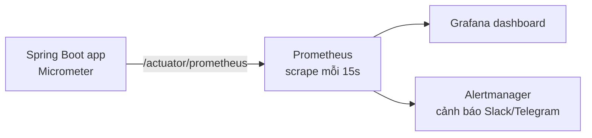

# Spring Boot Actuator

Viết xong ứng dụng mới là một nửa chặng đường; nửa còn lại là **vận hành**: ứng dụng còn sống không, có kết nối được DB không, mỗi giây xử lý bao nhiêu request, bộ nhớ đang dùng bao nhiêu. **Spring Boot Actuator** cung cấp sẵn các endpoint trả lời những câu hỏi đó — health, info, metrics, prometheus... Bài này hướng dẫn bật và expose endpoint, bảo mật chúng, viết `HealthIndicator` riêng, và dùng Micrometer để tạo metric gửi lên Prometheus/Grafana.

---

:::note[Ghi nhớ nhanh]

- ⭐ **Mặc định chỉ `health` được expose qua HTTP** — các endpoint khác phải bật bằng `management.endpoints.web.exposure.include`.
- ⭐ **Không expose `*` ra Internet** — `env`, `heapdump`, `configprops`, `loggers` có thể lộ secret hoặc cho phép đổi cấu hình; tách cổng quản trị và bảo vệ bằng Spring Security.
- **Kubernetes dùng `/actuator/health/liveness` và `/actuator/health/readiness`** cho probe.
- **Micrometer là "SLF4J cho metrics"** — một API, xuất ra nhiều hệ thống (Prometheus, Datadog, CloudWatch...).
- **Custom health**: implement `HealthIndicator`; custom metric: inject `MeterRegistry` tạo `Counter`, `Timer`, `Gauge`.

:::

---

## Mục lục

- [Vì sao Actuator ra đời?](#vì-sao-actuator-ra-đời)
- [Cài đặt và các endpoint](#cài-đặt-và-các-endpoint)
- [Expose endpoint](#expose-endpoint)
- [Health endpoint chi tiết](#health-endpoint-chi-tiết)
- [Bảo mật endpoint](#bảo-mật-endpoint)
- [Metrics với Micrometer](#metrics-với-micrometer)
- [Endpoint info và tuỳ biến khác](#endpoint-info-và-tuỳ-biến-khác)

---

## Vì sao Actuator ra đời?

**Vấn đề:** Không có công cụ chuẩn, mỗi team tự viết endpoint kiểm tra sức khoẻ và tự đếm số liệu:

```java
@RestController
public class PingController {
    private final AtomicLong orderCount = new AtomicLong(); // tự đếm, mất khi restart

    @GetMapping("/ping")
    public String ping() {
        return "OK"; // trả OK kể cả khi DB đã chết
    }

    @GetMapping("/stats")
    public Map<String, Object> stats() {
        Runtime rt = Runtime.getRuntime();
        return Map.of("orders", orderCount.get(),
                      "freeMemory", rt.freeMemory()); // định dạng riêng, công cụ giám sát không hiểu
    }
}
```

Mỗi service một kiểu, không kiểm tra phụ thuộc thật (DB, Redis), không theo chuẩn của Prometheus hay Kubernetes.

**Giải pháp:** Thêm một starter là có bộ endpoint chuẩn:

```xml
<dependency>
    <groupId>org.springframework.boot</groupId>
    <artifactId>spring-boot-starter-actuator</artifactId>
</dependency>
```

```bash
curl http://localhost:8080/actuator/health
# {"status":"UP"}
```

Health tự động kiểm tra DB, Redis, disk, RabbitMQ... (với mỗi thành phần có trên classpath); metrics tự đo request HTTP, JVM, connection pool.

:::tip[Dùng thực tế]

- **Kubernetes probe** — liveness/readiness quyết định restart pod hay ngừng đưa traffic vào.
- **Load balancer health check** — gỡ instance lỗi khỏi pool.
- **Prometheus + Grafana** — dashboard request/s, latency p95/p99, tỉ lệ lỗi, heap, GC.
- **Đổi log level lúc đang chạy** qua endpoint `loggers` để điều tra sự cố production mà không cần restart.

:::

:::tip[Ví dụ đời thường]

Actuator giống **bảng đồng hồ trên xe ô tô**: đồng hồ tốc độ (metrics), đèn báo động cơ, đèn báo dầu (health), số km (info). Tài xế (đội vận hành) không cần mở nắp capo mới biết xe có ổn không. Nhưng **ổ chẩn đoán OBD** (endpoint `env`, `heapdump`) thì chỉ thợ được cắm vào — không ai để nó lòi ra ngoài cho người qua đường cắm thử.

:::

---

## Cài đặt và các endpoint

| Endpoint | Đường dẫn | Cung cấp | Mức nhạy cảm |
|----------|-----------|----------|--------------|
| `health` | `/actuator/health` | Trạng thái UP/DOWN, chi tiết từng thành phần | Thấp (nếu ẩn details) |
| `info` | `/actuator/info` | Thông tin build, git, Java, OS | Thấp |
| `metrics` | `/actuator/metrics` | Danh sách và giá trị metric | Trung bình |
| `prometheus` | `/actuator/prometheus` | Metric định dạng Prometheus (cần `micrometer-registry-prometheus`) | Trung bình |
| `loggers` | `/actuator/loggers` | Xem/**đổi** log level lúc runtime | Cao |
| `env` | `/actuator/env` | Mọi thuộc tính cấu hình (giá trị được che mặc định) | **Rất cao** |
| `configprops` | `/actuator/configprops` | Các `@ConfigurationProperties` | Cao |
| `beans` | `/actuator/beans` | Mọi bean trong context | Trung bình |
| `conditions` | `/actuator/conditions` | Báo cáo auto-configuration | Trung bình |
| `mappings` | `/actuator/mappings` | Mọi URL mapping | Trung bình |
| `threaddump` | `/actuator/threaddump` | Dump các thread | Cao |
| `heapdump` | `/actuator/heapdump` | File heap dump — chứa **mọi dữ liệu trong bộ nhớ** | **Rất cao** |
| `scheduledtasks` | `/actuator/scheduledtasks` | Các tác vụ `@Scheduled` | Thấp |
| `shutdown` | `/actuator/shutdown` | Tắt ứng dụng (POST) — tắt mặc định | **Rất cao** |

Có hai khái niệm tách bạch:

- **Enabled / access** — endpoint có tồn tại (bean được tạo) và quyền truy cập ở mức nào. Mặc định mọi endpoint trừ `shutdown` đều bật.
- **Exposed** — endpoint có được đưa ra qua HTTP hoặc JMX không.

---

## Expose endpoint

```yaml
management:
  endpoints:
    web:
      exposure:
        include: health,info,metrics,prometheus   # chỉ liệt kê những gì cần
        # exclude: env,heapdump
      base-path: /actuator                          # mặc định
  server:
    port: 8081                                      # cổng quản trị riêng, không mở ra Internet
  endpoint:
    health:
      show-details: when-authorized                 # never | when-authorized | always
      probes:
        enabled: true                               # liveness/readiness (tự bật khi chạy trên Kubernetes)
```

Tách `management.server.port` là cách đơn giản và hiệu quả: cổng 8080 public qua ingress, cổng 8081 chỉ mở trong mạng nội bộ cho Prometheus và probe.

:::warning[Lỗi hay gặp]

- **`include: "*"` trên production** — lộ `env`, `heapdump`, `configprops`. Heap dump chứa mật khẩu DB, token người dùng nằm trong bộ nhớ. Đã có nhiều vụ rò rỉ dữ liệu thật từ `/actuator/heapdump` bị mở công khai.
- **Viết `*` trong YAML không có ngoặc kép** — `*` là ký tự đặc biệt của YAML; phải viết `include: "*"`.
- **Nhầm enable với expose** — bật endpoint mà không thêm vào `exposure.include` thì vẫn 404.

:::

---

## Health endpoint chi tiết

```json
{
  "status": "UP",
  "components": {
    "db": { "status": "UP", "details": { "database": "PostgreSQL", "validationQuery": "isValid()" } },
    "diskSpace": { "status": "UP", "details": { "total": 499963174912, "free": 91493838848, "threshold": 10485760 } },
    "redis": { "status": "UP", "details": { "version": "7.2.4" } },
    "livenessState": { "status": "UP" },
    "readinessState": { "status": "UP" },
    "ping": { "status": "UP" }
  }
}
```

Trạng thái tổng hợp: một thành phần `DOWN` → tổng `DOWN` → HTTP 503. Thứ tự mức độ mặc định: `DOWN`, `OUT_OF_SERVICE`, `UP`, `UNKNOWN`.

### Liveness và Readiness cho Kubernetes

| Probe | Đường dẫn | Ý nghĩa | Khi DOWN |
|-------|-----------|---------|----------|
| Liveness | `/actuator/health/liveness` | Ứng dụng còn "sống", không bị treo | Kubernetes **restart** pod |
| Readiness | `/actuator/health/readiness` | Sẵn sàng nhận traffic | Kubernetes **ngừng gửi** request tới pod |

```yaml
# Kubernetes deployment (trích)
livenessProbe:
  httpGet:
    path: /actuator/health/liveness
    port: 8081
  initialDelaySeconds: 30
readinessProbe:
  httpGet:
    path: /actuator/health/readiness
    port: 8081
```

Thêm kiểm tra DB vào readiness (không đưa vào liveness):

```yaml
management:
  endpoint:
    health:
      group:
        readiness:
          include: readinessState,db
```

:::warning[Lỗi hay gặp]

Đưa kiểm tra **phụ thuộc bên ngoài** (DB, API đối tác) vào **liveness**. Khi DB chập chờn, mọi pod cùng bị Kubernetes restart liên tục → sự cố nhỏ thành sập toàn hệ thống. Liveness chỉ nên phản ánh trạng thái nội bộ ứng dụng; phụ thuộc ngoài thuộc về readiness.

:::

### Custom HealthIndicator

```java
@Component
public class PaymentGatewayHealthIndicator implements HealthIndicator {
    private final PaymentGatewayClient client;

    public PaymentGatewayHealthIndicator(PaymentGatewayClient client) {
        this.client = client;
    }

    @Override
    public Health health() {
        try {
            Duration latency = client.ping();
            if (latency.toMillis() > 2000) {
                return Health.status("DEGRADED")
                        .withDetail("latencyMs", latency.toMillis())
                        .build();
            }
            return Health.up().withDetail("latencyMs", latency.toMillis()).build();
        } catch (RestClientException ex) {
            return Health.down(ex).withDetail("gateway", "vnpay").build();
        }
    }
}
```

Tên thành phần lấy từ tên bean bỏ hậu tố `HealthIndicator` → `paymentGateway`. Trạng thái tuỳ biến `DEGRADED` cần khai báo thứ tự và mã HTTP:

```yaml
management:
  endpoint:
    health:
      status:
        order: down,out-of-service,degraded,up,unknown
        http-mapping:
          degraded: 200
```

Lưu ý: ở Spring Boot 4, các class health được chuyển sang package mới (`org.springframework.boot.health...`); code trên dành cho Boot 3 (`org.springframework.boot.actuate.health`).

---

## Bảo mật endpoint

Nếu ứng dụng có Spring Security, cấu hình riêng một `SecurityFilterChain` cho Actuator:

```java
@Configuration
public class ActuatorSecurityConfig {

    @Bean
    @Order(1)
    public SecurityFilterChain actuatorChain(HttpSecurity http) throws Exception {
        http.securityMatcher(EndpointRequest.toAnyEndpoint())
            .authorizeHttpRequests(auth -> auth
                .requestMatchers(EndpointRequest.to(HealthEndpoint.class, InfoEndpoint.class)).permitAll()
                .requestMatchers(EndpointRequest.to("prometheus")).hasRole("MONITORING")
                .anyRequest().hasRole("ADMIN"))
            .httpBasic(Customizer.withDefaults());
        return http.build();
    }
}
```

`EndpointRequest` (package `org.springframework.boot.actuate.autoconfigure.security.servlet`) tự tính đường dẫn theo `base-path` và cổng quản trị, không cần viết cứng `/actuator/**`.

Checklist bảo mật:

1. Chỉ expose endpoint cần thiết.
2. Dùng cổng quản trị riêng (`management.server.port`), chặn ở firewall/ingress.
3. `show-details: when-authorized` — người lạ chỉ thấy `UP`/`DOWN`.
4. Endpoint ghi (`loggers` POST, `shutdown`) yêu cầu quyền ADMIN.
5. Không bao giờ expose `heapdump`, `env` ra ngoài mạng nội bộ.

---

## Metrics với Micrometer

**Micrometer** là thư viện metric trung lập nhà cung cấp; Actuator dùng nó để thu thập. Thêm registry tương ứng để xuất ra hệ thống giám sát:

```xml
<dependency>
    <groupId>io.micrometer</groupId>
    <artifactId>micrometer-registry-prometheus</artifactId>
</dependency>
```

```yaml
management:
  endpoints:
    web:
      exposure:
        include: health,info,prometheus
  metrics:
    tags:
      application: ${spring.application.name}   # gắn tag chung cho mọi metric
    distribution:
      percentiles-histogram:
        http.server.requests: true               # để tính p95/p99 trên Prometheus
```

Metric có sẵn (một phần):

| Metric | Ý nghĩa |
|--------|---------|
| `http.server.requests` | Số request, thời gian xử lý theo URI, method, status |
| `jvm.memory.used`, `jvm.gc.pause` | Bộ nhớ, thời gian GC |
| `hikaricp.connections.active` | Kết nối DB đang dùng |
| `process.cpu.usage`, `system.cpu.usage` | CPU |
| `tomcat.sessions.active.current` | Session đang hoạt động |
| `logback.events` | Số dòng log theo level |

```bash
curl http://localhost:8081/actuator/metrics/http.server.requests?tag=status:500
curl http://localhost:8081/actuator/prometheus
# http_server_requests_seconds_count{method="GET",status="200",uri="/api/products/{id}",...} 1532.0
```

### Metric tự định nghĩa

```java
@Service
public class OrderService {
    private final Counter ordersPlaced;
    private final Timer checkoutTimer;
    private final OrderRepository repo;

    public OrderService(MeterRegistry registry, OrderRepository repo) {
        this.repo = repo;
        this.ordersPlaced = Counter.builder("shop.orders.placed")
                .description("Số đơn hàng đã đặt")
                .tag("channel", "web")
                .register(registry);
        this.checkoutTimer = Timer.builder("shop.checkout.duration")
                .description("Thời gian xử lý thanh toán")
                .publishPercentileHistogram()
                .register(registry);
        Gauge.builder("shop.orders.pending", repo, OrderRepository::countPending)
                .description("Số đơn đang chờ xử lý")
                .register(registry);
    }

    public Order checkout(CreateOrderRequest req) {
        return checkoutTimer.record(() -> {
            Order saved = repo.save(Order.from(req));
            ordersPlaced.increment();
            return saved;
        });
    }
}
```

| Loại meter | Dùng cho | Ví dụ |
|------------|----------|-------|
| `Counter` | Giá trị chỉ tăng | Số đơn hàng, số lỗi |
| `Gauge` | Giá trị tức thời lên xuống | Số đơn chờ, kích thước hàng đợi |
| `Timer` | Thời gian + số lần | Thời gian checkout |
| `DistributionSummary` | Phân phối giá trị không phải thời gian | Kích thước file upload, giá trị đơn hàng |

:::warning[Lỗi hay gặp]

**Tag có số lượng giá trị không giới hạn** (high cardinality) như `userId`, `orderId`, URL chứa ID thô → mỗi giá trị một chuỗi time series, Prometheus phình bộ nhớ và chậm. Tag chỉ nên có tập giá trị nhỏ, cố định (channel, status, method). Spring MVC đã dùng URI template (`/api/products/{id}`) thay vì URL thật vì lý do này.

:::



Ngoài metrics, Micrometer còn có **Observation API** và **Micrometer Tracing** (thay cho Spring Cloud Sleuth đã ngừng phát triển) để gửi trace sang Zipkin/OpenTelemetry — sẽ học ở nhóm Microservices.

---

## Endpoint info và tuỳ biến khác

### Thông tin build và git

```xml
<plugin>
    <groupId>org.springframework.boot</groupId>
    <artifactId>spring-boot-maven-plugin</artifactId>
    <executions>
        <execution>
            <goals>
                <goal>build-info</goal>   <!-- sinh META-INF/build-info.properties -->
            </goals>
        </execution>
    </executions>
</plugin>
<plugin>
    <groupId>io.github.git-commit-id</groupId>
    <artifactId>git-commit-id-maven-plugin</artifactId> <!-- sinh git.properties -->
</plugin>
```

```yaml
management:
  info:
    env:
      enabled: true      # cho phép thuộc tính info.* hiện trong /info
    java:
      enabled: true
info:
  app:
    team: payment-squad
```

### Custom InfoContributor

```java
@Component
public class FeatureFlagInfo implements InfoContributor {
    @Override
    public void contribute(Info.Builder builder) {
        builder.withDetail("features", Map.of("newCheckout", true));
    }
}
```

### Đổi log level lúc runtime

```bash
curl -X POST http://localhost:8081/actuator/loggers/com.shop.order \
     -H "Content-Type: application/json" \
     -d '{"configuredLevel":"DEBUG"}'
```

### Custom endpoint

```java
@Component
@Endpoint(id = "cache-stats")
public class CacheStatsEndpoint {
    private final CacheManager cacheManager;

    public CacheStatsEndpoint(CacheManager cacheManager) {
        this.cacheManager = cacheManager;
    }

    @ReadOperation      // GET /actuator/cache-stats
    public Map<String, Object> stats() {
        return Map.of("caches", cacheManager.getCacheNames());
    }

    @DeleteOperation    // DELETE /actuator/cache-stats/{name}
    public void evict(@Selector String name) {
        Cache cache = cacheManager.getCache(name);
        if (cache != null) {
            cache.clear();
        }
    }
}
```

Nhớ thêm `cache-stats` vào `exposure.include`.
