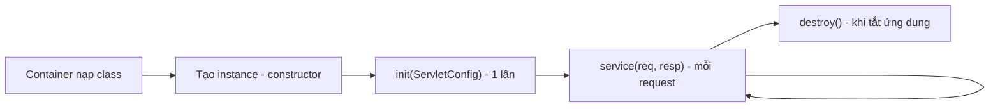
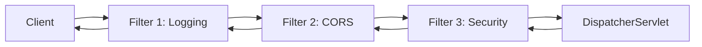
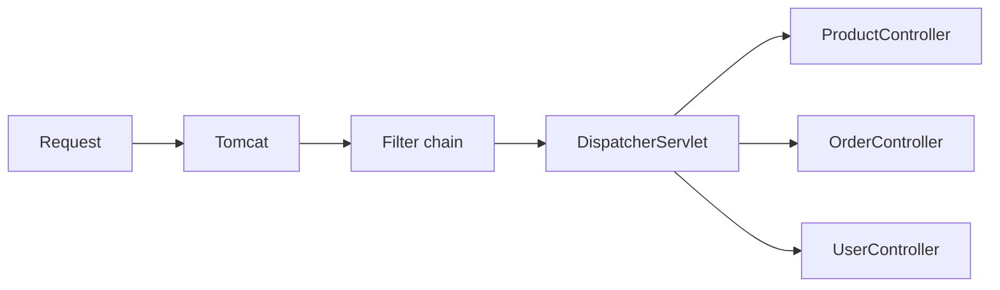

# Servlet

Servlet là nền móng của mọi ứng dụng web Java "truyền thống": Spring MVC, Struts, JSF đều chạy trên Servlet API. Hiểu Servlet giúp bạn biết request HTTP đi vào ứng dụng Spring Boot như thế nào, vì sao có `DispatcherServlet`, Filter chạy ở đâu và tại sao Spring Security lại được xây bằng Filter. Bài này đi từ khái niệm servlet container, vòng đời servlet, Filter cho tới vị trí của Spring MVC trong bức tranh đó.

---

:::note[Ghi nhớ nhanh]

- ⭐ **`DispatcherServlet` cũng chỉ là một Servlet** — Spring MVC đăng ký đúng một servlet "tổng đài" nhận mọi request rồi chia cho controller.
- ⭐ **Servlet là singleton, đa luồng** — container tạo một instance và cho nhiều thread gọi `service()` cùng lúc, nên không được giữ state theo request trong field.
- **Servlet container** (Tomcat, Jetty, Undertow) lo phần mạng, thread pool, phân tích HTTP; servlet chỉ lo xử lý nghiệp vụ.
- **Vòng đời**: `init()` một lần → `service()` mỗi request → `destroy()` khi tắt.
- **Filter** chạy trước và sau servlet, xếp thành chuỗi (`FilterChain`) — nơi đặt logging, CORS, bảo mật.
- **Spring Boot 3 dùng `jakarta.servlet`**, không còn `javax.servlet`.

:::

---

## Mục lục

- [Vì sao Servlet ra đời?](#vì-sao-servlet-ra-đời)
- [Servlet API là gì?](#servlet-api-là-gì)
- [Servlet container](#servlet-container)
- [Vòng đời của Servlet](#vòng-đời-của-servlet)
- [Viết một Servlet thuần](#viết-một-servlet-thuần)
- [Filter và FilterChain](#filter-và-filterchain)
- [DispatcherServlet là một Servlet](#dispatcherservlet-là-một-servlet)
- [Đăng ký Servlet và Filter trong Spring Boot](#đăng-ký-servlet-và-filter-trong-spring-boot)
- [javax sang jakarta](#javax-sang-jakarta)

---

## Vì sao Servlet ra đời?

**Vấn đề:** Cuối thập niên 90, cách phổ biến để tạo trang web động là **CGI** (Common Gateway Interface): mỗi request, web server **khởi động một process mới** chạy script (Perl, C), script in HTML ra stdout rồi kết thúc.

```bash
# Mỗi request = một process mới
GET /cgi-bin/hello.pl?name=An
# → web server fork process perl, chạy script, đọc stdout, trả về, kill process
```

Hệ quả:

- Tạo process tốn kém, 1000 request đồng thời là 1000 process.
- Không giữ được gì giữa các request (connection DB phải mở lại mỗi lần).
- Mỗi web server có cách tích hợp riêng, khó chuyển đổi.

**Giải pháp:** Sun đưa ra **Java Servlet** (1997): một lớp Java được nạp **một lần** vào JVM chạy lâu dài, mỗi request được xử lý bằng **một thread** gọi vào cùng object đó. Giao tiếp giữa server và code được chuẩn hoá thành **Servlet API**, nên một ứng dụng đóng gói `.war` chạy được trên bất kỳ container nào.

```java
public class HelloServlet extends HttpServlet {
    @Override
    protected void doGet(HttpServletRequest req, HttpServletResponse resp) throws IOException {
        resp.setContentType("text/plain;charset=UTF-8");
        resp.getWriter().write("Xin chào " + req.getParameter("name"));
    }
}
```

:::tip[Dùng thực tế]

- Bạn **gần như không bao giờ** tự viết `HttpServlet` trong dự án Spring Boot — nhưng mọi controller đều chạy bên trong `DispatcherServlet`.
- Khi cần chặn mọi request (log request ID, đo thời gian, kiểm tra header), bạn viết **Filter** — đó là Servlet API.
- Đọc stack trace lỗi, bạn sẽ thấy `org.apache.catalina...`, `FilterChain`, `DispatcherServlet.doDispatch` — hiểu Servlet là đọc được chúng.
- Cấu hình `server.tomcat.threads.max` chính là chỉnh thread pool của servlet container.

:::

---

## Servlet API là gì?

**Servlet API** là một bộ interface chuẩn (thuộc Jakarta EE) mô tả cách server và ứng dụng nói chuyện với nhau. Các thành phần chính:

| Interface / lớp | Vai trò |
|-----------------|---------|
| `Servlet` / `HttpServlet` | Lớp xử lý request; `HttpServlet` chia sẵn `doGet`, `doPost`, `doPut`, `doDelete` |
| `HttpServletRequest` | Đại diện request: URL, header, parameter, body, session, attribute |
| `HttpServletResponse` | Đại diện response: status, header, body (writer hoặc output stream) |
| `Filter` / `FilterChain` | Chặn request trước và sau servlet |
| `ServletContext` | Ngữ cảnh chung của cả ứng dụng web |
| `HttpSession` | Phiên làm việc của một người dùng, lưu ở server |
| `ServletContextListener` | Lắng nghe sự kiện khởi động/tắt ứng dụng |

Servlet API **chỉ là đặc tả + interface**. Phần hiện thực (mở socket, đọc byte HTTP, tạo object request) do **servlet container** làm.

## Servlet container

**Servlet container** (còn gọi là web container) là chương trình hiện thực Servlet API. Phổ biến nhất:

- **Apache Tomcat** — mặc định của `spring-boot-starter-web`.
- **Jetty** — nhẹ, hay dùng nhúng.
- **Undertow** — của Red Hat, hiệu năng tốt.

Container làm các việc:

1. Lắng nghe cổng (mặc định 8080), nhận kết nối TCP.
2. Phân tích byte thô thành `HttpServletRequest`.
3. Lấy một thread từ **thread pool**, chạy chuỗi Filter rồi servlet tương ứng.
4. Ghi `HttpServletResponse` thành byte trả về client.
5. Quản lý vòng đời servlet, session, tài nguyên.

:::tip[Ví dụ đời thường]

Servlet container giống **tổng đài và quầy lễ tân của một bệnh viện**: nhận bệnh nhân (request), lấy số, phân cho phòng khám (servlet) phù hợp, có sẵn đội y tá (thread pool) dẫn bệnh nhân đi. Bác sĩ (servlet) chỉ việc khám, không cần lo bãi giữ xe hay phát số thứ tự.

:::

Ngày trước, bạn cài Tomcat lên server rồi **deploy file `.war`** vào thư mục `webapps`. Spring Boot đảo ngược: **nhúng Tomcat vào trong ứng dụng**, chạy bằng `java -jar app.jar`.

```yaml
# application.yml — cấu hình Tomcat nhúng
server:
  port: 8080
  tomcat:
    threads:
      max: 200        # số thread xử lý request tối đa
      min-spare: 10
    connection-timeout: 20s
```

Đổi sang Jetty chỉ cần loại Tomcat khỏi starter:

```xml
<dependency>
    <groupId>org.springframework.boot</groupId>
    <artifactId>spring-boot-starter-web</artifactId>
    <exclusions>
        <exclusion>
            <groupId>org.springframework.boot</groupId>
            <artifactId>spring-boot-starter-tomcat</artifactId>
        </exclusion>
    </exclusions>
</dependency>
<dependency>
    <groupId>org.springframework.boot</groupId>
    <artifactId>spring-boot-starter-jetty</artifactId>
</dependency>
```

---

## Vòng đời của Servlet



1. **Nạp và khởi tạo** — container tạo **một instance duy nhất** cho mỗi khai báo servlet (lúc khởi động nếu `loadOnStartup` ≥ 0, hoặc lúc request đầu tiên).
2. **`init()`** — gọi đúng một lần, dùng để chuẩn bị tài nguyên.
3. **`service()`** — gọi cho **mỗi request**, trên thread của request đó. `HttpServlet.service()` đọc HTTP method rồi gọi `doGet`, `doPost`...
4. **`destroy()`** — gọi một lần khi container gỡ servlet, dùng để giải phóng tài nguyên.

:::warning[Lỗi hay gặp]

Vì chỉ có **một instance** phục vụ nhiều thread cùng lúc, đặt dữ liệu của request vào field là lỗi kinh điển:

```java
public class OrderServlet extends HttpServlet {
    private String currentUser; // SAI: mọi thread dùng chung field này

    @Override
    protected void doGet(HttpServletRequest req, HttpServletResponse resp) throws IOException {
        currentUser = req.getParameter("user"); // thread A ghi
        // ... thread B ghi đè ngay sau đó
        resp.getWriter().write("Đơn của " + currentUser); // A có thể in ra user của B
    }
}
```

Dùng biến cục bộ thay vì field. Quy tắc này áp dụng y hệt cho `@Controller` và `@Service` của Spring — chúng cũng là singleton.

:::

---

## Viết một Servlet thuần

Để thấy Spring MVC làm hộ bạn những gì, hãy xem một API JSON viết bằng Servlet thuần:

```java
import jakarta.servlet.annotation.WebServlet;
import jakarta.servlet.http.HttpServlet;
import jakarta.servlet.http.HttpServletRequest;
import jakarta.servlet.http.HttpServletResponse;
import java.io.IOException;

@WebServlet(urlPatterns = "/api/products/*", loadOnStartup = 1)
public class ProductServlet extends HttpServlet {

    @Override
    protected void doGet(HttpServletRequest req, HttpServletResponse resp) throws IOException {
        String path = req.getPathInfo();          // "/42"
        if (path == null || path.equals("/")) {
            resp.sendError(HttpServletResponse.SC_BAD_REQUEST, "Thiếu id");
            return;
        }
        long id;
        try {
            id = Long.parseLong(path.substring(1)); // tự parse path variable
        } catch (NumberFormatException e) {
            resp.sendError(HttpServletResponse.SC_BAD_REQUEST, "Id không hợp lệ");
            return;
        }
        resp.setContentType("application/json;charset=UTF-8");
        // tự ghép JSON bằng tay (hoặc tự gọi Jackson)
        resp.getWriter().write("{\"id\":" + id + ",\"name\":\"Bàn phím\"}");
    }
}
```

Mọi thứ đều thủ công: tách URL, parse kiểu, kiểm tra lỗi, chuyển object sang JSON, đặt status. Spring MVC gom tất cả thành:

```java
@GetMapping("/api/products/{id}")
public ProductDto get(@PathVariable long id) {
    return productService.findById(id);
}
```

---

## Filter và FilterChain

**Filter** là đối tượng chặn request **trước khi** tới servlet và có thể xử lý response **sau khi** servlet chạy xong. Nhiều filter xếp thành **chuỗi** (`FilterChain`); mỗi filter tự quyết định có gọi `chain.doFilter()` để đi tiếp hay chặn lại.



:::tip[Ví dụ đời thường]

Filter giống **các chốt kiểm tra ở sân bay**: soi vé → kiểm tra an ninh → hải quan → mới tới cửa ra máy bay (servlet). Chốt nào thấy có vấn đề thì giữ lại luôn, hành khách không đi tiếp được. Chiều về cũng đi ngược qua các chốt đó.

:::

Ví dụ filter đo thời gian xử lý và gắn request ID:

```java
import jakarta.servlet.FilterChain;
import jakarta.servlet.ServletException;
import jakarta.servlet.http.HttpServletRequest;
import jakarta.servlet.http.HttpServletResponse;
import org.slf4j.Logger;
import org.slf4j.LoggerFactory;
import org.springframework.stereotype.Component;
import org.springframework.web.filter.OncePerRequestFilter;

import java.io.IOException;
import java.util.UUID;

@Component
public class RequestTimingFilter extends OncePerRequestFilter {

    private static final Logger log = LoggerFactory.getLogger(RequestTimingFilter.class);

    @Override
    protected void doFilterInternal(HttpServletRequest request,
                                    HttpServletResponse response,
                                    FilterChain chain) throws ServletException, IOException {
        String requestId = UUID.randomUUID().toString();
        long start = System.nanoTime();
        response.setHeader("X-Request-Id", requestId);
        try {
            chain.doFilter(request, response);   // đi tiếp vào filter sau / servlet
        } finally {
            long ms = (System.nanoTime() - start) / 1_000_000;
            log.info("{} {} -> {} ({} ms) id={}", request.getMethod(),
                    request.getRequestURI(), response.getStatus(), ms, requestId);
        }
    }
}
```

`OncePerRequestFilter` của Spring đảm bảo filter chỉ chạy **một lần cho mỗi request**, kể cả khi request bị forward/dispatch nội bộ (ví dụ chuyển sang trang lỗi).

| | Filter | HandlerInterceptor (Spring MVC) |
|---|--------|----------------------------------|
| Thuộc | Servlet API | Spring MVC |
| Chạy ở | Trước/sau `DispatcherServlet` | Bên trong `DispatcherServlet`, quanh controller |
| Biết controller nào xử lý? | Không | Có (`handler`) |
| Dùng cho | Bảo mật, CORS, nén, log toàn cục | Kiểm tra theo controller, đo thời gian handler |

Spring Security là ví dụ lớn nhất của Filter: toàn bộ cơ chế đăng nhập, phân quyền nằm trong một filter tên `DelegatingFilterProxy` → `FilterChainProxy` → chuỗi `SecurityFilterChain`.

---

## DispatcherServlet là một Servlet

Spring MVC theo mẫu **Front Controller**: thay vì mỗi URL một servlet, chỉ có **một servlet** nhận mọi request (`/`) rồi điều phối tới đúng controller. Servlet đó là `DispatcherServlet`, kế thừa `HttpServlet`:

```
jakarta.servlet.http.HttpServlet
  └── HttpServletBean
        └── FrameworkServlet
              └── DispatcherServlet
```



Trong Spring Boot, `DispatcherServletAutoConfiguration` tự tạo bean `DispatcherServlet` và đăng ký nó với Tomcat nhúng ở đường dẫn `/`. Bạn có thể đổi:

```yaml
spring:
  mvc:
    servlet:
      path: /api      # mọi controller giờ nằm dưới /api
```

Chi tiết luồng bên trong `DispatcherServlet` được trình bày ở bài [Kiến trúc Spring MVC](./2_kien-truc-mvc.md).

---

## Đăng ký Servlet và Filter trong Spring Boot

Có ba cách:

**1. Khai báo bean `@Component`** cho Filter (như ví dụ trên) — Spring Boot tự đăng ký, áp dụng cho mọi URL.

**2. Dùng `FilterRegistrationBean` / `ServletRegistrationBean`** khi cần chọn URL, thứ tự:

```java
@Configuration
public class WebConfig {

    @Bean
    public FilterRegistrationBean<RequestTimingFilter> timingFilter() {
        FilterRegistrationBean<RequestTimingFilter> reg =
                new FilterRegistrationBean<>(new RequestTimingFilter());
        reg.addUrlPatterns("/api/*");
        reg.setOrder(Ordered.HIGHEST_PRECEDENCE);
        return reg;
    }

    @Bean
    public ServletRegistrationBean<HelloServlet> helloServlet() {
        return new ServletRegistrationBean<>(new HelloServlet(), "/legacy/hello");
    }
}
```

**3. `@ServletComponentScan`** trên lớp main để Spring Boot quét các lớp có `@WebServlet`, `@WebFilter`, `@WebListener`.

:::warning[Lỗi hay gặp]

Vừa đánh `@Component` vừa tạo `FilterRegistrationBean` cho cùng một filter → filter bị đăng ký **hai lần** và chạy hai lần mỗi request. Chọn một trong hai cách. Nếu muốn filter là bean (để inject dependency) nhưng tự kiểm soát URL, tạo `FilterRegistrationBean` và **bỏ** `@Component`.

:::

---

## javax sang jakarta

Năm 2017 Oracle chuyển Java EE cho Eclipse Foundation, nhưng không cho dùng tên `javax`. Từ **Jakarta EE 9**, toàn bộ package đổi từ `javax.*` sang `jakarta.*`.

| Spring Boot | Spring Framework | Servlet API | Package |
|-------------|------------------|-------------|---------|
| 2.x | 5.x | 4.0 | `javax.servlet` |
| 3.x | 6.x | 6.0 trở lên | `jakarta.servlet` |

```java
// Spring Boot 2
import javax.servlet.http.HttpServletRequest;
// Spring Boot 3
import jakarta.servlet.http.HttpServletRequest;
```

:::warning[Lỗi hay gặp]

Copy code mẫu cũ trên mạng vào dự án Spring Boot 3 sẽ báo lỗi biên dịch `package javax.servlet does not exist`. Tương tự với `javax.persistence` → `jakarta.persistence`, `javax.validation` → `jakarta.validation`. Thư viện bên thứ ba còn phụ thuộc `javax.servlet` cũng không chạy được trên Tomcat 10+.

:::
