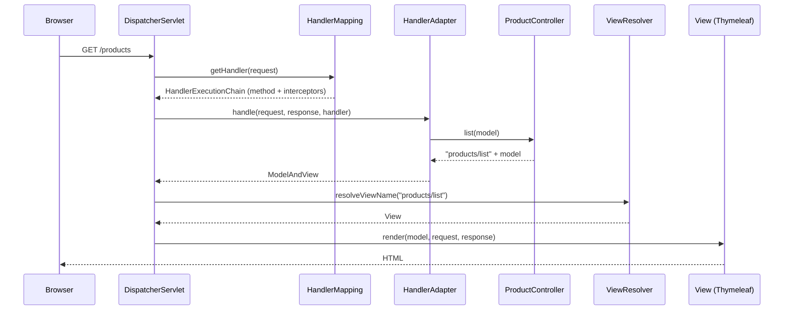
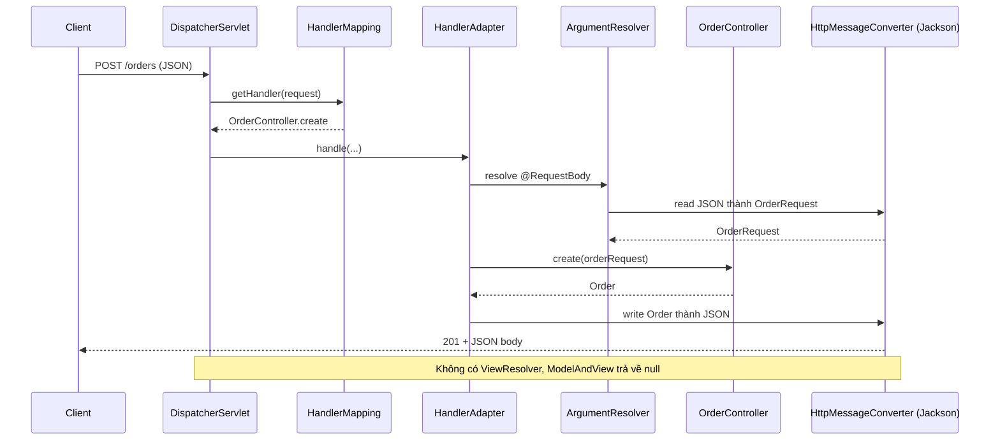
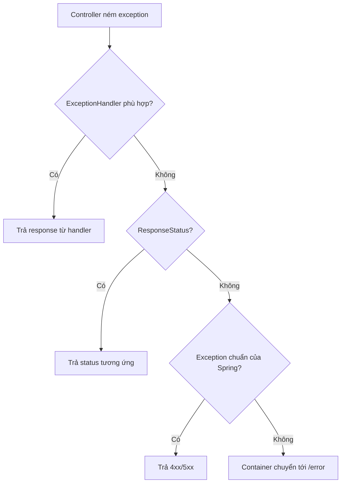

# Kiến trúc Spring MVC

Spring MVC là module web dựa trên Servlet của Spring, tổ chức theo mẫu **Model–View–Controller** và **Front Controller**. Bài này mổ xẻ hành trình của một request từ lúc vào `DispatcherServlet` cho tới khi trở thành HTML hoặc JSON: `HandlerMapping` tìm ai xử lý, `HandlerAdapter` gọi controller ra sao, rồi `ViewResolver` hoặc `HttpMessageConverter` tạo response. Nắm luồng này giúp bạn debug được lỗi 404, 415, 406 và biết nên "cắm" logic tuỳ biến vào đâu.

---

:::note[Ghi nhớ nhanh]

- ⭐ **Luồng chuẩn**: `DispatcherServlet` → `HandlerMapping` → `HandlerAdapter` → Controller → (`ViewResolver` → View) hoặc (`HttpMessageConverter` → JSON).
- ⭐ **`@RestController` / `@ResponseBody` bỏ qua ViewResolver** — giá trị trả về được Jackson ghi thẳng vào body.
- **`HandlerMapping`** trả về handler + danh sách interceptor (`HandlerExecutionChain`); hay dùng nhất là `RequestMappingHandlerMapping`.
- **`HandlerAdapter`** lo binding tham số (`@PathVariable`, `@RequestBody`...) và xử lý giá trị trả về.
- **`HandlerExceptionResolver`** biến exception thành response — nền tảng của `@ExceptionHandler`.

:::

---

## Mục lục

- [Vì sao cần Spring MVC?](#vì-sao-cần-spring-mvc)
- [Mẫu MVC và Front Controller](#mẫu-mvc-và-front-controller)
- [Các thành phần trong DispatcherServlet](#các-thành-phần-trong-dispatcherservlet)
- [Luồng request trả về View](#luồng-request-trả-về-view)
- [Luồng request trả về JSON](#luồng-request-trả-về-json)
- [Content negotiation và HttpMessageConverter](#content-negotiation-và-httpmessageconverter)
- [Xử lý exception trong luồng](#xử-lý-exception-trong-luồng)
- [Cấu hình bằng WebMvcConfigurer](#cấu-hình-bằng-webmvcconfigurer)
- [Spring MVC và Spring WebFlux](#spring-mvc-và-spring-webflux)
- [Câu hỏi phỏng vấn](#câu-hỏi-phỏng-vấn)

---

## Vì sao cần Spring MVC?

**Vấn đề:** Với Servlet thuần, mỗi chức năng là một servlet, mỗi servlet tự làm lại cùng một chuỗi việc: đọc URL, parse tham số, kiểm tra hợp lệ, gọi nghiệp vụ, chuyển object thành JSON hoặc forward sang JSP, bắt exception để trả lỗi.

```java
@WebServlet("/orders")
public class OrderServlet extends HttpServlet {
    private final ObjectMapper mapper = new ObjectMapper();

    @Override
    protected void doPost(HttpServletRequest req, HttpServletResponse resp) throws IOException {
        try {
            OrderRequest body = mapper.readValue(req.getInputStream(), OrderRequest.class);
            if (body.quantity() <= 0) {
                resp.sendError(400, "quantity phải lớn hơn 0");
                return;
            }
            Order order = orderService.create(body);
            resp.setStatus(201);
            resp.setContentType("application/json");
            mapper.writeValue(resp.getOutputStream(), order);
        } catch (JsonProcessingException e) {
            resp.sendError(400, "JSON sai định dạng");
        } catch (Exception e) {
            resp.sendError(500);
        }
    }
}
```

Nhân đoạn này lên 50 endpoint là có 50 bản sao của cùng một logic hạ tầng.

**Giải pháp:** Spring MVC tách phần lặp lại vào **một servlet trung tâm** và các thành phần có thể thay thế. Controller chỉ còn nghiệp vụ:

```java
@RestController
@RequestMapping("/orders")
public class OrderController {
    private final OrderService orderService;

    public OrderController(OrderService orderService) {
        this.orderService = orderService;
    }

    @PostMapping
    @ResponseStatus(HttpStatus.CREATED)
    public Order create(@Valid @RequestBody OrderRequest body) {
        return orderService.create(body);
    }
}
```

:::tip[Dùng thực tế]

- Gặp **404** dù đã viết controller → kiểm tra `HandlerMapping`: controller có được component scan không, path có khớp không.
- Gặp **415 Unsupported Media Type** → không có `HttpMessageConverter` đọc được `Content-Type` client gửi.
- Gặp **406 Not Acceptable** → không có converter ghi được kiểu mà header `Accept` yêu cầu.
- Muốn thêm log, kiểm tra quyền theo từng handler → cắm `HandlerInterceptor`; muốn tự định nghĩa kiểu tham số → `HandlerMethodArgumentResolver`.

:::

---

## Mẫu MVC và Front Controller

**MVC** chia ứng dụng thành ba phần:

- **Model** — dữ liệu cần hiển thị (trong Spring MVC là object `Model` chứa các attribute).
- **View** — phần trình bày (Thymeleaf template, JSP, hoặc JSON).
- **Controller** — nhận input, gọi nghiệp vụ, chọn view và đổ dữ liệu vào model.

**Front Controller** là mẫu có **một điểm vào duy nhất** cho mọi request. Ở Spring MVC, đó là `DispatcherServlet`.

:::tip[Ví dụ đời thường]

Hãy nghĩ tới **quầy tiếp nhận hồ sơ một cửa ở phường**. Người dân (request) chỉ nộp ở một quầy (`DispatcherServlet`). Cán bộ quầy tra **sổ phân công** (`HandlerMapping`) xem hồ sơ khai sinh thì chuyển phòng tư pháp, hồ sơ đất đai thì chuyển phòng địa chính (controller). Có một **người chạy giấy** (`HandlerAdapter`) biết cách điền đúng mẫu đơn của từng phòng. Kết quả trả về được **đóng dấu, in đúng mẫu** (`ViewResolver` hoặc converter) trước khi giao cho người dân.

:::

---

## Các thành phần trong DispatcherServlet

| Thành phần | Nhiệm vụ | Hiện thực mặc định hay gặp |
|------------|----------|-----------------------------|
| `HandlerMapping` | Tìm handler cho request, kèm interceptor | `RequestMappingHandlerMapping` (đọc `@RequestMapping`) |
| `HandlerAdapter` | Gọi handler bất kể kiểu gì | `RequestMappingHandlerAdapter` |
| `HandlerMethodArgumentResolver` | Tạo giá trị cho từng tham số method | resolver cho `@PathVariable`, `@RequestParam`, `@RequestBody`... |
| `HandlerMethodReturnValueHandler` | Xử lý giá trị trả về | xử lý `ResponseEntity`, `@ResponseBody`, tên view |
| `HttpMessageConverter` | Đọc/ghi body theo media type | `MappingJackson2HttpMessageConverter`, `StringHttpMessageConverter` |
| `ViewResolver` | Đổi tên view thành object `View` | `ThymeleafViewResolver`, `InternalResourceViewResolver` |
| `HandlerExceptionResolver` | Biến exception thành response | `ExceptionHandlerExceptionResolver`, `ResponseStatusExceptionResolver`, `DefaultHandlerExceptionResolver` |
| `LocaleResolver`, `MultipartResolver` | Ngôn ngữ, upload file | `AcceptHeaderLocaleResolver`, `StandardServletMultipartResolver` |

Khi khởi động, `DispatcherServlet` lấy các bean này từ `ApplicationContext`. Spring Boot cấu hình sẵn qua `WebMvcAutoConfiguration`; bạn chỉ cần khai báo bean riêng hoặc dùng `WebMvcConfigurer` để thêm/sửa.

Phương thức trung tâm là `DispatcherServlet.doDispatch()`. Giản lược, nó làm:

```java
// Mã giả mô phỏng doDispatch
HandlerExecutionChain chain = getHandler(request);          // HandlerMapping
if (chain == null) { noHandlerFound(request, response); return; } // 404
HandlerAdapter adapter = getHandlerAdapter(chain.getHandler());
if (!chain.applyPreHandle(request, response)) return;       // interceptor preHandle
ModelAndView mv = adapter.handle(request, response, chain.getHandler()); // gọi controller
chain.applyPostHandle(request, response, mv);               // interceptor postHandle
processDispatchResult(request, response, chain, mv, exception); // render view hoặc xử lý lỗi
// cuối cùng: afterCompletion của interceptor
```

---

## Luồng request trả về View

Với `@Controller` trả về **tên view** (ví dụ `"products/list"`):



```java
@Controller
@RequestMapping("/products")
public class ProductPageController {
    private final ProductService productService;

    public ProductPageController(ProductService productService) {
        this.productService = productService;
    }

    @GetMapping
    public String list(Model model) {
        model.addAttribute("products", productService.findAll());
        return "products/list"; // → templates/products/list.html
    }
}
```

`ThymeleafViewResolver` ghép prefix `classpath:/templates/` và suffix `.html` để ra file template. Phần View được trình bày kỹ ở bài [View: JSP và Thymeleaf](./4_jsp-thymeleaf.md).

---

## Luồng request trả về JSON

Với `@RestController` (tức `@Controller` + `@ResponseBody`), giá trị trả về **không phải tên view** mà là dữ liệu cần ghi vào body:



Điểm mấu chốt: việc ghi response xảy ra **ngay trong `HandlerAdapter`** (bởi `RequestResponseBodyMethodProcessor`), nên `DispatcherServlet` nhận về `ModelAndView` rỗng và không render view nào.

:::warning[Lỗi hay gặp]

Dùng `@Controller` (không có `@ResponseBody`) rồi trả về một object hoặc chuỗi `"ok"` → Spring coi `"ok"` là **tên view** và đi tìm template `ok.html`, kết quả là lỗi `Circular view path` hoặc 500 "template might not exist". Với API JSON, dùng `@RestController`.

:::

---

## Content negotiation và HttpMessageConverter

**Content negotiation** (thương lượng nội dung) là việc chọn định dạng response dựa trên header `Accept` của client và kiểu mà controller có thể tạo ra (`produces`).

```java
@GetMapping(value = "/{id}", produces = {MediaType.APPLICATION_JSON_VALUE, MediaType.APPLICATION_XML_VALUE})
public ProductDto get(@PathVariable Long id) { ... }
```

- `Accept: application/json` → `MappingJackson2HttpMessageConverter`.
- `Accept: application/xml` → cần thêm `jackson-dataformat-xml` để có converter XML.
- Request body với `Content-Type: text/plain` gửi tới tham số `@RequestBody ProductDto` → **415**, vì không converter nào đọc text thành object.

Spring Boot tự cấu hình `ObjectMapper` của Jackson; tuỳ biến qua `application.yml`:

```yaml
spring:
  jackson:
    default-property-inclusion: non_null   # bỏ field null khỏi JSON
    serialization:
      write-dates-as-timestamps: false     # ngày tháng dạng ISO-8601
    deserialization:
      fail-on-unknown-properties: false
```

:::note[Ghi chú về Spring Boot 4]

Spring Boot 4 / Spring Framework 7 chuyển mặc định sang Jackson 3 (package `tools.jackson`). Ý tưởng converter không đổi, nhưng tên lớp converter và package import khác. Bài này dùng Spring Boot 3.

:::

---

## Xử lý exception trong luồng

Nếu controller ném exception, `DispatcherServlet` hỏi lần lượt các `HandlerExceptionResolver`:

1. **`ExceptionHandlerExceptionResolver`** — tìm method `@ExceptionHandler` phù hợp trong controller, rồi trong các `@ControllerAdvice`.
2. **`ResponseStatusExceptionResolver`** — xử lý exception có `@ResponseStatus` hoặc `ResponseStatusException`.
3. **`DefaultHandlerExceptionResolver`** — đổi các exception chuẩn của Spring thành mã HTTP (ví dụ `HttpRequestMethodNotSupportedException` → 405, `HttpMediaTypeNotSupportedException` → 415).

Không resolver nào xử lý được → exception lên tới servlet container → Spring Boot chuyển tới `/error` (`BasicErrorController`) và trả JSON lỗi mặc định.



---

## Cấu hình bằng WebMvcConfigurer

Spring Boot đã cấu hình sẵn Spring MVC. Muốn **bổ sung** mà vẫn giữ auto-configuration, implement `WebMvcConfigurer`:

```java
@Configuration
public class MvcConfig implements WebMvcConfigurer {

    @Override
    public void addInterceptors(InterceptorRegistry registry) {
        registry.addInterceptor(new TimingInterceptor()).addPathPatterns("/api/**");
    }

    @Override
    public void addCorsMappings(CorsRegistry registry) {
        registry.addMapping("/api/**").allowedOrigins("https://app.example.com");
    }

    @Override
    public void addFormatters(FormatterRegistry registry) {
        registry.addConverter(String.class, OrderStatus.class,
                s -> OrderStatus.valueOf(s.toUpperCase()));
    }
}
```

:::warning[Lỗi hay gặp]

Thêm `@EnableWebMvc` vào lớp cấu hình trong Spring Boot sẽ **tắt `WebMvcAutoConfiguration`**: mất cấu hình static resource, Jackson tuỳ biến từ `application.yml`, converter mặc định... Chỉ dùng `@EnableWebMvc` khi bạn thật sự muốn tự cấu hình toàn bộ MVC.

:::

---

## Spring MVC và Spring WebFlux

| | Spring MVC | Spring WebFlux |
|---|-----------|----------------|
| Nền tảng | Servlet API (blocking) | Reactive Streams, Netty mặc định |
| Mô hình thread | Một thread cho mỗi request | Ít thread, event loop |
| Kiểu trả về | Object, `ResponseEntity` | `Mono`, `Flux` |
| Front controller | `DispatcherServlet` | `DispatcherHandler` |
| Phù hợp | Đa số ứng dụng CRUD, dùng JDBC/JPA | Nhiều kết nối I/O đồng thời, streaming |

Từ Java 21, Spring Boot 3.2+ hỗ trợ **virtual threads** (`spring.threads.virtual.enabled: true`), giúp Spring MVC phục vụ nhiều request đồng thời mà vẫn giữ code blocking dễ đọc.

---

## Câu hỏi phỏng vấn

**1. Mô tả luồng xử lý một request trong Spring MVC.**

<details className="qa">
<summary>Xem đáp án</summary>

Request đi qua filter chain tới `DispatcherServlet`. Nó hỏi các `HandlerMapping` để lấy `HandlerExecutionChain` (handler + interceptor), chọn `HandlerAdapter` phù hợp, chạy `preHandle` của interceptor, rồi adapter gọi controller method (dùng argument resolver để binding tham số). Nếu trả về tên view, `ViewResolver` tìm `View` và render với model. Nếu là `@ResponseBody`, `HttpMessageConverter` ghi thẳng object vào body. Sau đó chạy `postHandle`/`afterCompletion`. Exception được chuyển cho `HandlerExceptionResolver`.

</details>

**2. HandlerMapping và HandlerAdapter khác nhau thế nào? Sao không gộp làm một?**

<details className="qa">
<summary>Xem đáp án</summary>

`HandlerMapping` trả lời "ai xử lý request này", `HandlerAdapter` trả lời "gọi handler đó như thế nào". Tách ra giúp `DispatcherServlet` hỗ trợ nhiều kiểu handler khác nhau (method `@RequestMapping`, lớp implement `Controller` interface cũ, `HttpRequestHandler`, functional endpoint `RouterFunction`) mà không cần biết chi tiết từng kiểu — đây là mẫu Adapter.

</details>

**3. @RestController khác @Controller thế nào trong luồng xử lý?**

<details className="qa">
<summary>Xem đáp án</summary>

`@RestController` = `@Controller` + `@ResponseBody`. Với `@ResponseBody`, giá trị trả về được `RequestResponseBodyMethodProcessor` ghi vào body qua `HttpMessageConverter` ngay trong adapter, không qua `ViewResolver`. Với `@Controller` thường, chuỗi trả về được hiểu là tên view.

</details>

**4. Khi nào gặp lỗi 415 và 406?**

<details className="qa">
<summary>Xem đáp án</summary>

415 Unsupported Media Type: client gửi body với `Content-Type` mà không `HttpMessageConverter` nào đọc được thành kiểu tham số, hoặc không khớp `consumes`. 406 Not Acceptable: header `Accept` yêu cầu định dạng mà không converter nào ghi được giá trị trả về, hoặc không khớp `produces`.

</details>

**5. Filter và HandlerInterceptor nằm ở đâu trong luồng?**

<details className="qa">
<summary>Xem đáp án</summary>

Filter thuộc Servlet API, chạy trước khi request tới `DispatcherServlet`. Interceptor chạy bên trong `DispatcherServlet`, sau khi `HandlerMapping` đã xác định handler, nên biết controller method nào sẽ chạy và có `postHandle` để sửa `ModelAndView`.

</details>

**6. Tại sao không nên dùng @EnableWebMvc trong Spring Boot?**

<details className="qa">
<summary>Xem đáp án</summary>

`@EnableWebMvc` import `DelegatingWebMvcConfiguration` (một `WebMvcConfigurationSupport`), và `WebMvcAutoConfiguration` có điều kiện chỉ chạy khi không có bean loại này. Thêm annotation đó tức là tắt toàn bộ cấu hình mặc định của Boot. Muốn tuỳ biến thêm, implement `WebMvcConfigurer`.

</details>

**7. Exception ném ra từ controller được xử lý ra sao?**

<details className="qa">
<summary>Xem đáp án</summary>

`DispatcherServlet` duyệt các `HandlerExceptionResolver`: trước hết là `ExceptionHandlerExceptionResolver` (tìm `@ExceptionHandler` trong controller rồi trong `@ControllerAdvice`), sau đó `ResponseStatusExceptionResolver`, rồi `DefaultHandlerExceptionResolver`. Nếu không resolver nào xử lý, exception đi lên container và Spring Boot chuyển tới endpoint `/error`.

</details>
