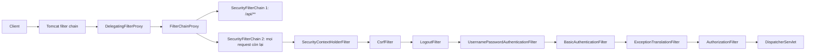
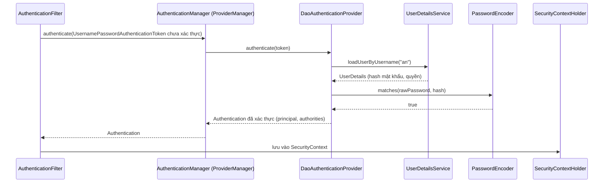

# Authentication

Authentication (xác thực) trả lời câu hỏi "bạn là ai?". Trong Spring Security, việc này không nằm trong controller mà diễn ra trong một **chuỗi filter** chạy trước `DispatcherServlet`. Bài này giải thích kiến trúc filter chain, các thành phần cốt lõi (`SecurityFilterChain`, `AuthenticationManager`, `AuthenticationProvider`, `UserDetailsService`, `PasswordEncoder`, `SecurityContext`) và cách cấu hình form login, HTTP Basic với user lưu trong database theo phong cách Spring Security 6.

---

:::note[Ghi nhớ nhanh]

- ⭐ **Spring Security là một chuỗi Filter** — `DelegatingFilterProxy` → `FilterChainProxy` → các `SecurityFilterChain`; request bị chặn trước khi tới controller.
- ⭐ **Cấu hình bằng bean `SecurityFilterChain` + lambda DSL** — `WebSecurityConfigurerAdapter` đã bị xoá từ Spring Security 6.
- **Luồng xác thực**: filter tạo `Authentication` chưa xác thực → `AuthenticationManager` (`ProviderManager`) → `AuthenticationProvider` → `UserDetailsService` + `PasswordEncoder`.
- **Luôn băm mật khẩu bằng `BCryptPasswordEncoder`** (hoặc `DelegatingPasswordEncoder`), không bao giờ lưu plain text.
- **`SecurityContextHolder`** giữ người dùng hiện tại theo thread (ThreadLocal); lấy trong controller bằng `@AuthenticationPrincipal`.

:::

---

## Mục lục

- [Vì sao cần Spring Security?](#vì-sao-cần-spring-security)
- [Kiến trúc filter chain](#kiến-trúc-filter-chain)
- [Các thành phần xác thực cốt lõi](#các-thành-phần-xác-thực-cốt-lõi)
- [Cấu hình SecurityFilterChain](#cấu-hình-securityfilterchain)
- [UserDetailsService với database](#userdetailsservice-với-database)
- [PasswordEncoder và BCrypt](#passwordencoder-và-bcrypt)
- [Form login và HTTP Basic](#form-login-và-http-basic)
- [SecurityContext và người dùng hiện tại](#securitycontext-và-người-dùng-hiện-tại)
- [Câu hỏi phỏng vấn](#câu-hỏi-phỏng-vấn)

---

## Vì sao cần Spring Security?

**Vấn đề:** Tự viết xác thực thường bắt đầu bằng một filter "cho nhanh":

```java
@WebFilter("/*")
public class LoginFilter implements Filter {
    public void doFilter(ServletRequest req, ServletResponse res, FilterChain chain)
            throws IOException, ServletException {
        HttpServletRequest request = (HttpServletRequest) req;
        Object user = request.getSession().getAttribute("user");
        if (user == null && !request.getRequestURI().startsWith("/login")) {
            ((HttpServletResponse) res).sendRedirect("/login");
            return;
        }
        chain.doFilter(req, res);
    }
}
// Còn thiếu: băm mật khẩu, chống CSRF, chống session fixation, header bảo mật,
// khoá tài khoản, remember-me, logout an toàn, so sánh mật khẩu chống timing attack...
```

Mỗi thứ còn thiếu là một lỗ hổng tiềm tàng.

**Giải pháp:** Spring Security cung cấp sẵn chuỗi filter đã được kiểm chứng: xác thực nhiều kiểu (form, Basic, OAuth2, JWT), băm mật khẩu, CSRF, session fixation protection, security headers. Bạn chỉ khai báo **chính sách**:

```java
@Bean
SecurityFilterChain securityFilterChain(HttpSecurity http) throws Exception {
    http
        .authorizeHttpRequests(auth -> auth
            .requestMatchers("/login", "/css/**").permitAll()
            .anyRequest().authenticated())
        .formLogin(Customizer.withDefaults());
    return http.build();
}
```

:::tip[Dùng thực tế]

- Trang quản trị nội bộ: form login + session, user lưu trong database.
- API cho công cụ nội bộ hoặc CI: HTTP Basic qua HTTPS.
- Ứng dụng nhiều loại client: một `SecurityFilterChain` cho `/api/**` (stateless, JWT), một cho trang web (form login).
- Chỉ thêm `spring-boot-starter-security` là mọi endpoint đã được bảo vệ, kèm user mặc định `user` và mật khẩu ngẫu nhiên in ra log.

:::

---

## Kiến trúc filter chain



- **`DelegatingFilterProxy`** — filter đăng ký với servlet container, chỉ làm cầu nối sang bean Spring (container không biết gì về bean).
- **`FilterChainProxy`** — bean tên `springSecurityFilterChain`, chọn **`SecurityFilterChain` đầu tiên khớp** với request.
- **`SecurityFilterChain`** — danh sách filter bảo mật theo thứ tự cố định. Một vài filter quan trọng:

| Filter | Nhiệm vụ |
|--------|----------|
| `SecurityContextHolderFilter` | Nạp `SecurityContext` (ví dụ từ session) vào `SecurityContextHolder` |
| `CsrfFilter` | Kiểm tra CSRF token với request thay đổi dữ liệu |
| `LogoutFilter` | Xử lý `/logout` |
| `UsernamePasswordAuthenticationFilter` | Xử lý POST `/login` của form login |
| `BasicAuthenticationFilter` | Đọc header `Authorization: Basic ...` |
| `BearerTokenAuthenticationFilter` | Đọc `Authorization: Bearer ...` (Resource Server) |
| `ExceptionTranslationFilter` | Đổi `AuthenticationException` → 401/redirect login, `AccessDeniedException` → 403 |
| `AuthorizationFilter` | Kiểm tra quyền theo `authorizeHttpRequests` |

:::tip[Ví dụ đời thường]

Filter chain giống **các lớp an ninh khi vào một toà nhà ngân hàng**: bảo vệ cổng kiểm tra thẻ ra vào cũ (nạp `SecurityContext`), quầy lễ tân đối chiếu CCCD với danh sách (xác thực), rồi máy quẹt thẻ ở từng tầng quyết định bạn được lên tầng nào (phân quyền). Ai không qua được lớp nào thì bị giữ lại ngay tại đó, không bao giờ chạm tới phòng giao dịch (controller).

:::

Bật log để thấy chuỗi filter thực tế khi khởi động:

```yaml
logging:
  level:
    org.springframework.security: DEBUG   # chỉ dùng khi phát triển
```

---

## Các thành phần xác thực cốt lõi



| Thành phần | Vai trò |
|------------|---------|
| `Authentication` | Đại diện "ai đang yêu cầu": `principal`, `credentials`, `authorities`, cờ `authenticated` |
| `AuthenticationManager` | Interface với một method `authenticate()`; hiện thực chính là `ProviderManager` |
| `ProviderManager` | Duyệt danh sách `AuthenticationProvider`, provider nào hỗ trợ kiểu token thì xử lý |
| `AuthenticationProvider` | Thực hiện xác thực một kiểu cụ thể; `DaoAuthenticationProvider` cho username/password |
| `UserDetailsService` | Tải `UserDetails` theo username (từ DB, LDAP...) |
| `UserDetails` | Thông tin user cho Security: username, password hash, authorities, cờ khoá/hết hạn |
| `PasswordEncoder` | Băm và so khớp mật khẩu |
| `SecurityContextHolder` | Giữ `SecurityContext` chứa `Authentication` hiện tại |

---

## Cấu hình SecurityFilterChain

```xml
<dependency>
    <groupId>org.springframework.boot</groupId>
    <artifactId>spring-boot-starter-security</artifactId>
</dependency>
```

Cấu hình tối thiểu cho ứng dụng web có trang đăng nhập và API dùng Basic:

```java
@Configuration
@EnableWebSecurity
public class SecurityConfig {

    @Bean
    @Order(1)
    SecurityFilterChain apiChain(HttpSecurity http) throws Exception {
        http
            .securityMatcher("/api/**")                       // chain này chỉ áp dụng cho /api/**
            .authorizeHttpRequests(auth -> auth.anyRequest().authenticated())
            .httpBasic(Customizer.withDefaults())
            .csrf(csrf -> csrf.disable())                    // API không dùng cookie session
            .sessionManagement(s -> s.sessionCreationPolicy(SessionCreationPolicy.STATELESS));
        return http.build();
    }

    @Bean
    @Order(2)
    SecurityFilterChain webChain(HttpSecurity http) throws Exception {
        http
            .authorizeHttpRequests(auth -> auth
                .requestMatchers("/", "/login", "/register", "/css/**", "/js/**").permitAll()
                .anyRequest().authenticated())
            .formLogin(form -> form
                .loginPage("/login")                         // trang login tự viết
                .defaultSuccessUrl("/dashboard", true)
                .permitAll())
            .logout(logout -> logout.logoutSuccessUrl("/login?logout"));
        return http.build();
    }

    @Bean
    PasswordEncoder passwordEncoder() {
        return PasswordEncoderFactories.createDelegatingPasswordEncoder(); // mặc định bcrypt
    }
}
```

:::warning[Lỗi hay gặp]

- Còn copy code `extends WebSecurityConfigurerAdapter` → lớp này **đã bị xoá** trong Spring Security 6, không biên dịch được. Thay bằng bean `SecurityFilterChain`.
- `antMatchers`, `mvcMatchers`, `authorizeRequests` cũng đã bị bỏ/thay thế → dùng `requestMatchers` và `authorizeHttpRequests`.
- Nhiều `SecurityFilterChain` mà chain đầu không có `securityMatcher` → nó khớp **mọi request**, chain sau không bao giờ chạy. Chain cụ thể phải có `@Order` nhỏ hơn.

:::

---

## UserDetailsService với database

Entity người dùng (rút gọn):

```java
@Entity
@Table(name = "users")
public class AppUser {
    @Id @GeneratedValue(strategy = GenerationType.IDENTITY)
    private Long id;

    @Column(unique = true, nullable = false)
    private String username;

    @Column(nullable = false)
    private String passwordHash;

    private boolean enabled = true;

    @Enumerated(EnumType.STRING)
    private Role role;          // USER, ADMIN

    // getter...
}
```

Hiện thực `UserDetailsService`:

```java
@Service
public class DbUserDetailsService implements UserDetailsService {
    private final AppUserRepository repository;

    public DbUserDetailsService(AppUserRepository repository) {
        this.repository = repository;
    }

    @Override
    public UserDetails loadUserByUsername(String username) throws UsernameNotFoundException {
        AppUser user = repository.findByUsername(username)
                .orElseThrow(() -> new UsernameNotFoundException("Không tìm thấy user"));
        return User.withUsername(user.getUsername())
                .password(user.getPasswordHash())
                .roles(user.getRole().name())        // thành authority "ROLE_USER"/"ROLE_ADMIN"
                .disabled(!user.isEnabled())
                .build();
    }
}
```

Chỉ cần **một bean** `UserDetailsService` và một bean `PasswordEncoder`, Spring Boot tự dựng `DaoAuthenticationProvider` và `AuthenticationManager`. Không cần tự khai báo provider.

Đăng ký người dùng — băm mật khẩu trước khi lưu:

```java
@Service
public class RegistrationService {
    private final AppUserRepository repository;
    private final PasswordEncoder passwordEncoder;

    public RegistrationService(AppUserRepository repository, PasswordEncoder passwordEncoder) {
        this.repository = repository;
        this.passwordEncoder = passwordEncoder;
    }

    @Transactional
    public void register(String username, String rawPassword) {
        if (repository.existsByUsername(username)) {
            throw new DuplicateUsernameException(username);
        }
        repository.save(new AppUser(username, passwordEncoder.encode(rawPassword), Role.USER));
    }
}
```

:::warning[Lỗi hay gặp]

Thông báo lỗi đăng nhập kiểu "Sai mật khẩu" vs "Không tồn tại user" cho phép kẻ tấn công **dò tên đăng nhập**. Spring Security mặc định gộp cả hai thành `BadCredentialsException` ("Bad credentials") — đừng tự tách ra.

:::

---

## PasswordEncoder và BCrypt

**Băm** (hash) là biến đổi một chiều: từ hash không suy ngược được mật khẩu. **BCrypt** là hàm băm chậm có chủ đích, tự sinh **salt** ngẫu nhiên cho mỗi mật khẩu và có **cost factor** (mặc định 10) để tăng độ chậm khi máy tính mạnh lên.

```java
PasswordEncoder encoder = new BCryptPasswordEncoder(12);
String hash1 = encoder.encode("matkhau123");
String hash2 = encoder.encode("matkhau123");
// hash1 != hash2 vì salt khác nhau, nhưng:
encoder.matches("matkhau123", hash1); // true
```

Hash BCrypt có dạng `$2a$12$` + 22 ký tự salt + 31 ký tự hash — salt và cost nằm ngay trong chuỗi.

`DelegatingPasswordEncoder` (tạo bằng `PasswordEncoderFactories.createDelegatingPasswordEncoder()`) lưu hash kèm tiền tố thuật toán, ví dụ `{bcrypt}$2a$10$...`. Nhờ đó có thể chuyển sang thuật toán mới (Argon2) mà vẫn đọc được hash cũ.

:::tip[Ví dụ đời thường]

Băm mật khẩu giống **xay sinh tố**: từ quả xoài ra được ly sinh tố, nhưng không ai biến ly sinh tố trở lại quả xoài. Muốn kiểm tra khách mang đúng xoài không, bạn xay quả mới rồi so hai ly. Salt là **thêm một nhúm đường ngẫu nhiên khác nhau cho từng ly**, nên hai người cùng mang xoài giống hệt vẫn ra hai ly khác nhau — kẻ gian không thể dùng "bảng tra sinh tố có sẵn" (rainbow table).

:::

:::warning[Lỗi hay gặp]

- Dùng `NoOpPasswordEncoder` hoặc MD5/SHA-256 thuần → mật khẩu bị bẻ cực nhanh khi lộ database.
- Lưu mật khẩu chưa có tiền tố khi dùng `DelegatingPasswordEncoder` → lỗi `There is no PasswordEncoder mapped for the id "null"`.

:::

---

## Form login và HTTP Basic

| | Form login | HTTP Basic |
|---|-----------|------------|
| Cách gửi thông tin | POST form `username`, `password` tới `/login` | Header `Authorization: Basic base64(user:pass)` mỗi request |
| Trạng thái | Lưu `SecurityContext` vào `HttpSession` (cookie `JSESSIONID`) | Thường stateless, gửi lại mỗi lần |
| Khi chưa đăng nhập | Redirect tới trang login | Trả 401 + `WWW-Authenticate: Basic` |
| Phù hợp | Ứng dụng web có giao diện | Công cụ nội bộ, script, service-to-service đơn giản |

Trang login tự viết với Thymeleaf (field mặc định tên `username` và `password`):

```html
<form th:action="@{/login}" method="post">
  <p th:if="${param.error}">Sai tên đăng nhập hoặc mật khẩu.</p>
  <p th:if="${param.logout}">Bạn đã đăng xuất.</p>
  <input type="text" name="username" placeholder="Tên đăng nhập">
  <input type="password" name="password" placeholder="Mật khẩu">
  <button type="submit">Đăng nhập</button>
  <!-- th:action tự chèn input ẩn _csrf -->
</form>
```

Gọi API với Basic:

```bash
curl -u an:matkhau123 http://localhost:8080/api/me
```

:::warning[Lỗi hay gặp]

HTTP Basic chỉ **mã hoá base64**, không phải mã hoá bảo mật — ai đọc được request là có mật khẩu. Bắt buộc dùng HTTPS.

:::

---

## SecurityContext và người dùng hiện tại

Sau khi xác thực, `Authentication` được đặt vào `SecurityContext` và lưu trong `SecurityContextHolder`. Mặc định dùng **ThreadLocal**, nên mọi code chạy trên cùng thread request đều đọc được.

```java
// Cách 1: đọc trực tiếp (dùng trong service khi cần)
Authentication auth = SecurityContextHolder.getContext().getAuthentication();
String username = auth.getName();

// Cách 2: inject vào controller — gọn và dễ test hơn
@GetMapping("/api/me")
public Map<String, Object> me(@AuthenticationPrincipal UserDetails user) {
    return Map.of(
        "username", user.getUsername(),
        "authorities", user.getAuthorities().stream().map(GrantedAuthority::getAuthority).toList());
}
```

Với form login, `SecurityContext` được lưu vào session sau khi đăng nhập thành công (qua `SecurityContextRepository`) và được nạp lại ở request sau bởi `SecurityContextHolderFilter`.

:::warning[Lỗi hay gặp]

- Code chạy trong `@Async` hoặc `CompletableFuture` ở thread khác sẽ **không thấy** `SecurityContext` (ThreadLocal). Dùng `DelegatingSecurityContextExecutor` hoặc truyền thông tin user làm tham số.
- Tự tạo `Authentication` rồi gán vào `SecurityContextHolder` khi đăng nhập thủ công: từ Spring Security 6 phải **tự gọi** `securityContextRepository.saveContext(...)`, nếu không request sau sẽ mất đăng nhập.

:::

---

## Câu hỏi phỏng vấn

**1. Spring Security tích hợp vào ứng dụng web như thế nào?**

<details className="qa">
<summary>Xem đáp án</summary>

Thông qua Servlet Filter. `DelegatingFilterProxy` được đăng ký với container, chuyển request cho bean `FilterChainProxy`. `FilterChainProxy` chọn `SecurityFilterChain` đầu tiên khớp request và chạy chuỗi filter bảo mật của nó (CSRF, xác thực, xử lý exception, phân quyền) trước khi request tới `DispatcherServlet`.

</details>

**2. Mô tả luồng xác thực username/password.**

<details className="qa">
<summary>Xem đáp án</summary>

`UsernamePasswordAuthenticationFilter` (hoặc `BasicAuthenticationFilter`) tạo `UsernamePasswordAuthenticationToken` chưa xác thực, gọi `AuthenticationManager.authenticate()`. `ProviderManager` chuyển cho `DaoAuthenticationProvider`, provider gọi `UserDetailsService.loadUserByUsername()`, dùng `PasswordEncoder.matches()` so mật khẩu, kiểm tra tài khoản bị khoá/vô hiệu. Thành công thì trả `Authentication` đã xác thực có authorities, filter lưu vào `SecurityContext` (và session nếu stateful). Thất bại ném `AuthenticationException`.

</details>

**3. Vì sao WebSecurityConfigurerAdapter bị bỏ? Thay bằng gì?**

<details className="qa">
<summary>Xem đáp án</summary>

Nó bị deprecated từ Spring Security 5.7 và xoá ở 6.0 để chuyển sang cấu hình dựa trên bean (component-based): khai báo bean `SecurityFilterChain` từ `HttpSecurity`, bean `UserDetailsService`, `PasswordEncoder`, dùng lambda DSL. Cách này dễ có nhiều chain, dễ test và nhất quán với phong cách cấu hình bean của Spring.

</details>

**4. Vì sao dùng BCrypt thay vì SHA-256?**

<details className="qa">
<summary>Xem đáp án</summary>

SHA-256 được thiết kế để nhanh, nên GPU có thể thử hàng tỷ mật khẩu mỗi giây. BCrypt chậm có chủ đích với cost factor điều chỉnh được, tự sinh salt cho mỗi mật khẩu chống rainbow table. Argon2 và scrypt còn tốn bộ nhớ, chống phần cứng chuyên dụng tốt hơn.

</details>

**5. SecurityContextHolder lưu dữ liệu ở đâu? Có vấn đề gì với thread khác?**

<details className="qa">
<summary>Xem đáp án</summary>

Mặc định dùng chiến lược `MODE_THREADLOCAL`: mỗi thread có `SecurityContext` riêng, được xoá sau khi request kết thúc. Thread khác (async, executor) không thấy context; cần `DelegatingSecurityContextExecutor`/`DelegatingSecurityContextRunnable` hoặc chiến lược `MODE_INHERITABLETHREADLOCAL` (cẩn thận với thread pool).

</details>

**6. Khác nhau giữa 401 và 403 trong Spring Security?**

<details className="qa">
<summary>Xem đáp án</summary>

401 Unauthorized nghĩa là chưa xác thực hoặc xác thực sai — `ExceptionTranslationFilter` gọi `AuthenticationEntryPoint` (redirect login hoặc trả 401). 403 Forbidden nghĩa là đã xác thực nhưng không đủ quyền — `AccessDeniedHandler` xử lý.

</details>

**7. Khi nào cần nhiều SecurityFilterChain?**

<details className="qa">
<summary>Xem đáp án</summary>

Khi các nhóm URL cần chính sách khác nhau, ví dụ `/api/**` stateless dùng JWT/Basic và tắt CSRF, còn phần web dùng form login và session. Mỗi chain có `securityMatcher` riêng và `@Order`; `FilterChainProxy` dùng chain đầu tiên khớp.

</details>
