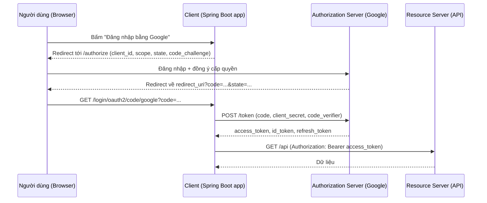

# OAuth2 & OpenID Connect

OAuth2 là giao thức **ủy quyền**: cho một ứng dụng truy cập tài nguyên thay mặt người dùng mà không cần biết mật khẩu của họ. OpenID Connect (OIDC) xây trên OAuth2 để thêm phần **xác thực** — biết người dùng là ai. Bài này giải thích các vai trò, các grant type, PKCE, rồi đi qua ba cách Spring Security hỗ trợ: **OAuth2 Client** (đăng nhập bằng Google/GitHub), **Resource Server** (API kiểm tra access token) và **Authorization Server** (tự phát hành token).

---

:::note[Ghi nhớ nhanh]

- ⭐ **OAuth2 là ủy quyền, OIDC là xác thực** — access token để gọi API, ID token (JWT) để biết người dùng là ai.
- ⭐ **Authorization Code + PKCE là luồng chuẩn** cho mọi client có người dùng (web, SPA, mobile); Implicit và Password grant đã bị loại khỏi OAuth 2.1.
- **Bốn vai trò**: Resource Owner (người dùng), Client (ứng dụng), Authorization Server (phát token), Resource Server (API).
- **Spring Boot có ba starter**: `oauth2-client`, `oauth2-resource-server`, `oauth2-authorization-server`.
- **Client Credentials** dùng cho service gọi service, không có người dùng.

:::

---

## Mục lục

- [Vì sao OAuth2 ra đời?](#vì-sao-oauth2-ra-đời)
- [Các vai trò trong OAuth2](#các-vai-trò-trong-oauth2)
- [Các grant type](#các-grant-type)
- [PKCE](#pkce)
- [OpenID Connect](#openid-connect)
- [OAuth2 Client: đăng nhập bằng Google và GitHub](#oauth2-client-đăng-nhập-bằng-google-và-github)
- [Resource Server: bảo vệ API bằng access token](#resource-server-bảo-vệ-api-bằng-access-token)
- [Authorization Server: tự phát hành token](#authorization-server-tự-phát-hành-token)
- [Câu hỏi phỏng vấn](#câu-hỏi-phỏng-vấn)

---

## Vì sao OAuth2 ra đời?

**Vấn đề:** Trước OAuth, một ứng dụng muốn đọc danh bạ Gmail của bạn (để mời bạn bè) sẽ **hỏi thẳng mật khẩu Gmail**:

```
Ứng dụng X: "Nhập email và mật khẩu Gmail để tìm bạn bè"
→ X lưu mật khẩu, đăng nhập Gmail thay bạn
→ X có TOÀN QUYỀN: đọc mail, xoá mail, đổi mật khẩu
→ Muốn thu hồi quyền của X? Chỉ còn cách đổi mật khẩu (và mọi app khác cũng mất quyền)
```

**Giải pháp:** OAuth2 (RFC 6749, 2012) tách bạch: người dùng đăng nhập **trực tiếp tại Google**, đồng ý cấp **một số quyền giới hạn** (scope), Google cấp cho ứng dụng một **access token** có hạn dùng. Ứng dụng không bao giờ thấy mật khẩu; người dùng thu hồi quyền của từng app riêng.

```
1. App chuyển người dùng tới accounts.google.com?client_id=...&scope=contacts.readonly
2. Người dùng đăng nhập tại Google, bấm "Cho phép"
3. Google redirect về app kèm authorization code
4. App (phía server) đổi code lấy access token
5. App gọi Google Contacts API với "Authorization: Bearer <token>"
```

:::tip[Dùng thực tế]

- Nút "Đăng nhập bằng Google/GitHub/Facebook" — OAuth2 Client + OIDC.
- Microservices: API Gateway và các service kiểm tra JWT do Keycloak/Auth0/Okta phát — Resource Server.
- Service batch gọi API nội bộ không có người dùng — Client Credentials.
- Doanh nghiệp muốn tự làm trung tâm SSO cho nhiều ứng dụng — Authorization Server (hoặc Keycloak).

:::

---

## Các vai trò trong OAuth2

| Vai trò | Là ai | Ví dụ |
|---------|-------|-------|
| **Resource Owner** | Người sở hữu dữ liệu | Bạn, chủ tài khoản Google |
| **Client** | Ứng dụng muốn truy cập dữ liệu | Ứng dụng quản lý lịch của bạn |
| **Authorization Server** | Xác thực người dùng, phát token | Google Accounts, Keycloak, Spring Authorization Server |
| **Resource Server** | API chứa dữ liệu, kiểm tra token | Google Calendar API, API đơn hàng của bạn |

:::tip[Ví dụ đời thường]

OAuth2 giống **thẻ giữ xe valet ở nhà hàng**: bạn (resource owner) không đưa cả chùm chìa khoá nhà cho nhân viên đỗ xe (client), mà đưa một **chìa valet** (access token) chỉ nổ máy và chạy tối đa vài km, không mở được cốp. Quầy lễ tân (authorization server) cấp chìa đó sau khi xác nhận bạn là chủ xe. Chiếc xe (resource server) chỉ quan tâm chìa có hợp lệ không. Cuối buổi chìa hết hiệu lực; bạn cũng có thể thu hồi bất cứ lúc nào.

:::

---

## Các grant type

**Grant type** là cách client lấy được access token.

| Grant type | Dùng khi | Trạng thái |
|------------|----------|------------|
| **Authorization Code** (+ PKCE) | Có người dùng: web app, SPA, mobile | Chuẩn, khuyên dùng |
| **Client Credentials** | Service-to-service, không có người dùng | Khuyên dùng |
| **Refresh Token** | Lấy access token mới khi token cũ hết hạn | Khuyên dùng (kèm rotation với public client) |
| **Device Code** (RFC 8628) | Thiết bị không có bàn phím: Smart TV, CLI | Khuyên dùng cho trường hợp này |
| Implicit | SPA thời trước, token trả qua URL fragment | Lỗi thời, bị loại khỏi OAuth 2.1 |
| Resource Owner Password | Client nhận thẳng username/password | Lỗi thời, bị loại khỏi OAuth 2.1 |

Luồng **Authorization Code** đầy đủ:



Tham số `state` là chuỗi ngẫu nhiên chống **CSRF** trong luồng đăng nhập: client so `state` nhận về với giá trị đã lưu trước khi redirect.

**Client Credentials** — không có người dùng, client tự xác thực bằng id/secret:

```bash
curl -X POST https://auth.example.com/oauth2/token \
  -u order-service:secret \
  -d grant_type=client_credentials \
  -d scope=inventory.read
```

---

## PKCE

**PKCE** (Proof Key for Code Exchange, RFC 7636, đọc là "pixy") chống việc **authorization code bị đánh cắp** (qua app độc hại đăng ký cùng custom URL scheme trên mobile, log, lịch sử trình duyệt). Ý tưởng: chỉ client đã khởi tạo luồng mới đổi được code.

1. Client sinh chuỗi ngẫu nhiên `code_verifier` (43–128 ký tự), giữ bí mật.
2. Tính `code_challenge = BASE64URL(SHA256(code_verifier))`, gửi kèm request `/authorize` với `code_challenge_method=S256`.
3. Authorization server lưu `code_challenge` gắn với code.
4. Khi đổi code ở `/token`, client gửi `code_verifier`. Server băm lại và so với `code_challenge`.

Kẻ trộm có code nhưng không có `code_verifier` → không đổi được token.

| | Không PKCE | Có PKCE |
|---|-----------|---------|
| Public client (SPA, mobile) không giữ được secret | Code bị đánh cắp là mất token | An toàn |
| Confidential client (server) | Được bảo vệ bởi client secret | Thêm một lớp, OAuth 2.1 khuyên dùng luôn |

Spring Security OAuth2 Client tự dùng PKCE cho **public client** (khai báo `client-authentication-method: none`). Với confidential client có thể bật thêm qua `OAuth2AuthorizationRequestCustomizers.withPkce()` khi cấu hình `DefaultOAuth2AuthorizationRequestResolver`.

---

## OpenID Connect

OAuth2 chỉ nói "app này được phép đọc lịch", không chuẩn hoá "người dùng là ai". Nhiều nhà cung cấp tự chế endpoint `/me` khác nhau. **OIDC** (2014) chuẩn hoá phần này:

- Thêm scope `openid`. Có scope này, authorization server trả thêm **ID token** — một JWT có chữ ký chứa thông tin người dùng (`sub`, `email`, `name`, `iss`, `aud`, `exp`).
- Endpoint **UserInfo** chuẩn.
- **Discovery**: `/.well-known/openid-configuration` mô tả mọi endpoint và khoá công khai (JWKS) — nhờ vậy Spring chỉ cần `issuer-uri` là tự cấu hình được.

| | Access token | ID token |
|---|--------------|----------|
| Dành cho | Resource Server (API) | Client |
| Mục đích | Ủy quyền gọi API | Chứng minh người dùng đã đăng nhập |
| Định dạng | Tuỳ server (JWT hoặc chuỗi opaque) | Luôn là JWT |
| Gửi tới API? | Có | Không |

:::warning[Lỗi hay gặp]

Dùng **ID token** làm Bearer token gọi API, hoặc dùng access token của Google để "đăng nhập" vào API của mình mà không kiểm tra `aud` (audience) → token phát cho app khác cũng dùng được ở API của bạn. API chỉ nhận access token được phát **cho chính nó**.

:::

---

## OAuth2 Client: đăng nhập bằng Google và GitHub

```xml
<dependency>
    <groupId>org.springframework.boot</groupId>
    <artifactId>spring-boot-starter-oauth2-client</artifactId>
</dependency>
```

Đăng ký ứng dụng tại Google Cloud Console và GitHub Developer Settings, khai báo redirect URI dạng `http://localhost:8080/login/oauth2/code/google` (mẫu mặc định của Spring là `/login/oauth2/code/` + registration id).

```yaml
spring:
  security:
    oauth2:
      client:
        registration:
          google:
            client-id: ${GOOGLE_CLIENT_ID}          # lấy từ biến môi trường, không hardcode
            client-secret: ${GOOGLE_CLIENT_SECRET}
            scope: openid, profile, email
          github:
            client-id: ${GITHUB_CLIENT_ID}
            client-secret: ${GITHUB_CLIENT_SECRET}
            scope: read:user, user:email
```

Google, GitHub, Facebook, Okta có sẵn cấu hình provider trong `CommonOAuth2Provider`, nên không cần khai báo URL. Với provider khác (Keycloak), thêm phần `provider` với `issuer-uri`.

```java
@Configuration
@EnableWebSecurity
public class OAuth2LoginConfig {

    @Bean
    SecurityFilterChain securityFilterChain(HttpSecurity http) throws Exception {
        http
            .authorizeHttpRequests(auth -> auth
                .requestMatchers("/", "/error", "/css/**").permitAll()
                .anyRequest().authenticated())
            .oauth2Login(oauth -> oauth
                .loginPage("/login")                      // trang có nút Google/GitHub
                .defaultSuccessUrl("/dashboard", true))
            .logout(logout -> logout.logoutSuccessUrl("/"));
        return http.build();
    }
}
```

Lấy thông tin người dùng:

```java
@GetMapping("/dashboard")
public String dashboard(@AuthenticationPrincipal OAuth2User user, Model model) {
    // Google (OIDC) → OidcUser, có getEmail(), getIdToken()
    // GitHub (OAuth2 thuần) → attribute "login", "name", "avatar_url"
    model.addAttribute("name", user.getAttribute("name"));
    return "dashboard";
}
```

Muốn lưu/đồng bộ người dùng vào database lần đầu đăng nhập, tuỳ biến `OidcUserService` (Google) hoặc `DefaultOAuth2UserService` (GitHub):

```java
@Bean
OAuth2UserService<OidcUserRequest, OidcUser> oidcUserService(AppUserRepository repo) {
    OidcUserService delegate = new OidcUserService();
    return request -> {
        OidcUser oidcUser = delegate.loadUser(request);
        repo.findByEmail(oidcUser.getEmail())
            .orElseGet(() -> repo.save(AppUser.fromOidc(oidcUser)));  // tạo user mới nếu chưa có
        return oidcUser;
    };
}
```

Gọi API bên ngoài thay mặt người dùng — `OAuth2AuthorizedClientManager` lo lưu và làm mới token; với `RestClient` (Spring Security 6.4+) có thể dùng `OAuth2ClientHttpRequestInterceptor` để tự gắn Bearer token.

:::warning[Lỗi hay gặp]

- Redirect URI đăng ký ở Google khác một ký tự (http/https, có/không dấu `/` cuối, sai cổng) → lỗi `redirect_uri_mismatch`.
- Chạy sau reverse proxy (Nginx) mà không cấu hình `server.forward-headers-strategy: framework` → Spring tạo redirect URI dạng `http://` thay vì `https://`.
- Commit `client-secret` vào Git — luôn dùng biến môi trường hoặc secret manager.

:::

---

## Resource Server: bảo vệ API bằng access token

Resource Server không quan tâm token được lấy bằng cách nào; nó chỉ **kiểm tra token hợp lệ** rồi đổi thành `Authentication`.

```xml
<dependency>
    <groupId>org.springframework.boot</groupId>
    <artifactId>spring-boot-starter-oauth2-resource-server</artifactId>
</dependency>
```

```yaml
spring:
  security:
    oauth2:
      resourceserver:
        jwt:
          issuer-uri: https://auth.example.com/realms/shop   # Spring tự tải JWKS qua discovery
          audiences: order-api                               # Boot 3.2+: kiểm tra claim aud
```

```java
@Bean
SecurityFilterChain api(HttpSecurity http) throws Exception {
    http
        .authorizeHttpRequests(auth -> auth
            .requestMatchers(HttpMethod.GET, "/api/orders/**").hasAuthority("SCOPE_orders.read")
            .requestMatchers("/api/orders/**").hasAuthority("SCOPE_orders.write")
            .anyRequest().authenticated())
        .oauth2ResourceServer(oauth -> oauth.jwt(Customizer.withDefaults()))
        .sessionManagement(s -> s.sessionCreationPolicy(SessionCreationPolicy.STATELESS))
        .csrf(csrf -> csrf.disable());
    return http.build();
}
```

`BearerTokenAuthenticationFilter` đọc header `Authorization: Bearer`, `JwtDecoder` kiểm tra chữ ký (theo JWKS), `exp`, `iss`; claim `scope` được đổi thành authority có tiền tố `SCOPE_`. Chi tiết về JWT và cách tuỳ biến xem bài [JWT Authentication](./4_jwt.md).

Với token **opaque** (chuỗi ngẫu nhiên không tự chứa thông tin), dùng `oauth2.opaqueToken(...)` — Resource Server gọi endpoint **introspection** của authorization server cho mỗi request (hoặc có cache).

---

## Authorization Server: tự phát hành token

Phần lớn dự án nên dùng giải pháp có sẵn (Keycloak, Auth0, Okta, AWS Cognito). Khi cần tự làm, dùng **Spring Authorization Server** — dự án chính thức thay thế `spring-security-oauth2` (đã ngừng hỗ trợ từ lâu).

```xml
<dependency>
    <groupId>org.springframework.boot</groupId>
    <artifactId>spring-boot-starter-oauth2-authorization-server</artifactId>
</dependency>
```

Spring Boot 3.1+ cho phép khai báo client bằng properties:

```yaml
spring:
  security:
    oauth2:
      authorizationserver:
        issuer: http://localhost:9000
        client:
          web-client:
            registration:
              client-id: web-client
              client-secret: "{bcrypt}$2a$10$..."      # secret đã băm
              client-authentication-methods: client_secret_basic
              authorization-grant-types: authorization_code, refresh_token
              redirect-uris: http://localhost:8080/login/oauth2/code/my-auth
              scopes: openid, profile, orders.read
            require-proof-key: true                    # bắt buộc PKCE
          inventory-service:
            registration:
              client-id: inventory-service
              client-secret: "{bcrypt}$2a$10$..."
              client-authentication-methods: client_secret_basic
              authorization-grant-types: client_credentials
              scopes: inventory.read
```

Kèm một `UserDetailsService` để người dùng đăng nhập. Server tự cung cấp các endpoint chuẩn: `/oauth2/authorize`, `/oauth2/token`, `/oauth2/jwks`, `/oauth2/introspect`, `/oauth2/revoke`, `/.well-known/openid-configuration`.

:::note[Về Spring Security 7]

Từ Spring Security 7 (đi cùng Spring Boot 4), Spring Authorization Server được đưa vào trong dự án Spring Security. Khái niệm và endpoint không đổi; khi nâng cấp hãy kiểm tra lại tên dependency theo tài liệu chính thức tại [docs.spring.io](https://docs.spring.io/spring-security/reference/).

:::

---

## Câu hỏi phỏng vấn

**1. OAuth2 và OpenID Connect khác nhau thế nào?**

<details className="qa">
<summary>Xem đáp án</summary>

OAuth2 là framework ủy quyền: cấp access token để client gọi API thay người dùng, không chuẩn hoá thông tin danh tính. OIDC là lớp xác thực xây trên OAuth2: thêm scope `openid`, ID token dạng JWT chứa thông tin người dùng, endpoint UserInfo và discovery. "Đăng nhập bằng Google" thực chất là OIDC.

</details>

**2. Vì sao Implicit grant bị loại bỏ?**

<details className="qa">
<summary>Xem đáp án</summary>

Implicit trả access token trực tiếp qua URL fragment trên trình duyệt: token có thể lộ qua lịch sử, Referer, extension; không có refresh token an toàn; không xác thực được client. Authorization Code + PKCE giải quyết được bài toán SPA mà không trả token qua URL, nên OAuth 2.1 và các best practice hiện tại loại Implicit.

</details>

**3. PKCE hoạt động thế nào và chống được gì?**

<details className="qa">
<summary>Xem đáp án</summary>

Client sinh `code_verifier` ngẫu nhiên, gửi `code_challenge` (SHA-256 của verifier) ở bước authorize. Khi đổi code lấy token phải gửi kèm `code_verifier`; server băm lại và so. Kẻ đánh cắp authorization code (qua redirect bị chặn, app độc hại trên mobile) không có verifier nên không đổi được token. Đặc biệt cần cho public client không giữ được client secret.

</details>

**4. Khi nào dùng Client Credentials?**

<details className="qa">
<summary>Xem đáp án</summary>

Khi không có người dùng tham gia: service gọi service, job batch, tác vụ hệ thống. Client tự xác thực bằng client id/secret (hoặc private key JWT, mTLS) và nhận access token mang quyền của chính client.

</details>

**5. Resource Server kiểm tra JWT như thế nào trong Spring?**

<details className="qa">
<summary>Xem đáp án</summary>

`BearerTokenAuthenticationFilter` lấy token từ header, `JwtAuthenticationProvider` dùng `JwtDecoder` (thường `NimbusJwtDecoder` cấu hình từ `issuer-uri` hoặc `jwk-set-uri`) để kiểm tra chữ ký bằng khoá công khai JWKS, kiểm tra `exp`, `nbf`, `iss` và `aud` nếu cấu hình. Sau đó `JwtAuthenticationConverter` đổi claim `scope`/`scp` thành authority `SCOPE_...` và tạo `JwtAuthenticationToken`.

</details>

**6. Tham số state trong luồng Authorization Code dùng để làm gì?**

<details className="qa">
<summary>Xem đáp án</summary>

Chống CSRF trên callback: kẻ tấn công không thể dụ người dùng hoàn tất luồng đăng nhập bằng code của kẻ tấn công, vì client chỉ chấp nhận callback có `state` khớp giá trị nó đã lưu trong session trước khi redirect. Spring Security OAuth2 Client tự sinh và kiểm tra `state`.

</details>

**7. Access token opaque và JWT khác nhau thế nào?**

<details className="qa">
<summary>Xem đáp án</summary>

JWT tự chứa thông tin và chữ ký, Resource Server kiểm tra cục bộ bằng khoá công khai, nhanh và không cần gọi mạng, nhưng khó thu hồi trước khi hết hạn. Opaque token là chuỗi ngẫu nhiên, Resource Server phải gọi introspection endpoint để hỏi, tốn thêm một lượt mạng nhưng thu hồi tức thì và không lộ thông tin.

</details>
