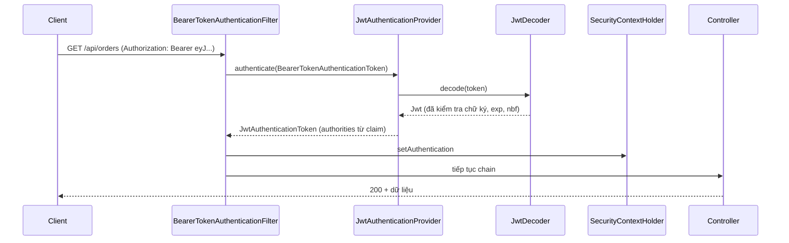

# JWT Authentication

JWT (JSON Web Token) là định dạng token tự chứa thông tin, được dùng rất rộng rãi để xác thực REST API không trạng thái (stateless). Rất nhiều hướng dẫn trên mạng dạy tự viết `JwtFilter` bằng thư viện `jjwt`, nhưng Spring Security đã có sẵn module **OAuth2 Resource Server** làm việc đó chuẩn hơn và an toàn hơn. Bài này giải thích cấu trúc JWT, cách phát và kiểm tra token bằng `JwtEncoder`/`JwtDecoder`, khi nào mới cần tự viết filter, chiến lược access/refresh token và nơi lưu token ở client.

---

:::note[Ghi nhớ nhanh]

- ⭐ **Dùng `oauth2ResourceServer().jwt()` thay vì tự viết filter** — Spring đã có `BearerTokenAuthenticationFilter` + `JwtDecoder` kiểm tra chữ ký, hạn dùng, issuer.
- ⭐ **JWT chỉ được ký, không được mã hoá** — ai cũng đọc được payload (base64url), tuyệt đối không bỏ mật khẩu hay dữ liệu nhạy cảm vào.
- **Cấu trúc**: `header.payload.signature`; chữ ký đảm bảo không ai sửa được nội dung.
- **Access token ngắn hạn (5–15 phút) + refresh token dài hạn** có rotation và lưu ở server để thu hồi được.
- **Lưu token**: access token trong bộ nhớ, refresh token trong cookie `HttpOnly; Secure; SameSite` — tránh `localStorage`.

:::

---

## Mục lục

- [Vì sao JWT ra đời?](#vì-sao-jwt-ra-đời)
- [Cấu trúc JWT](#cấu-trúc-jwt)
- [Kiểm tra JWT bằng OAuth2 Resource Server](#kiểm-tra-jwt-bằng-oauth2-resource-server)
- [Phát JWT bằng JwtEncoder](#phát-jwt-bằng-jwtencoder)
- [Map claim thành quyền](#map-claim-thành-quyền)
- [Khi nào tự viết filter?](#khi-nào-tự-viết-filter)
- [Access token và refresh token](#access-token-và-refresh-token)
- [Stateless session](#stateless-session)
- [Lưu token ở đâu?](#lưu-token-ở-đâu)

---

## Vì sao JWT ra đời?

**Vấn đề:** Với session truyền thống, server lưu trạng thái đăng nhập (trong bộ nhớ hoặc Redis), client giữ cookie `JSESSIONID`:

```
Request → cookie JSESSIONID=abc → server tra session store → biết user
```

Khi hệ thống lớn lên:

- Nhiều instance phải dùng chung session store (Redis), thêm một điểm phụ thuộc.
- Microservices: service đơn hàng muốn biết user là ai lại phải gọi sang service auth hoặc session store.
- Mobile app, client khác domain làm việc với cookie bất tiện.

**Giải pháp:** JWT (RFC 7519) đặt **thông tin cần thiết vào chính token** và **ký số** để chống giả mạo. Bất kỳ service nào có khoá kiểm tra (khoá công khai) đều tự xác minh được token mà không cần gọi ai:

```
Request → Authorization: Bearer eyJhbGciOi... → service kiểm tra chữ ký + exp → biết user
```

:::tip[Dùng thực tế]

- REST API cho SPA (React/Vue) và mobile app.
- Microservices: gateway và các service cùng kiểm tra JWT bằng một bộ khoá công khai (JWKS).
- Token do Keycloak/Auth0/Cognito phát, API Spring Boot chỉ việc kiểm tra.
- Token ngắn hạn cho link tải file, link xác nhận email.

:::

---

## Cấu trúc JWT

JWT gồm ba phần base64url nối bằng dấu chấm: `header.payload.signature`.

```
eyJhbGciOiJSUzI1NiIsInR5cCI6IkpXVCJ9      ← header
.eyJzdWIiOiJhbiIsInJvbGVzIjpbIlVTRVIiXX0  ← payload
.Kx9f...                                  ← signature
```

```json
// Header
{ "alg": "RS256", "typ": "JWT", "kid": "2026-key-1" }

// Payload (claims)
{
  "iss": "https://api.shop.vn",
  "sub": "an",
  "aud": "shop-api",
  "iat": 1760400000,
  "exp": 1760400900,
  "jti": "5f1c...",
  "roles": ["USER"]
}
```

| Claim | Ý nghĩa |
|-------|---------|
| `iss` (issuer) | Ai phát token |
| `sub` (subject) | Token nói về ai (user id/username) |
| `aud` (audience) | Token dành cho API nào |
| `exp` / `iat` / `nbf` | Hết hạn / phát lúc / chưa dùng trước lúc |
| `jti` | Id duy nhất của token (dùng cho blacklist) |

**Chữ ký** = ký(`header.payload`) bằng khoá:

- **HS256** (HMAC, khoá đối xứng): cùng một secret để ký và kiểm tra. Đơn giản, nhưng mọi service kiểm tra đều phải giữ secret — lộ một chỗ là ai cũng ký được token.
- **RS256 / ES256** (bất đối xứng): ký bằng **private key** (chỉ auth server giữ), kiểm tra bằng **public key** (phát công khai qua JWKS). Phù hợp microservices.

:::tip[Ví dụ đời thường]

JWT giống **vé xem concert có hologram chống giả**: trên vé in sẵn tên, hạng ghế, ngày diễn (payload) — ai cầm lên cũng đọc được, nên đừng in số tài khoản ngân hàng lên đó. Nhân viên soát vé ở bất kỳ cổng nào chỉ cần soi hologram (chữ ký) là biết vé thật, không cần gọi về phòng vé. Nhược điểm: vé đã phát thì khó "thu hồi" — muốn huỷ phải phát danh sách đen cho mọi cổng.

:::

:::warning[Lỗi hay gặp]

- Tin rằng JWT "được mã hoá" và bỏ email, số điện thoại, quyền chi tiết nhạy cảm vào payload. Dán token vào jwt.io là đọc được hết.
- Chấp nhận `alg: none` hoặc để thư viện tự chọn thuật toán theo header → kẻ tấn công tự ký token. `NimbusJwtDecoder` của Spring cố định thuật toán theo khoá cấu hình nên tránh được lỗi này.
- Secret HS256 quá ngắn (`"secret"`) → bẻ được bằng brute force. Tối thiểu 256 bit ngẫu nhiên.

:::

---

## Kiểm tra JWT bằng OAuth2 Resource Server

```xml
<dependency>
    <groupId>org.springframework.boot</groupId>
    <artifactId>spring-boot-starter-oauth2-resource-server</artifactId>
</dependency>
```

**Trường hợp 1 — token do Authorization Server bên ngoài phát** (Keycloak, Auth0...). Chỉ cần cấu hình:

```yaml
spring:
  security:
    oauth2:
      resourceserver:
        jwt:
          issuer-uri: https://auth.shop.vn/realms/shop
```

**Trường hợp 2 — ứng dụng tự phát token** bằng cặp khoá RSA của mình:

```yaml
jwt:
  public-key: classpath:keys/app.pub    # PEM public key
  private-key: classpath:keys/app.key   # PEM private key (PKCS#8) - production nên lấy từ secret manager
  access-token-ttl: 15m
```

```java
@ConfigurationProperties(prefix = "jwt")
public record JwtProperties(RSAPublicKey publicKey, RSAPrivateKey privateKey, Duration accessTokenTtl) {
}
```

Spring Boot tự chuyển file PEM thành `RSAPublicKey`/`RSAPrivateKey` khi bind properties. Cấu hình bảo mật:

```java
@Configuration
@EnableWebSecurity
@EnableConfigurationProperties(JwtProperties.class)
public class JwtSecurityConfig {

    private final JwtProperties props;

    public JwtSecurityConfig(JwtProperties props) {
        this.props = props;
    }

    @Bean
    SecurityFilterChain api(HttpSecurity http) throws Exception {
        http
            .authorizeHttpRequests(auth -> auth
                .requestMatchers("/api/auth/**").permitAll()
                .anyRequest().authenticated())
            .oauth2ResourceServer(oauth -> oauth.jwt(Customizer.withDefaults()))
            .sessionManagement(s -> s.sessionCreationPolicy(SessionCreationPolicy.STATELESS))
            .csrf(csrf -> csrf.disable());   // không dùng cookie để xác thực API → không cần CSRF
        return http.build();
    }

    @Bean
    JwtDecoder jwtDecoder() {
        return NimbusJwtDecoder.withPublicKey(props.publicKey()).build();
    }

    @Bean
    JwtEncoder jwtEncoder() {
        RSAKey rsaKey = new RSAKey.Builder(props.publicKey()).privateKey(props.privateKey()).build();
        return new NimbusJwtEncoder(new ImmutableJWKSet<>(new JWKSet(rsaKey)));
    }
}
```

Luồng một request:



Token sai chữ ký hoặc hết hạn → 401 kèm header `WWW-Authenticate: Bearer error="invalid_token"`.

Thêm kiểm tra `iss`, `aud`:

```java
@Bean
JwtDecoder jwtDecoder() {
    NimbusJwtDecoder decoder = NimbusJwtDecoder.withPublicKey(props.publicKey()).build();
    OAuth2TokenValidator<Jwt> withIssuer = JwtValidators.createDefaultWithIssuer("https://api.shop.vn");
    OAuth2TokenValidator<Jwt> audience = new JwtClaimValidator<List<String>>(
            JwtClaimNames.AUD, aud -> aud != null && aud.contains("shop-api"));
    decoder.setJwtValidator(new DelegatingOAuth2TokenValidator<>(withIssuer, audience));
    return decoder;
}
```

---

## Phát JWT bằng JwtEncoder

Endpoint đăng nhập: xác thực username/password bằng `AuthenticationManager`, rồi phát token.

```java
@Service
public class TokenService {
    private final JwtEncoder encoder;
    private final JwtProperties props;

    public TokenService(JwtEncoder encoder, JwtProperties props) {
        this.encoder = encoder;
        this.props = props;
    }

    public String createAccessToken(Authentication auth) {
        Instant now = Instant.now();
        List<String> roles = auth.getAuthorities().stream()
                .map(GrantedAuthority::getAuthority)
                .map(a -> a.replaceFirst("^ROLE_", ""))
                .toList();
        JwtClaimsSet claims = JwtClaimsSet.builder()
                .issuer("https://api.shop.vn")
                .audience(List.of("shop-api"))
                .subject(auth.getName())
                .issuedAt(now)
                .expiresAt(now.plus(props.accessTokenTtl()))
                .id(UUID.randomUUID().toString())
                .claim("roles", roles)
                .build();
        JwsHeader header = JwsHeader.with(SignatureAlgorithm.RS256).build();
        return encoder.encode(JwtEncoderParameters.from(header, claims)).getTokenValue();
    }
}
```

```java
@RestController
@RequestMapping("/api/auth")
public class AuthController {
    private final AuthenticationManager authenticationManager;
    private final TokenService tokenService;

    public AuthController(AuthenticationManager authenticationManager, TokenService tokenService) {
        this.authenticationManager = authenticationManager;
        this.tokenService = tokenService;
    }

    public record LoginRequest(@NotBlank String username, @NotBlank String password) {}
    public record TokenResponse(String accessToken, String tokenType, long expiresIn) {}

    @PostMapping("/login")
    public TokenResponse login(@Valid @RequestBody LoginRequest req) {
        Authentication auth = authenticationManager.authenticate(
                UsernamePasswordAuthenticationToken.unauthenticated(req.username(), req.password()));
        return new TokenResponse(tokenService.createAccessToken(auth), "Bearer", 900);
    }
}
```

Bean `AuthenticationManager` không có sẵn để inject; khai báo nó từ `AuthenticationConfiguration`:

```java
@Bean
AuthenticationManager authenticationManager(AuthenticationConfiguration config) throws Exception {
    return config.getAuthenticationManager();
}
```

---

## Map claim thành quyền

Mặc định `JwtAuthenticationConverter` đọc claim `scope` (hoặc `scp`) và tạo authority `SCOPE_xxx`. Token của chúng ta dùng claim `roles`, nên cần đổi:

```java
@Bean
JwtAuthenticationConverter jwtAuthenticationConverter() {
    JwtGrantedAuthoritiesConverter authorities = new JwtGrantedAuthoritiesConverter();
    authorities.setAuthoritiesClaimName("roles");   // đọc claim "roles"
    authorities.setAuthorityPrefix("ROLE_");        // "ADMIN" → "ROLE_ADMIN"

    JwtAuthenticationConverter converter = new JwtAuthenticationConverter();
    converter.setJwtGrantedAuthoritiesConverter(authorities);
    return converter;
}
```

Spring Boot tự dùng bean này. Giờ `hasRole("ADMIN")` và `@PreAuthorize` hoạt động bình thường. Trong controller:

```java
@GetMapping("/api/me")
public Map<String, Object> me(@AuthenticationPrincipal Jwt jwt) {
    return Map.of("username", jwt.getSubject(), "roles", jwt.getClaimAsStringList("roles"));
}
```

---

## Khi nào tự viết filter?

Code tự viết phổ biến trên mạng trông như sau:

```java
// Cách thường thấy: tự parse JWT bằng jjwt trong OncePerRequestFilter
public class JwtFilter extends OncePerRequestFilter {
    protected void doFilterInternal(HttpServletRequest req, HttpServletResponse res, FilterChain chain)
            throws ServletException, IOException {
        String header = req.getHeader("Authorization");
        if (header != null && header.startsWith("Bearer ")) {
            String username = jwtUtil.extractUsername(header.substring(7)); // tự parse, tự validate
            UserDetails user = userDetailsService.loadUserByUsername(username); // query DB mỗi request
            var auth = new UsernamePasswordAuthenticationToken(user, null, user.getAuthorities());
            SecurityContextHolder.getContext().setAuthentication(auth);
        }
        chain.doFilter(req, res);
    }
}
```

Vấn đề: tự lo chọn thuật toán, xử lý exception (token hết hạn thường thành 500 hoặc bị nuốt im lặng), không có header `WWW-Authenticate` chuẩn, thường query DB mỗi request (mất lợi thế stateless), khó hỗ trợ xoay vòng khoá. Resource Server đã giải quyết tất cả.

**Tự viết filter hợp lý khi:**

- Token **không phải JWT/OAuth2**: API key tĩnh, chữ ký HMAC của webhook (kiểu Stripe), token định dạng riêng của hệ thống cũ.
- Lấy token từ nơi không chuẩn mà `BearerTokenResolver` không tuỳ biến được (thực ra `DefaultBearerTokenResolver` đã hỗ trợ đọc từ query param; có thể tự viết `BearerTokenResolver` để đọc từ cookie — vẫn không cần filter riêng).
- Cần bổ sung bước sau xác thực (gắn tenant id vào MDC log) — viết filter **đặt sau** `BearerTokenAuthenticationFilter`, không thay thế nó.

Ví dụ filter API key cho endpoint nội bộ:

```java
public class ApiKeyFilter extends OncePerRequestFilter {
    private final String expectedKeyHash;   // lấy từ cấu hình/secret manager

    public ApiKeyFilter(String expectedKeyHash) {
        this.expectedKeyHash = expectedKeyHash;
    }

    @Override
    protected void doFilterInternal(HttpServletRequest req, HttpServletResponse res, FilterChain chain)
            throws ServletException, IOException {
        String key = req.getHeader("X-Api-Key");
        if (key == null || !MessageDigest.isEqual(sha256Hex(key).getBytes(UTF_8), expectedKeyHash.getBytes(UTF_8))) {
            res.sendError(HttpServletResponse.SC_UNAUTHORIZED);
            return;
        }
        var auth = UsernamePasswordAuthenticationToken.authenticated(
                "internal-job", null, List.of(new SimpleGrantedAuthority("ROLE_SYSTEM")));
        SecurityContextHolder.getContext().setAuthentication(auth);
        chain.doFilter(req, res);
    }
}
// http.addFilterBefore(new ApiKeyFilter(hash), AuthorizationFilter.class);
```

---

## Access token và refresh token

JWT khó thu hồi trước khi hết hạn, nên giải pháp chuẩn là **hai loại token**:

| | Access token | Refresh token |
|---|--------------|---------------|
| Thời hạn | Ngắn: 5–15 phút | Dài: vài ngày tới vài tuần |
| Gửi tới | Mọi request API | Chỉ endpoint `/api/auth/refresh` |
| Định dạng | JWT (kiểm tra cục bộ) | Chuỗi ngẫu nhiên (opaque) |
| Lưu ở server | Không | Có — bản băm trong DB/Redis để thu hồi |

**Refresh token rotation**: mỗi lần dùng refresh token, server phát refresh token **mới** và vô hiệu hoá cái cũ. Nếu một refresh token **đã dùng** lại xuất hiện → dấu hiệu bị đánh cắp → thu hồi cả "họ" token của phiên đó.

```java
@Transactional
public TokenPair refresh(String rawRefreshToken) {
    RefreshToken stored = refreshTokenRepository.findByTokenHash(sha256Hex(rawRefreshToken))
            .orElseThrow(InvalidRefreshTokenException::new);
    if (stored.isUsed()) {                         // token cũ bị dùng lại → nghi bị đánh cắp
        refreshTokenRepository.revokeFamily(stored.getFamilyId());
        throw new InvalidRefreshTokenException();
    }
    if (stored.isExpired()) {
        throw new InvalidRefreshTokenException();
    }
    stored.markUsed();
    String newRefresh = generateSecureRandom();
    refreshTokenRepository.save(stored.rotate(sha256Hex(newRefresh)));
    return new TokenPair(tokenService.createAccessTokenFor(stored.getUsername()), newRefresh);
}
```

**Đăng xuất / thu hồi**: xoá refresh token trong DB. Access token còn sống tối đa vài phút — chấp nhận được với đa số hệ thống. Nếu cần cắt ngay (khoá tài khoản bị hack), lưu `jti` vào blacklist (Redis, TTL bằng thời gian sống còn lại) và thêm một `OAuth2TokenValidator` kiểm tra blacklist.

---

## Stateless session

Với API dùng JWT, server không nên tạo `HttpSession`:

```java
.sessionManagement(s -> s.sessionCreationPolicy(SessionCreationPolicy.STATELESS))
```

| Policy | Hành vi |
|--------|---------|
| `ALWAYS` | Luôn tạo session |
| `IF_REQUIRED` (mặc định) | Tạo khi cần (ví dụ form login) |
| `NEVER` | Không tự tạo nhưng dùng nếu đã có |
| `STATELESS` | Không tạo, không dùng session cho Security |

Lợi ích: mọi instance xử lý được mọi request, không cần sticky session hay session store chung. Đổi lại: không thu hồi tức thì, token to hơn session id.

:::tip[Ví dụ đời thường]

Session giống **gửi xe có sổ ghi**: bác bảo vệ phải giữ sổ, mở thêm bãi thì phải dùng chung sổ. Stateless JWT giống **vé tháng có dán tem**: bảo vệ bãi nào cũng kiểm được tem mà không cần sổ, nhưng vé mất thì phải chờ hết tháng hoặc báo danh sách vé mất cho mọi bãi.

:::

---

## Lưu token ở đâu?

| Nơi lưu | Rủi ro XSS | Rủi ro CSRF | Ghi chú |
|---------|-----------|-------------|---------|
| `localStorage` / `sessionStorage` | Cao — script độc đọc được | Không | Phổ biến nhưng không khuyên dùng |
| Biến trong bộ nhớ JS | Thấp hơn (mất khi reload) | Không | Phù hợp cho access token |
| Cookie `HttpOnly; Secure; SameSite=Strict/Lax` | JS không đọc được | Có — cần `SameSite` và/hoặc CSRF token | Phù hợp cho refresh token |
| Keychain (iOS) / Keystore (Android) | Không áp dụng | Không áp dụng | Cho mobile app |

Mô hình khuyên dùng cho SPA:

1. Đăng nhập → server trả **access token trong body** và **refresh token trong cookie** `HttpOnly; Secure; SameSite=Strict; Path=/api/auth/refresh`.
2. SPA giữ access token trong bộ nhớ, gửi qua header `Authorization`.
3. Reload trang hoặc access token hết hạn → gọi `/api/auth/refresh` (trình duyệt tự gửi cookie) để nhận access token mới.

Phương án an toàn hơn nữa là **BFF** (Backend for Frontend): SPA không chạm vào token nào, chỉ dùng cookie session với BFF; BFF giữ token và gọi API thay.

```java
ResponseCookie cookie = ResponseCookie.from("refresh_token", newRefresh)
        .httpOnly(true)
        .secure(true)
        .sameSite("Strict")
        .path("/api/auth/refresh")
        .maxAge(Duration.ofDays(14))
        .build();
return ResponseEntity.ok()
        .header(HttpHeaders.SET_COOKIE, cookie.toString())
        .body(new TokenResponse(accessToken, "Bearer", 900));
```

:::warning[Lỗi hay gặp]

- Đặt access token sống 30 ngày "cho tiện" → token bị lộ là kẻ tấn công dùng được cả tháng, không cách nào thu hồi.
- Gửi token qua query string (`?token=...`) → token nằm trong log server, lịch sử trình duyệt, header Referer.
- Dùng cookie để gửi token nhưng vẫn `csrf.disable()` → mở lại lỗ hổng CSRF. Tắt CSRF chỉ an toàn khi xác thực bằng header `Authorization`.

:::
