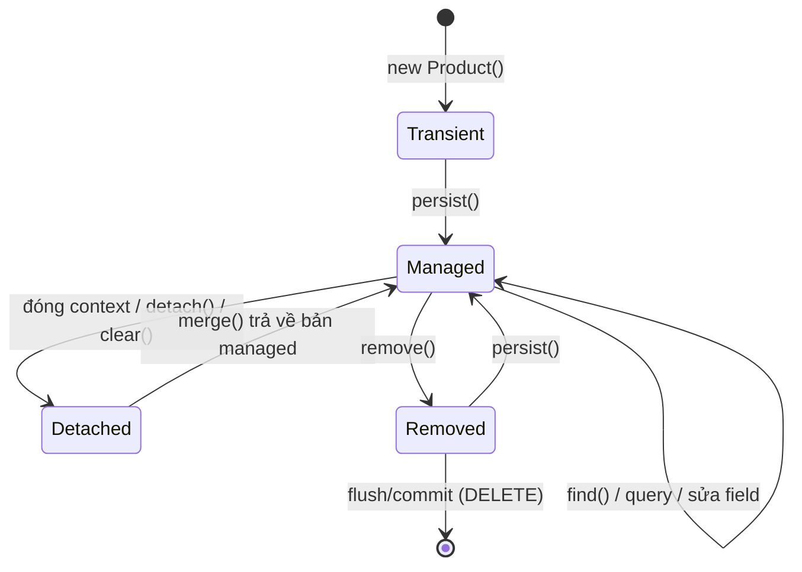

# Vòng đời Entity

Hibernate là ORM (Object-Relational Mapping) phổ biến nhất của Java và là hiện thực JPA mặc định trong Spring Boot. Muốn dùng Hibernate không "bị bất ngờ" — UPDATE tự chạy dù không gọi `save()`, thay đổi không được lưu, `LazyInitializationException` — bạn phải hiểu **persistence context** và bốn trạng thái của entity. Bài này đi từ khác biệt JPA và Hibernate, cách khai báo entity, tới các thao tác `persist`/`merge`/`remove`, dirty checking và flush.

---

:::note[Ghi nhớ nhanh]

- ⭐ **Entity managed được tự động lưu thay đổi (dirty checking)** — trong transaction, sửa field của entity đã tải là đủ, không cần gọi `save()`.
- ⭐ **Bốn trạng thái**: transient (mới tạo) → managed (trong persistence context) → detached (context đã đóng) → removed (đánh dấu xoá).
- **JPA là đặc tả, Hibernate là hiện thực** — code nên dùng API `jakarta.persistence`, chỉ dùng tính năng riêng Hibernate khi cần.
- **Persistence context là cache cấp 1** — trong cùng context, cùng id luôn trả về cùng một object.
- **Flush** đồng bộ thay đổi xuống DB (trước commit, trước query liên quan); flush không phải commit.

:::

---

## Mục lục

- [Vì sao ORM ra đời?](#vì-sao-orm-ra-đời)
- [JPA và Hibernate](#jpa-và-hibernate)
- [Khai báo Entity](#khai-báo-entity)
- [Chiến lược sinh khoá chính](#chiến-lược-sinh-khoá-chính)
- [Persistence context](#persistence-context)
- [Bốn trạng thái của Entity](#bốn-trạng-thái-của-entity)
- [persist, merge, remove](#persist-merge-remove)
- [Dirty checking](#dirty-checking)
- [Flush](#flush)
- [Câu hỏi phỏng vấn](#câu-hỏi-phỏng-vấn)

---

## Vì sao ORM ra đời?

**Vấn đề:** Với JDBC thuần, mỗi thao tác là một đống code lặp lại: viết SQL, gán tham số, duyệt `ResultSet`, chuyển từng cột thành field, đóng tài nguyên:

```java
public Product findById(long id) throws SQLException {
    String sql = "SELECT id, name, price, stock FROM products WHERE id = ?";
    try (Connection conn = dataSource.getConnection();
         PreparedStatement ps = conn.prepareStatement(sql)) {
        ps.setLong(1, id);
        try (ResultSet rs = ps.executeQuery()) {
            if (!rs.next()) return null;
            Product p = new Product();
            p.setId(rs.getLong("id"));
            p.setName(rs.getString("name"));
            p.setPrice(rs.getBigDecimal("price"));
            p.setStock(rs.getInt("stock"));
            return p;
        }
    }
}
// Thêm cột mới → sửa mọi câu SELECT, INSERT, UPDATE và mọi đoạn mapping
```

Đó là **object-relational impedance mismatch**: Java nghĩ theo object, kế thừa, tham chiếu; database nghĩ theo bảng, cột, khoá ngoại.

**Giải pháp:** ORM ánh xạ lớp ↔ bảng một lần bằng annotation, rồi sinh SQL giúp bạn:

```java
Product p = entityManager.find(Product.class, 42L);  // SELECT tự sinh
p.setStock(p.getStock() - 1);                         // UPDATE tự sinh khi commit
```

:::tip[Dùng thực tế]

- CRUD nghiệp vụ thông thường (đơn hàng, khách hàng, sản phẩm) — Spring Data JPA + Hibernate.
- Cập nhật nhiều field theo logic nghiệp vụ: tải entity, gọi method domain, để dirty checking sinh UPDATE.
- Báo cáo, thống kê phức tạp, import hàng loạt — cân nhắc native query, JDBC hoặc jOOQ thay vì ép qua entity.
- Debug "tại sao có câu UPDATE lạ" — gần như luôn là dirty checking trên entity managed.

:::

---

## JPA và Hibernate

| | JPA (Jakarta Persistence) | Hibernate ORM |
|---|---------------------------|---------------|
| Bản chất | Đặc tả (interface, annotation) | Thư viện hiện thực đặc tả đó |
| Package | `jakarta.persistence.*` | `org.hibernate.*` |
| API chính | `EntityManager`, `@Entity`, JPQL | `Session`, HQL, tính năng mở rộng |
| Hiện thực khác | EclipseLink, OpenJPA | — |

Spring Boot 3.x dùng **Hibernate 6.x** (Jakarta Persistence 3.1). `spring-boot-starter-data-jpa` kéo theo Hibernate, HikariCP và Spring Data JPA. `EntityManager` của JPA thực chất bọc `Session` của Hibernate (`entityManager.unwrap(Session.class)`).

:::tip[Ví dụ đời thường]

JPA giống **luật giao thông**: quy định đèn đỏ dừng, đèn xanh đi. Hibernate giống **một hãng xe cụ thể** tuân thủ luật đó, có thêm tính năng riêng (cảm biến lùi, cửa sổ trời). Bạn học lái theo luật chung thì đổi hãng xe vẫn chạy được; dùng tính năng riêng của hãng thì phải chấp nhận gắn với hãng đó.

:::

---

## Khai báo Entity

```java
import jakarta.persistence.*;
import java.math.BigDecimal;
import java.time.Instant;

@Entity
@Table(name = "products", indexes = @Index(name = "idx_products_sku", columnList = "sku", unique = true))
public class Product {

    @Id
    @GeneratedValue(strategy = GenerationType.IDENTITY)
    private Long id;

    @Column(nullable = false, length = 50)
    private String sku;

    @Column(nullable = false, length = 200)
    private String name;

    @Column(nullable = false, precision = 15, scale = 2)
    private BigDecimal price;

    private int stock;

    @Enumerated(EnumType.STRING)          // lưu "ACTIVE" thay vì số thứ tự 0, 1
    private ProductStatus status = ProductStatus.ACTIVE;

    @Column(name = "created_at", updatable = false)
    private Instant createdAt;

    protected Product() {                  // JPA cần constructor không tham số
    }

    public Product(String sku, String name, BigDecimal price, int stock) {
        this.sku = sku;
        this.name = name;
        this.price = price;
        this.stock = stock;
    }

    @PrePersist
    void onCreate() {
        this.createdAt = Instant.now();
    }

    public void decreaseStock(int quantity) {   // logic domain thay vì setter tuỳ tiện
        if (quantity > stock) {
            throw new IllegalStateException("Không đủ hàng");
        }
        this.stock -= quantity;
    }

    // getter...
}
```

Yêu cầu của entity: có `@Entity` và `@Id`; constructor không tham số (`public` hoặc `protected`); lớp và method không `final` (để Hibernate tạo proxy lazy). Vì vậy **không dùng `record` làm entity** — record là final và bất biến; record hợp với DTO.

:::warning[Lỗi hay gặp]

- `@Enumerated` mặc định là `ORDINAL` (lưu số thứ tự). Chèn thêm giá trị enum vào giữa là toàn bộ dữ liệu cũ bị hiểu sai. Luôn dùng `EnumType.STRING`.
- `spring.jpa.hibernate.ddl-auto: update` trên production → Hibernate tự sửa schema, không xoá cột thừa, không có lịch sử. Production dùng `validate` hoặc `none` kèm Flyway/Liquibase.

:::

---

## Chiến lược sinh khoá chính

| Chiến lược | Cách hoạt động | Ghi chú |
|------------|----------------|---------|
| `IDENTITY` | Cột auto-increment của DB (MySQL, PostgreSQL `identity`) | Phải INSERT ngay khi `persist` để biết id → **tắt JDBC batch insert** |
| `SEQUENCE` | Lấy từ sequence của DB, có thể lấy trước theo khối (`allocationSize`) | Hiệu quả nhất với PostgreSQL/Oracle, hỗ trợ batch |
| `TABLE` | Bảng riêng giả lập sequence | Chậm, tránh dùng |
| `AUTO` (mặc định) | Hibernate tự chọn theo dialect | Hibernate 6 thường chọn `SEQUENCE` |
| `UUID` | `@GeneratedValue(strategy = GenerationType.UUID)` (JPA 3.1) | Không lộ số lượng bản ghi; khoá lớn hơn |

```java
@Id
@GeneratedValue(strategy = GenerationType.SEQUENCE, generator = "order_seq")
@SequenceGenerator(name = "order_seq", sequenceName = "orders_seq", allocationSize = 50)
private Long id;
```

---

## Persistence context

**Persistence context** là tập hợp các entity mà `EntityManager` đang **quản lý**, kèm bản chụp (snapshot) trạng thái ban đầu của chúng. Trong Spring, mặc định mỗi transaction có một persistence context riêng.

Tính chất quan trọng:

- **Cache cấp 1 (first-level cache)** — `find()` cùng id lần hai không query lại DB.
- **Đảm bảo định danh** — trong cùng context, cùng id luôn là **cùng một object Java** (`==` trả `true`).
- **Theo dõi thay đổi** — so entity với snapshot để sinh UPDATE (dirty checking).
- **Ghi trễ (write-behind)** — câu SQL được gom lại và gửi khi flush.

```java
@Transactional
public void demo() {
    Product a = em.find(Product.class, 1L);   // SELECT
    Product b = em.find(Product.class, 1L);   // không SELECT, lấy từ context
    System.out.println(a == b);               // true
}
```

:::tip[Ví dụ đời thường]

Persistence context giống **giỏ hàng đang mở ở quầy thu ngân**. Món nào đã quét mã vào giỏ (managed) thì thu ngân nhớ giá gốc; bạn đổi số lượng, máy tự tính lại khi thanh toán (flush/commit). Quét lại cùng món không thêm dòng mới, chỉ chỉ vào đúng dòng cũ. Thanh toán xong, giỏ đóng lại — món đồ bạn cầm ra về (detached) có sửa gì thì máy cũng không biết nữa.

:::

---

## Bốn trạng thái của Entity



| Trạng thái | Có id? | Trong persistence context? | Thay đổi có được lưu? |
|------------|--------|----------------------------|------------------------|
| **Transient** (mới) | Thường chưa | Không | Không — DB không biết object này |
| **Managed** (được quản lý) | Có | Có | Có — dirty checking tự UPDATE |
| **Detached** (tách rời) | Có | Không (context đã đóng) | Không, trừ khi `merge()` |
| **Removed** (đã đánh dấu xoá) | Có | Có, chờ DELETE | DELETE khi flush |

```java
@Transactional
public void lifecycle() {
    Product p = new Product("KB-01", "Bàn phím", new BigDecimal("990000"), 10); // transient
    em.persist(p);                 // managed (với IDENTITY: INSERT chạy ngay để lấy id)
    p.setName("Bàn phím cơ");      // vẫn managed → sẽ UPDATE khi flush
    em.detach(p);                  // detached
    p.setName("Tên khác");         // không ai theo dõi → không được lưu
    Product managed = em.merge(p); // copy trạng thái vào bản managed
    em.remove(managed);            // removed → DELETE khi flush
}
```

---

## persist, merge, remove

**`persist(entity)`** — biến object transient thành managed. INSERT sẽ chạy khi flush (riêng `IDENTITY` thì chạy ngay). Gọi với entity detached → `EntityExistsException` hoặc lỗi "detached entity passed to persist".

**`merge(entity)`** — **copy** trạng thái của object (detached hoặc transient) vào một bản managed và **trả về bản managed đó**. Object truyền vào vẫn detached.

```java
Product detached = ...;               // ví dụ nhận từ request, có id
Product managed = em.merge(detached); // SELECT theo id, copy field, trả về bản managed
managed.setStock(5);                  // được theo dõi
detached.setStock(99);                // KHÔNG được theo dõi
```

**`remove(entity)`** — chỉ nhận entity managed; đánh dấu xoá, DELETE chạy khi flush.

Spring Data `save()` làm gì?

```java
// SimpleJpaRepository.save (giản lược)
public <S extends T> S save(S entity) {
    if (entityInformation.isNew(entity)) {   // id == null (hoặc @Version == null)
        em.persist(entity);
        return entity;
    } else {
        return em.merge(entity);
    }
}
```

:::warning[Lỗi hay gặp]

- Gán id thủ công (UUID tự sinh trong constructor, mã nghiệp vụ) rồi gọi `save()` → Spring Data thấy id khác null, tưởng là entity cũ → gọi `merge` → thêm một câu SELECT thừa trước INSERT. Khắc phục bằng `@Version` hoặc implement `Persistable` với `isNew()`.
- Dùng object truyền vào `merge` thay vì object trả về → thay đổi sau đó bị mất.
- Gọi `repository.save(entity)` sau khi sửa entity managed là **thừa** (không sai nhưng gây hiểu lầm rằng không có `save` thì không lưu).

:::

---

## Dirty checking

Khi một entity được nạp vào persistence context, Hibernate lưu một **snapshot** các giá trị. Lúc flush, nó so từng entity managed với snapshot; field nào khác → sinh UPDATE.

```java
@Transactional
public void placeOrder(Long productId, int qty) {
    Product product = productRepository.findById(productId).orElseThrow(); // SELECT
    product.decreaseStock(qty);
    // Không gọi save() — khi commit, Hibernate thấy stock đổi:
    // UPDATE products SET name=?, price=?, sku=?, status=?, stock=? WHERE id=?
}
```

Mặc định UPDATE ghi **mọi cột**; đặt `@DynamicUpdate` (riêng Hibernate) lên entity để chỉ ghi cột thay đổi — hữu ích với bảng nhiều cột.

:::warning[Lỗi hay gặp]

- Sửa entity "để hiển thị" (ví dụ che bớt số điện thoại `entity.setPhone("09xx...")`) trong method `@Transactional` → dữ liệu thật bị ghi đè khi commit. Hãy chuyển sang DTO trước khi biến đổi.
- Method không có `@Transactional` (và không chạy trong transaction nào) → entity trả về từ repository đã detached ngay, sửa field không được lưu.
- Tải hàng chục nghìn entity trong một transaction → dirty checking so từng cái lúc flush, tốn CPU và bộ nhớ. Dùng `@Transactional(readOnly = true)` cho truy vấn chỉ đọc, xử lý theo lô và `em.clear()` định kỳ.

:::

---

## Flush

**Flush** là gửi các thay đổi đang chờ trong persistence context xuống database (INSERT/UPDATE/DELETE). **Flush khác commit**: sau flush, dữ liệu đã nằm trong transaction ở DB nhưng chưa commit, vẫn rollback được.

Với `FlushModeType.AUTO` (mặc định), Hibernate flush:

1. Trước khi **commit** transaction.
2. Trước khi chạy **JPQL/HQL query** có liên quan tới bảng đang có thay đổi chờ (để query thấy dữ liệu mới nhất).
3. Khi gọi `em.flush()` thủ công.

Với native SQL, Hibernate không phân tích được câu lệnh đụng tới bảng nào, nên hành vi flush phụ thuộc phiên bản và cấu hình — nếu native query cần thấy thay đổi vừa làm, hãy gọi `em.flush()` trước cho chắc chắn.

```java
@Transactional
public void importProducts(List<ProductRequest> requests) {
    for (int i = 0; i < requests.size(); i++) {
        em.persist(toEntity(requests.get(i)));
        if (i > 0 && i % 50 == 0) {
            em.flush();   // gửi 50 INSERT xuống DB
            em.clear();   // giải phóng bộ nhớ, các entity cũ thành detached
        }
    }
}
```

```yaml
spring:
  jpa:
    properties:
      hibernate:
        jdbc:
          batch_size: 50         # gom nhiều INSERT/UPDATE thành một lượt gửi
        order_inserts: true
        order_updates: true
    show-sql: false              # dùng logging bên dưới thay vì show-sql
logging:
  level:
    org.hibernate.SQL: DEBUG
    org.hibernate.orm.jdbc.bind: TRACE   # xem giá trị tham số (Hibernate 6)
```

---

## Câu hỏi phỏng vấn

**1. JPA và Hibernate khác nhau thế nào?**

<details className="qa">
<summary>Xem đáp án</summary>

JPA (Jakarta Persistence) là đặc tả gồm interface và annotation (`EntityManager`, `@Entity`, JPQL). Hibernate là một hiện thực của đặc tả đó, đồng thời có thêm tính năng riêng (`Session`, `@DynamicUpdate`, `@BatchSize`, filter...). Spring Boot dùng Hibernate làm hiện thực JPA mặc định.

</details>

**2. Mô tả các trạng thái của entity.**

<details className="qa">
<summary>Xem đáp án</summary>

Transient: object mới tạo, chưa gắn với persistence context, DB không biết. Managed: nằm trong persistence context, mọi thay đổi được theo dõi và đồng bộ khi flush. Detached: từng managed nhưng context đã đóng hoặc bị `detach`/`clear`, thay đổi không được theo dõi. Removed: managed nhưng đã đánh dấu xoá, DELETE chạy khi flush.

</details>

**3. persist và merge khác nhau thế nào?**

<details className="qa">
<summary>Xem đáp án</summary>

`persist` biến chính object truyền vào thành managed, dùng cho entity mới; không trả về gì. `merge` copy trạng thái của object (thường detached) vào một bản managed — tải từ DB hoặc lấy trong context — và trả về bản managed đó; object truyền vào vẫn detached. `merge` với entity chưa có trong DB sẽ INSERT.

</details>

**4. Dirty checking là gì? Vì sao sửa entity không gọi save vẫn được lưu?**

<details className="qa">
<summary>Xem đáp án</summary>

Hibernate lưu snapshot trạng thái khi entity được nạp vào persistence context. Lúc flush (trước commit), nó so trạng thái hiện tại với snapshot và tự sinh UPDATE cho field thay đổi. Vì vậy entity managed trong transaction được lưu mà không cần gọi `save()`.

</details>

**5. Flush khác commit thế nào? Khi nào Hibernate tự flush?**

<details className="qa">
<summary>Xem đáp án</summary>

Flush gửi câu SQL xuống DB trong transaction hiện tại; commit kết thúc transaction và làm thay đổi vĩnh viễn. Sau flush vẫn rollback được. Ở chế độ AUTO, Hibernate flush trước commit, trước khi chạy query có thể bị ảnh hưởng bởi thay đổi chưa flush, và khi gọi `flush()` thủ công.

</details>

**6. Persistence context đóng vai trò cache như thế nào?**

<details className="qa">
<summary>Xem đáp án</summary>

Đó là cache cấp 1, gắn với một `EntityManager` (thường là một transaction). `find` cùng id lần hai trả về object đã có mà không query lại, và đảm bảo cùng id là cùng một instance. Cache này mất khi context đóng. Cache cấp 2 (dùng chung giữa các session) là tính năng riêng, phải bật thêm.

</details>

**7. Vì sao GenerationType.IDENTITY làm mất batch insert?**

<details className="qa">
<summary>Xem đáp án</summary>

Với IDENTITY, id chỉ có sau khi DB thực hiện INSERT. Hibernate cần id ngay khi `persist` để đưa entity vào persistence context, nên buộc phải INSERT ngay từng câu, không gom lại thành batch được. `SEQUENCE` với `allocationSize` cho phép lấy trước khối id, giữ được batch insert.

</details>
