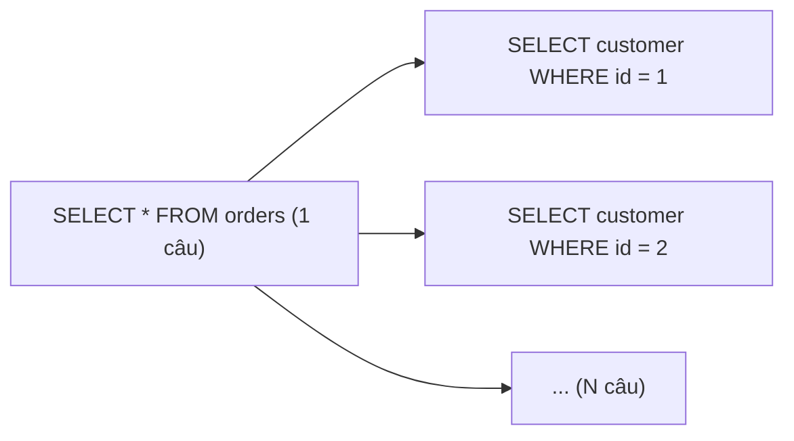

# Quan hệ giữa Entity

Dữ liệu thật hiếm khi đứng một mình: đơn hàng có nhiều dòng hàng, mỗi dòng trỏ tới một sản phẩm, sinh viên đăng ký nhiều môn học. Bài này trình bày cách ánh xạ các quan hệ `@OneToOne`, `@OneToMany`/`@ManyToOne`, `@ManyToMany`, khái niệm **owning side** và `mappedBy`, cascade và `orphanRemoval`, chiến lược tải LAZY/EAGER — và hai vấn đề hiệu năng/lỗi kinh điển nhất của Hibernate: **N+1 query** và **`LazyInitializationException`**.

---

:::note[Ghi nhớ nhanh]

- ⭐ **Mặc định mọi quan hệ nên là LAZY** — `@ManyToOne`/`@OneToOne` mặc định là EAGER, hãy đổi thành `fetch = FetchType.LAZY`.
- ⭐ **N+1 query**: 1 câu lấy danh sách + N câu lấy quan hệ cho từng phần tử; xử lý bằng `JOIN FETCH`, `@EntityGraph`, batch fetching hoặc DTO projection.
- **Owning side là phía giữ khoá ngoại** — Hibernate chỉ nhìn owning side khi ghi; phía có `mappedBy` chỉ để đọc.
- **Quan hệ hai chiều phải đồng bộ cả hai phía** bằng helper method (`addItem`, `removeItem`).
- **`@ManyToMany` thực tế thường thay bằng entity trung gian** để thêm cột (ngày đăng ký, điểm số).

:::

---

## Mục lục

- [Vì sao cần ánh xạ quan hệ?](#vì-sao-cần-ánh-xạ-quan-hệ)
- [ManyToOne và OneToMany](#manytoone-và-onetomany)
- [Owning side và mappedBy](#owning-side-và-mappedby)
- [OneToOne](#onetoone)
- [ManyToMany](#manytomany)
- [Cascade và orphanRemoval](#cascade-và-orphanremoval)
- [FetchType LAZY và EAGER](#fetchtype-lazy-và-eager)
- [Vấn đề N+1 query](#vấn-đề-n1-query)
- [LazyInitializationException](#lazyinitializationexception)
- [Câu hỏi phỏng vấn](#câu-hỏi-phỏng-vấn)

---

## Vì sao cần ánh xạ quan hệ?

**Vấn đề:** Nếu chỉ lưu khoá ngoại dạng số, code phải tự ghép dữ liệu:

```java
@Entity
public class OrderItem {
    @Id @GeneratedValue private Long id;
    private Long orderId;      // chỉ là con số
    private Long productId;
}

// Muốn hiển thị tên sản phẩm của từng dòng hàng:
for (OrderItem item : items) {
    Product p = productRepository.findById(item.getProductId()).orElseThrow(); // tự query
    ...
}
```

Mô hình mất tính hướng đối tượng, dễ quên kiểm tra toàn vẹn, và lặp lại code ghép dữ liệu khắp nơi.

**Giải pháp:** Khai báo quan hệ bằng tham chiếu object; Hibernate tự sinh JOIN hoặc query phụ khi cần:

```java
@Entity
public class OrderItem {
    @Id @GeneratedValue private Long id;

    @ManyToOne(fetch = FetchType.LAZY, optional = false)
    @JoinColumn(name = "product_id")
    private Product product;   // item.getProduct().getName()
}
```

:::tip[Dùng thực tế]

- Đơn hàng – dòng hàng (`@OneToMany` + `@ManyToOne`, cascade, orphanRemoval).
- User – hồ sơ chi tiết (`@OneToOne` dùng chung khoá chính với `@MapsId`).
- Bài viết – thẻ tag (`@ManyToMany` đơn giản) hoặc sinh viên – môn học có điểm (entity trung gian).
- Trang danh sách chậm bất thường → bật log SQL và tìm N+1.

:::

---

## ManyToOne và OneToMany

Đây là quan hệ phổ biến nhất. Ví dụ `Order` (1) – `OrderItem` (N):

```java
@Entity
@Table(name = "orders")
public class Order {
    @Id @GeneratedValue(strategy = GenerationType.IDENTITY)
    private Long id;

    @ManyToOne(fetch = FetchType.LAZY, optional = false)
    @JoinColumn(name = "customer_id")
    private Customer customer;

    @OneToMany(mappedBy = "order", cascade = CascadeType.ALL, orphanRemoval = true)
    private List<OrderItem> items = new ArrayList<>();

    // Helper giữ hai phía đồng bộ
    public void addItem(Product product, int quantity) {
        OrderItem item = new OrderItem(this, product, quantity, product.getPrice());
        items.add(item);
    }

    public void removeItem(OrderItem item) {
        items.remove(item);
        item.detachFromOrder();   // đặt order = null
    }

    public List<OrderItem> getItems() {
        return Collections.unmodifiableList(items);  // không cho bên ngoài sửa trực tiếp
    }
}

@Entity
@Table(name = "order_items")
public class OrderItem {
    @Id @GeneratedValue(strategy = GenerationType.IDENTITY)
    private Long id;

    @ManyToOne(fetch = FetchType.LAZY, optional = false)
    @JoinColumn(name = "order_id")          // cột khoá ngoại nằm ở bảng order_items
    private Order order;

    @ManyToOne(fetch = FetchType.LAZY, optional = false)
    @JoinColumn(name = "product_id")
    private Product product;

    private int quantity;
    private BigDecimal unitPrice;

    protected OrderItem() {
    }

    OrderItem(Order order, Product product, int quantity, BigDecimal unitPrice) {
        this.order = order;
        this.product = product;
        this.quantity = quantity;
        this.unitPrice = unitPrice;
    }

    void detachFromOrder() {
        this.order = null;
    }
}
```

Bảng sinh ra:

```sql
CREATE TABLE order_items (
    id         BIGSERIAL PRIMARY KEY,
    order_id   BIGINT NOT NULL REFERENCES orders(id),
    product_id BIGINT NOT NULL REFERENCES products(id),
    quantity   INT NOT NULL,
    unit_price NUMERIC(15,2)
);
```

:::warning[Lỗi hay gặp]

`@OneToMany` **một chiều** không có `mappedBy` và không có `@JoinColumn` → Hibernate tạo thêm **bảng trung gian** `orders_items` như quan hệ nhiều-nhiều, sinh thêm INSERT/DELETE thừa. Hãy dùng quan hệ hai chiều với `mappedBy`, hoặc chỉ `@ManyToOne` ở phía con nếu không cần duyệt từ cha.

:::

---

## Owning side và mappedBy

Trong quan hệ hai chiều, có hai tham chiếu Java (`order.items` và `item.order`) nhưng chỉ **một khoá ngoại** trong database. JPA cần biết phía nào quyết định giá trị của khoá ngoại:

- **Owning side** (phía sở hữu) — phía có `@JoinColumn`, với `@OneToMany`/`@ManyToOne` luôn là phía `@ManyToOne`. Hibernate **chỉ đọc phía này** khi ghi khoá ngoại.
- **Inverse side** (phía nghịch đảo) — phía có `mappedBy = "tênField"` trỏ tới field ở owning side. Thay đổi ở phía này **bị bỏ qua** khi ghi.

```java
Order order = orderRepository.findById(1L).orElseThrow();
OrderItem item = new OrderItem();
order.getItems().add(item);   // giả sử getter trả list gốc: chỉ thêm vào phía inverse
// item.order vẫn null → INSERT order_items với order_id = NULL → lỗi NOT NULL
```

Vì thế cần helper method như `addItem` ở trên để set **cả hai phía**.

:::tip[Ví dụ đời thường]

Quan hệ hai chiều giống **sổ hộ khẩu và căn cước công dân**. Thông tin "người này thuộc hộ nào" có giá trị pháp lý nằm ở **sổ hộ khẩu** (owning side, giữ khoá ngoại). Việc bạn tự ghi vào sổ tay cá nhân "tôi ở hộ ông A" (inverse side) không làm thay đổi gì ở phường. Muốn hợp lệ phải cập nhật đúng sổ hộ khẩu — và tốt nhất là cập nhật cả hai cho khớp nhau.

:::

---

## OneToOne

Ví dụ `User` – `UserProfile`. Cách hiệu quả nhất là **dùng chung khoá chính** với `@MapsId`:

```java
@Entity
public class UserProfile {
    @Id
    private Long id;                       // cũng là user_id

    @OneToOne(fetch = FetchType.LAZY, optional = false)
    @MapsId
    @JoinColumn(name = "id")
    private User user;

    private String bio;
    private String avatarUrl;
}
```

```java
UserProfile profile = profileRepository.findById(userId).orElseThrow(); // tìm thẳng theo user id
```

:::warning[Lỗi hay gặp]

Khai báo `@OneToOne(mappedBy = "user", fetch = LAZY)` ở phía **inverse** (`User.profile`) thường **không lazy được**: Hibernate không biết profile có tồn tại hay không nếu không query, nên phải tải ngay để quyết định gán `null` hay proxy. Cách tránh: dùng `@MapsId` và chỉ khai báo quan hệ ở phía profile, hoặc bật bytecode enhancement.

:::

---

## ManyToMany

Ví dụ bài viết – tag:

```java
@Entity
public class Post {
    @Id @GeneratedValue private Long id;

    @ManyToMany
    @JoinTable(name = "post_tags",
            joinColumns = @JoinColumn(name = "post_id"),
            inverseJoinColumns = @JoinColumn(name = "tag_id"))
    private Set<Tag> tags = new HashSet<>();     // dùng Set, không dùng List

    public void addTag(Tag tag) {
        tags.add(tag);
        tag.getPosts().add(this);
    }
}

@Entity
public class Tag {
    @Id @GeneratedValue private Long id;

    @Column(unique = true)
    private String name;

    @ManyToMany(mappedBy = "tags")
    private Set<Post> posts = new HashSet<>();
}
```

Khi quan hệ có **thuộc tính riêng** (ngày đăng ký, điểm, vai trò), tách thành entity trung gian:

```java
@Entity
public class Enrollment {
    @EmbeddedId
    private EnrollmentId id;           // (studentId, courseId)

    @ManyToOne(fetch = FetchType.LAZY) @MapsId("studentId")
    private Student student;

    @ManyToOne(fetch = FetchType.LAZY) @MapsId("courseId")
    private Course course;

    private LocalDate enrolledAt;
    private BigDecimal score;
}
```

:::warning[Lỗi hay gặp]

- `@ManyToMany` với `List` → khi xoá một phần tử, Hibernate **xoá toàn bộ** dòng của post trong bảng nối rồi INSERT lại phần còn lại. Dùng `Set`.
- `cascade = CascadeType.REMOVE` (hoặc `ALL`) trên `@ManyToMany` → xoá bài viết sẽ xoá luôn **tag** đang được bài khác dùng.

:::

---

## Cascade và orphanRemoval

**Cascade** lan truyền thao tác từ entity cha sang entity con.

| Kiểu | Lan truyền |
|------|------------|
| `PERSIST` | `persist(cha)` → persist các con mới |
| `MERGE` | `merge(cha)` → merge các con |
| `REMOVE` | `remove(cha)` → remove các con |
| `REFRESH`, `DETACH` | Tương tự cho refresh/detach |
| `ALL` | Tất cả các loại trên |

**`orphanRemoval = true`** — con bị **gỡ khỏi collection** của cha (không còn cha) sẽ bị DELETE.

```java
@Transactional
public void removeLine(Long orderId, Long itemId) {
    Order order = orderRepository.findById(orderId).orElseThrow();
    order.removeItemById(itemId);   // bên trong: items.removeIf(...) + item.detachFromOrder()
    // orphanRemoval → DELETE FROM order_items WHERE id = ?
}
```

| | `CascadeType.REMOVE` | `orphanRemoval = true` |
|---|----------------------|-------------------------|
| Kích hoạt khi | Xoá entity cha | Gỡ con khỏi collection (hoặc xoá cha) |
| Phù hợp | Con không tồn tại độc lập | Con thuộc trọn vẹn về cha (dòng hàng của đơn) |

Quy tắc: cascade chỉ dùng từ **cha xuống con** trong cùng một "aggregate" (đơn hàng → dòng hàng). Không cascade từ `@ManyToOne` lên cha, không cascade sang entity dùng chung (sản phẩm, tag, khách hàng).

---

## FetchType LAZY và EAGER

| Annotation | Mặc định |
|------------|----------|
| `@ManyToOne`, `@OneToOne` | **EAGER** |
| `@OneToMany`, `@ManyToMany` | LAZY |

- **EAGER** — luôn tải quan hệ cùng entity, kể cả khi không dùng. Không tắt được ở từng query.
- **LAZY** — Hibernate đặt một **proxy** (với quan hệ đơn) hoặc **collection bọc** (`PersistentBag`, `PersistentSet`), chỉ query khi bạn truy cập lần đầu.

Khuyến nghị: **khai báo mọi quan hệ LAZY**, rồi quyết định tải gì **theo từng use case** bằng fetch join hoặc entity graph. EAGER là quyết định toàn cục, không gỡ được, và chính nó thường gây ra N+1 khi dùng JPQL.

```java
@ManyToOne(fetch = FetchType.LAZY)   // luôn ghi rõ
private Customer customer;
```

---

## Vấn đề N+1 query

```java
@Transactional(readOnly = true)
public List<OrderSummary> listOrders() {
    List<Order> orders = orderRepository.findAll();               // 1 câu: SELECT * FROM orders
    return orders.stream()
            .map(o -> new OrderSummary(o.getId(),
                    o.getCustomer().getName(),                     // N câu: SELECT customer theo id
                    o.getItems().size()))                          // N câu: SELECT items theo order_id
            .toList();
}
// 100 đơn hàng → 1 + 100 + 100 = 201 câu query
```



:::tip[Ví dụ đời thường]

N+1 giống **đi chợ mà mỗi món lại chạy về nhà hỏi mẹ một lần**: mua rau, chạy về hỏi "mua bao nhiêu?"; mua thịt, lại chạy về hỏi. Hai mươi món là hai mươi chuyến. Fetch join là **cầm sẵn danh sách đầy đủ** từ nhà đi một lượt.

:::

**Cách 1 — `JOIN FETCH` trong JPQL:**

```java
public interface OrderRepository extends JpaRepository<Order, Long> {

    @Query("select o from Order o join fetch o.customer where o.status = :status")
    List<Order> findWithCustomer(@Param("status") OrderStatus status);

    @Query("select distinct o from Order o join fetch o.items i join fetch i.product where o.id = :id")
    Optional<Order> findDetail(@Param("id") Long id);
}
```

**Cách 2 — `@EntityGraph`** (khai báo quan hệ cần tải, không phải viết JPQL):

```java
@EntityGraph(attributePaths = {"customer", "items"})
List<Order> findByStatus(OrderStatus status);
```

**Cách 3 — Batch fetching**: thay vì N câu, Hibernate gom thành vài câu `WHERE id IN (...)`:

```yaml
spring:
  jpa:
    properties:
      hibernate:
        default_batch_fetch_size: 50
```

**Cách 4 — DTO projection** cho màn hình chỉ đọc (hiệu quả nhất, không tải entity):

```java
public record OrderSummary(Long id, String customerName, long itemCount) {}

@Query("""
       select new com.shop.order.OrderSummary(o.id, c.name, count(i))
       from Order o join o.customer c left join o.items i
       group by o.id, c.name
       """)
List<OrderSummary> findSummaries();
```

| Cách | Ưu điểm | Hạn chế |
|------|---------|---------|
| `JOIN FETCH` | Một câu query, kiểm soát rõ | Fetch collection + phân trang bị xử lý trong bộ nhớ |
| `@EntityGraph` | Gọn, dùng được với method query | Cùng hạn chế với collection |
| Batch fetching | Cấu hình một lần, áp dụng toàn bộ | Vẫn nhiều hơn một câu |
| DTO projection | Nhanh nhất, chỉ lấy cột cần | Không có entity để sửa |

:::warning[Lỗi hay gặp]

- `JOIN FETCH` một **collection** kèm `Pageable` → Hibernate cảnh báo `HHH90003004: firstResult/maxResults specified with collection fetch; applying in memory` và tải **toàn bộ** bản ghi vào RAM để phân trang. Hãy phân trang id trước rồi fetch theo danh sách id, hoặc dùng batch fetching.
- Fetch join **hai collection kiểu `List`** cùng lúc → `MultipleBagFetchException`. Đổi một trong hai sang `Set`, hoặc tách thành hai query.

:::

---

## LazyInitializationException

```
org.hibernate.LazyInitializationException:
  failed to lazily initialize a collection of role: com.shop.Order.items:
  could not initialize proxy - no Session
```

Nguyên nhân: truy cập quan hệ LAZY **sau khi persistence context đã đóng** (entity đã detached), ví dụ trong controller, trong Jackson khi serialize, hoặc trong thread khác.

```java
@GetMapping("/api/orders/{id}")
public Order get(@PathVariable Long id) {
    return orderService.findById(id);   // transaction đã kết thúc
}   // Jackson gọi getItems() → LazyInitializationException (khi open-in-view tắt)
```

Cách xử lý đúng:

1. **Tải đủ dữ liệu trong transaction** bằng fetch join / `@EntityGraph`.
2. **Chuyển sang DTO ngay trong service** (bên trong `@Transactional`), controller chỉ nhận DTO.

Cách **không** nên dùng:

- Đổi sang `FetchType.EAGER` — giải quyết triệu chứng, gây N+1 và tải thừa ở mọi nơi khác.
- `hibernate.enable_lazy_load_no_trans=true` — mỗi lần truy cập lazy mở một kết nối mới, N+1 ngầm.
- Dựa vào **Open Session in View**.

:::note[Open Session in View]

Spring Boot mặc định bật `spring.jpa.open-in-view=true`: persistence context mở suốt request, kể cả lúc render view/JSON, nên lazy loading "chạy được" ở controller. Đổi lại kết nối DB bị giữ lâu hơn và query phát sinh ngoài tầm kiểm soát. Boot in cảnh báo khi khởi động nếu bạn không cấu hình rõ. Với REST API, nên đặt `spring.jpa.open-in-view: false` và tải dữ liệu chủ động.

:::

---

## Câu hỏi phỏng vấn

**1. Owning side là gì? mappedBy dùng để làm gì?**

<details className="qa">
<summary>Xem đáp án</summary>

Trong quan hệ hai chiều chỉ có một khoá ngoại, nên JPA chọn một phía làm owning side — phía giữ `@JoinColumn` (với 1-N là phía `@ManyToOne`). Hibernate chỉ dựa vào owning side để ghi khoá ngoại. `mappedBy` đánh dấu phía inverse, chỉ ra field nào ở owning side quản lý quan hệ; thay đổi chỉ ở phía inverse sẽ không được lưu.

</details>

**2. N+1 query là gì và cách xử lý?**

<details className="qa">
<summary>Xem đáp án</summary>

Là khi 1 câu query lấy N bản ghi, rồi truy cập quan hệ của từng bản ghi sinh thêm N câu query. Xử lý: `JOIN FETCH` trong JPQL, `@EntityGraph`, batch fetching (`default_batch_fetch_size` hoặc `@BatchSize`) để gom thành câu `IN`, hoặc DTO projection chỉ lấy cột cần thiết. Phát hiện bằng log SQL hoặc thống kê Hibernate.

</details>

**3. Vì sao nên để @ManyToOne là LAZY?**

<details className="qa">
<summary>Xem đáp án</summary>

Mặc định của `@ManyToOne` là EAGER, nên mọi truy vấn entity đều kéo theo quan hệ, kể cả khi không dùng. Với JPQL, EAGER thường được tải bằng câu query phụ cho từng bản ghi, gây N+1. EAGER không thể tắt theo từng query, còn LAZY có thể bật tải theo use case bằng fetch join hoặc entity graph.

</details>

**4. CascadeType.REMOVE khác orphanRemoval thế nào?**

<details className="qa">
<summary>Xem đáp án</summary>

`CascadeType.REMOVE` xoá con khi entity cha bị xoá. `orphanRemoval = true` còn xoá con khi nó bị gỡ khỏi collection của cha (trở thành mồ côi), kể cả khi cha vẫn tồn tại. `orphanRemoval` phù hợp khi con không có ý nghĩa nếu tách khỏi cha, như dòng hàng của đơn hàng.

</details>

**5. LazyInitializationException xảy ra khi nào và xử lý thế nào?**

<details className="qa">
<summary>Xem đáp án</summary>

Khi truy cập quan hệ LAZY chưa được tải sau khi persistence context đã đóng (entity detached). Xử lý: tải sẵn dữ liệu cần dùng trong transaction bằng fetch join/entity graph, và chuyển sang DTO ngay trong tầng service. Tránh dùng EAGER, `enable_lazy_load_no_trans` hay dựa vào Open Session in View để che lỗi.

</details>

**6. Vì sao không nên dùng List cho @ManyToMany?**

<details className="qa">
<summary>Xem đáp án</summary>

Hibernate coi `List` không có cột thứ tự là "bag"; khi xoá một phần tử, nó không xác định được dòng cụ thể trong bảng nối nên xoá hết rồi chèn lại phần còn lại. Với `Set`, nó xoá đúng một dòng. Ngoài ra fetch join nhiều bag cùng lúc gây `MultipleBagFetchException`.

</details>

**7. Phân trang khi fetch join collection có vấn đề gì?**

<details className="qa">
<summary>Xem đáp án</summary>

Join với collection nhân số dòng kết quả, nên `LIMIT/OFFSET` ở SQL không còn đúng theo số entity cha. Hibernate vì vậy bỏ phân trang ở SQL, tải toàn bộ rồi phân trang trong bộ nhớ và cảnh báo HHH90003004. Cách đúng: query phân trang lấy danh sách id trước, sau đó fetch join theo các id đó, hoặc dùng batch fetching.

</details>
