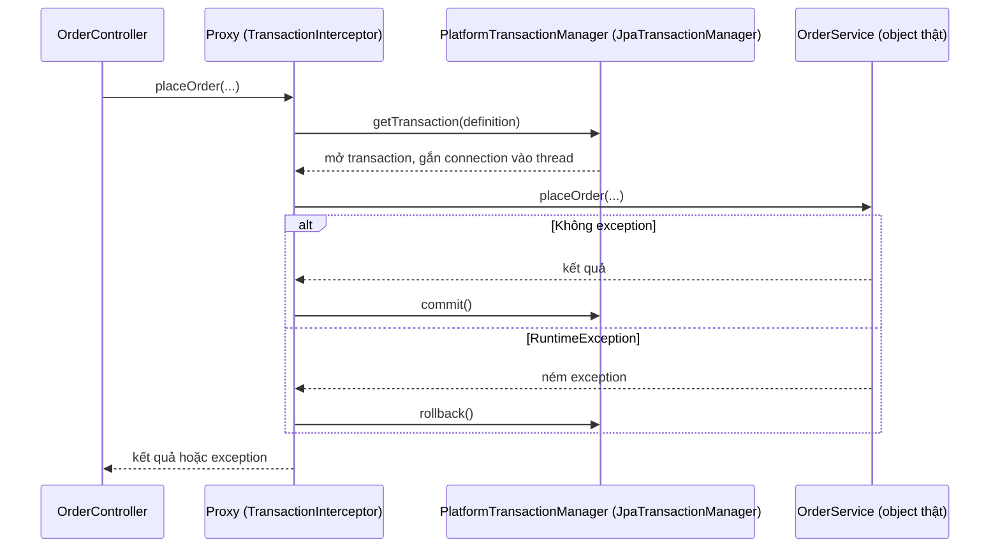
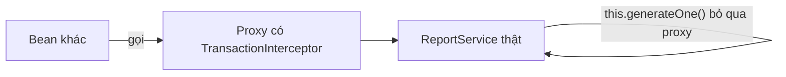
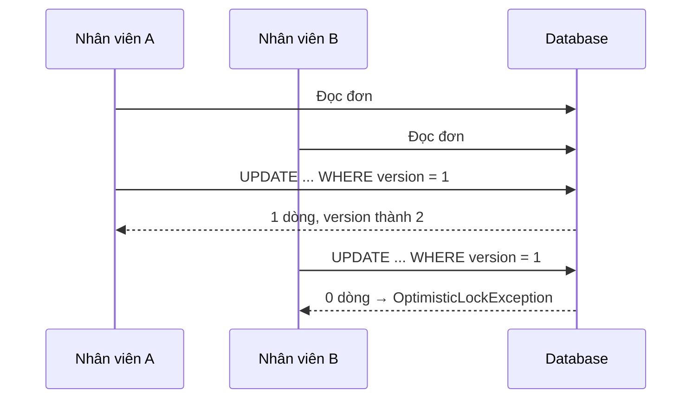

# Transaction

Transaction (giao dịch) đảm bảo một nhóm thao tác với database hoặc **thành công trọn vẹn**, hoặc **không để lại dấu vết gì**. Spring cung cấp `@Transactional` để quản lý transaction theo kiểu khai báo, nhưng đằng sau annotation đơn giản đó là proxy AOP, các quy tắc propagation, isolation, rollback mà nếu không hiểu sẽ gây lỗi rất khó tìm: transaction không mở, exception không rollback, dữ liệu bị ghi đè. Bài này giải thích từng phần và kết thúc bằng optimistic locking với `@Version`.

---

:::note[Ghi nhớ nhanh]

- ⭐ **Mặc định chỉ rollback với unchecked exception** (`RuntimeException`, `Error`) — checked exception vẫn **commit**, trừ khi khai báo `rollbackFor`.
- ⭐ **Self-invocation không qua proxy** — gọi method `@Transactional` từ method khác trong cùng lớp thì annotation bị bỏ qua.
- **Propagation mặc định `REQUIRED`** — tham gia transaction đang có, chưa có thì mở mới; `REQUIRES_NEW` luôn mở transaction riêng.
- **Isolation mặc định là của database** (PostgreSQL, SQL Server, Oracle: READ COMMITTED; MySQL InnoDB: REPEATABLE READ).
- **`@Version` (optimistic locking)** chống mất cập nhật khi hai người cùng sửa một bản ghi.

:::

---

## Mục lục

- [Vì sao cần quản lý transaction?](#vì-sao-cần-quản-lý-transaction)
- [ACID và Transactional](#acid-và-transactional)
- [Transactional hoạt động thế nào?](#transactional-hoạt-động-thế-nào)
- [Propagation](#propagation)
- [Isolation](#isolation)
- [Rollback rules: checked và unchecked](#rollback-rules-checked-và-unchecked)
- [readOnly](#readonly)
- [Bẫy self-invocation do proxy](#bẫy-self-invocation-do-proxy)
- [Optimistic locking với Version](#optimistic-locking-với-version)
- [Câu hỏi phỏng vấn](#câu-hỏi-phỏng-vấn)

---

## Vì sao cần quản lý transaction?

**Vấn đề:** Với JDBC thuần, bạn phải tự tắt auto-commit, tự commit, tự rollback, tự đóng kết nối — và truyền cùng một `Connection` qua mọi tầng:

```java
public void transfer(long fromId, long toId, BigDecimal amount) throws SQLException {
    Connection conn = dataSource.getConnection();
    try {
        conn.setAutoCommit(false);
        accountDao.withdraw(conn, fromId, amount);   // phải truyền conn vào từng DAO
        accountDao.deposit(conn, toId, amount);
        conn.commit();
    } catch (SQLException | RuntimeException e) {
        conn.rollback();
        throw e;
    } finally {
        conn.close();
    }
}
```

Code hạ tầng lẫn với nghiệp vụ, dễ quên rollback, và đổi từ JDBC sang JPA là phải viết lại.

**Giải pháp:** `@Transactional` khai báo ranh giới transaction; Spring lo mở, gắn kết nối vào thread, commit hoặc rollback:

```java
@Service
public class TransferService {
    private final AccountRepository accounts;

    public TransferService(AccountRepository accounts) {
        this.accounts = accounts;
    }

    @Transactional
    public void transfer(Long fromId, Long toId, BigDecimal amount) {
        Account from = accounts.findById(fromId).orElseThrow();
        Account to = accounts.findById(toId).orElseThrow();
        from.withdraw(amount);     // ném InsufficientBalanceException (unchecked) nếu không đủ tiền
        to.deposit(amount);
    }   // không exception → commit; RuntimeException → rollback cả hai
}
```

:::tip[Dùng thực tế]

- Chuyển tiền, đặt hàng trừ kho: nhiều thao tác phải cùng thành công.
- Ghi log kiểm toán (audit) **vẫn phải lưu dù nghiệp vụ chính rollback** → `REQUIRES_NEW`.
- Màn hình báo cáo chỉ đọc → `@Transactional(readOnly = true)` để giảm chi phí dirty checking.
- Hai nhân viên cùng sửa một đơn hàng → `@Version` để người lưu sau nhận lỗi thay vì ghi đè.

:::

---

## ACID và Transactional

| Tính chất | Ý nghĩa |
|-----------|---------|
| **Atomicity** (nguyên tử) | Tất cả hoặc không gì cả |
| **Consistency** (nhất quán) | Dữ liệu luôn thoả các ràng buộc sau transaction |
| **Isolation** (cô lập) | Các transaction đồng thời không thấy trạng thái dở dang của nhau (ở mức nào tuỳ isolation level) |
| **Durability** (bền vững) | Đã commit thì không mất dù server sập |

:::tip[Ví dụ đời thường]

Transaction giống **chuyển khoản ngân hàng**: tiền phải **trừ ở tài khoản bạn và cộng vào tài khoản người nhận cùng lúc**. Nếu mất điện giữa chừng, ngân hàng không được để tình trạng "đã trừ mà chưa cộng" — cả giao dịch bị huỷ như chưa từng xảy ra (rollback).

:::

Các thuộc tính của `@Transactional` (`org.springframework.transaction.annotation.Transactional`):

```java
@Transactional(
    propagation = Propagation.REQUIRED,      // mặc định
    isolation = Isolation.DEFAULT,           // dùng mức của DB
    readOnly = false,
    timeout = 30,                            // giây
    rollbackFor = Exception.class,           // thêm loại exception gây rollback
    noRollbackFor = BusinessWarning.class)
```

Có thể đặt trên lớp (áp dụng cho mọi method public) và ghi đè ở từng method.

---

## Transactional hoạt động thế nào?

Spring tạo một **proxy** bao quanh bean. Lời gọi từ bên ngoài đi qua `TransactionInterceptor`:



Hệ quả quan trọng:

- Chỉ lời gọi **đi qua proxy** mới có transaction.
- Kết nối và persistence context được gắn vào **thread hiện tại** (`TransactionSynchronizationManager`); code chạy ở thread khác (`@Async`, `CompletableFuture`) **không** chung transaction.
- Exception bị bắt và "nuốt" bên trong method thì proxy không thấy → vẫn commit.

---

## Propagation

**Propagation** quy định hành vi khi một method `@Transactional` được gọi trong lúc đã có (hoặc chưa có) transaction.

| Propagation | Đã có transaction | Chưa có transaction |
|-------------|-------------------|---------------------|
| `REQUIRED` (mặc định) | Tham gia | Mở mới |
| `REQUIRES_NEW` | **Tạm dừng** transaction cũ, mở transaction mới độc lập | Mở mới |
| `SUPPORTS` | Tham gia | Chạy không transaction |
| `MANDATORY` | Tham gia | Ném exception |
| `NOT_SUPPORTED` | Tạm dừng, chạy không transaction | Chạy không transaction |
| `NEVER` | Ném exception | Chạy không transaction |
| `NESTED` | Tạo **savepoint** trong transaction hiện tại | Mở mới |

Ví dụ `REQUIRES_NEW` cho audit log:

```java
@Service
public class AuditService {
    private final AuditLogRepository repo;

    public AuditService(AuditLogRepository repo) {
        this.repo = repo;
    }

    @Transactional(propagation = Propagation.REQUIRES_NEW)
    public void record(String action, String detail) {
        repo.save(new AuditLog(action, detail));   // commit riêng, không bị rollback theo nghiệp vụ
    }
}

@Service
public class OrderService {
    private final AuditService auditService;
    // ...

    @Transactional
    public void cancel(Long orderId) {
        auditService.record("CANCEL_ATTEMPT", "order=" + orderId);  // đã commit
        Order order = orderRepository.findById(orderId).orElseThrow();
        order.cancel();   // nếu ném exception → hủy đơn rollback, audit vẫn còn
    }
}
```

:::warning[Lỗi hay gặp]

**`UnexpectedRollbackException: Transaction silently rolled back because it has been marked as rollback-only`**

```java
@Transactional
public void outer() {
    try {
        inner.process();          // REQUIRED, ném RuntimeException
    } catch (RuntimeException e) {
        log.warn("bỏ qua lỗi");   // tưởng là đã xử lý xong
    }
}   // commit → UnexpectedRollbackException
```

`inner` tham gia **cùng** transaction; khi nó ném exception, proxy của `inner` đánh dấu cả transaction là rollback-only. `outer` bắt exception nhưng transaction đã "hỏng", nên lúc commit Spring ném lỗi trên. Nếu muốn lỗi của `inner` không ảnh hưởng `outer`, dùng `REQUIRES_NEW` (hoặc `NESTED` với JDBC/savepoint) cho `inner`.

:::

`REQUIRES_NEW` chiếm thêm **một kết nối** từ pool trong lúc transaction cũ vẫn giữ kết nối của nó. Dùng tràn lan dưới tải cao có thể làm cạn pool và treo (deadlock pool).

---

## Isolation

**Isolation level** quy định một transaction thấy được bao nhiêu thay đổi của transaction khác đang chạy song song. Các hiện tượng cần tránh:

- **Dirty read** — đọc dữ liệu transaction khác **chưa commit** (có thể bị rollback).
- **Non-repeatable read** — đọc cùng một dòng hai lần ra hai giá trị khác nhau (do transaction khác commit giữa chừng).
- **Phantom read** — chạy cùng một query điều kiện hai lần, lần sau xuất hiện thêm/bớt dòng.

| Isolation | Dirty read | Non-repeatable read | Phantom read |
|-----------|-----------|---------------------|--------------|
| `READ_UNCOMMITTED` | Có thể | Có thể | Có thể |
| `READ_COMMITTED` | Không | Có thể | Có thể |
| `REPEATABLE_READ` | Không | Không | Có thể (theo chuẩn SQL) |
| `SERIALIZABLE` | Không | Không | Không |

```java
@Transactional(isolation = Isolation.REPEATABLE_READ)
public Report buildMonthlyReport() { ... }
```

Thực tế, hiện thực ở từng DB khác chuẩn: PostgreSQL REPEATABLE READ là snapshot isolation (cũng không có phantom), MySQL InnoDB REPEATABLE READ dùng MVCC + gap lock. Isolation cao hơn → nhiều khoá/xung đột hơn → thông lượng thấp hơn và có thể phải retry (`SERIALIZABLE` ở PostgreSQL ném lỗi serialization failure).

:::warning[Lỗi hay gặp]

Isolation **không** chống được lost update kiểu "đọc – sửa trong Java – ghi lại" ở READ COMMITTED: hai request cùng đọc `stock = 10`, cùng trừ 1, cùng ghi `9` — mất một lượt bán. Giải pháp: optimistic locking (`@Version`), pessimistic locking (`SELECT ... FOR UPDATE` qua `@Lock(LockModeType.PESSIMISTIC_WRITE)`), hoặc câu UPDATE nguyên tử `UPDATE products SET stock = stock - 1 WHERE id = ? AND stock > 0`.

:::

---

## Rollback rules: checked và unchecked

Mặc định Spring **chỉ rollback** khi gặp `RuntimeException` hoặc `Error`. **Checked exception** (kế thừa `Exception` nhưng không phải `RuntimeException`) → **vẫn commit**. Quy tắc này kế thừa từ EJB: checked exception được coi là "kết quả nghiệp vụ có thể dự đoán".

```java
@Transactional
public void importFile(Path file) throws IOException {
    productRepository.save(new Product(...));      // đã thực hiện
    Files.readAllLines(file);                       // ném IOException (checked)
}   // → COMMIT, sản phẩm vẫn được lưu dù import thất bại!

@Transactional(rollbackFor = Exception.class)      // rollback với mọi exception
public void importFileSafe(Path file) throws IOException { ... }
```

| Exception | Mặc định |
|-----------|----------|
| `RuntimeException` và lớp con (`IllegalStateException`, `DataAccessException`...) | Rollback |
| `Error` | Rollback |
| Checked exception (`IOException`, exception nghiệp vụ tự định nghĩa kế thừa `Exception`) | **Commit** |

Khuyến nghị: exception nghiệp vụ kế thừa `RuntimeException`; nếu buộc dùng checked exception thì khai báo `rollbackFor`.

:::warning[Lỗi hay gặp]

- Bắt exception bên trong method rồi trả về `false`/`null` → proxy không thấy exception → commit dữ liệu dở dang. Nếu bắt thì phải ném lại, hoặc gọi `TransactionAspectSupport.currentTransactionStatus().setRollbackOnly()`.
- Dùng `jakarta.transaction.Transactional` thay vì của Spring: vẫn được Spring hỗ trợ nhưng thuộc tính khác (`rollbackOn`, không có `readOnly`, `propagation` theo kiểu `TxType`). Thống nhất dùng `org.springframework.transaction.annotation.Transactional`.

:::

---

## readOnly

```java
@Service
@Transactional(readOnly = true)          // mặc định cho cả lớp: chỉ đọc
public class ProductQueryService {

    public List<ProductResponse> search(String keyword) { ... }

    @Transactional                        // ghi đè cho method cần ghi
    public void updatePrice(Long id, BigDecimal price) { ... }
}
```

`readOnly = true` mang lại:

- Hibernate đặt flush mode `MANUAL` và (từ Spring 5.1) không giữ snapshot cho dirty checking → tiết kiệm bộ nhớ và CPU.
- Gợi ý cho JDBC driver/DB (`Connection.setReadOnly(true)`); một số cấu hình định tuyến tới **replica** đọc dựa vào cờ này.

`readOnly` **không phải** cơ chế bảo mật: không đảm bảo chặn mọi câu ghi (ví dụ native UPDATE vẫn có thể chạy tuỳ DB/driver). Nó là tối ưu hoá và tài liệu hoá ý định.

---

## Bẫy self-invocation do proxy

```java
@Service
public class ReportService {

    public void generateAll() {
        for (Long id : ids()) {
            generateOne(id);              // gọi qua "this", KHÔNG qua proxy
        }
    }

    @Transactional(propagation = Propagation.REQUIRES_NEW)
    public void generateOne(Long id) { ... }   // annotation bị bỏ qua hoàn toàn
}
```



Cách khắc phục:

1. **Tách method sang bean khác** (cách sạch nhất):

```java
@Service
public class ReportService {
    private final SingleReportGenerator generator;   // bean riêng có @Transactional

    public ReportService(SingleReportGenerator generator) {
        this.generator = generator;
    }

    public void generateAll() {
        ids().forEach(generator::generateOne);       // đi qua proxy
    }
}
```

2. **Dùng `TransactionTemplate`** — quản lý transaction bằng code, không phụ thuộc proxy:

```java
@Service
public class ReportService {
    private final TransactionTemplate requiresNew;

    public ReportService(PlatformTransactionManager tm) {
        TransactionTemplate template = new TransactionTemplate(tm);
        template.setPropagationBehavior(TransactionDefinition.PROPAGATION_REQUIRES_NEW);
        this.requiresNew = template;
    }

    public void generateAll() {
        for (Long id : ids()) {
            requiresNew.executeWithoutResult(status -> doGenerate(id));
        }
    }
}
```

Các trường hợp `@Transactional` cũng **không có tác dụng** vì cùng lý do proxy: method `private`; method `final` hoặc lớp `final` (CGLIB không ghi đè được); object tự `new` thay vì lấy từ Spring container; gọi trong constructor hoặc `@PostConstruct`. (Từ Spring 6, method `protected` và package-private cũng được hỗ trợ với proxy CGLIB, nhưng nên giữ `@Transactional` trên method public cho rõ ràng.)

:::tip[Ví dụ đời thường]

Proxy giống **cô thư ký** của giám đốc: mọi cuộc gọi từ bên ngoài đều qua cô ấy, cô ghi sổ, ghi âm cuộc gọi (mở transaction) rồi mới nối máy. Nhưng nếu giám đốc **tự nói chuyện với chính mình** trong phòng, cô thư ký không hề biết, chẳng có gì được ghi lại.

:::

---

## Optimistic locking với Version

**Lost update** (mất cập nhật): hai người cùng mở đơn hàng phiên bản 1, A sửa địa chỉ và lưu, B sửa ghi chú và lưu sau — thay đổi của A bị ghi đè mà không ai biết.

**Optimistic locking** (khoá lạc quan) giả định xung đột hiếm: không khoá khi đọc, chỉ kiểm tra lúc ghi bằng một cột phiên bản.

```java
@Entity
public class Order {
    @Id @GeneratedValue private Long id;

    @Version
    private Long version;        // Hibernate tự tăng mỗi lần UPDATE

    private String shippingAddress;
    private String note;
}
```

Câu UPDATE Hibernate sinh ra:

```sql
UPDATE orders SET shipping_address = ?, note = ?, version = 2
WHERE id = ? AND version = 1
```

Nếu đã có người cập nhật (version không còn là 1) → 0 dòng bị ảnh hưởng → Hibernate ném `OptimisticLockException`, Spring dịch thành `ObjectOptimisticLockingFailureException`.



Với REST API, gửi `version` cho client và nhận lại khi cập nhật để phát hiện xung đột **giữa các request** (người dùng mở form lâu):

```java
public record UpdateOrderRequest(String shippingAddress, String note, Long version) {}

@Transactional
public OrderResponse update(Long id, UpdateOrderRequest req) {
    Order order = orderRepository.findById(id).orElseThrow();
    if (!order.getVersion().equals(req.version())) {
        throw new ConcurrentModificationConflictException(id);   // → 409 Conflict
    }
    order.changeShipping(req.shippingAddress(), req.note());
    return OrderResponse.from(order);
}
```

```java
@ExceptionHandler({ObjectOptimisticLockingFailureException.class, ConcurrentModificationConflictException.class})
public ProblemDetail handleConflict(RuntimeException ex) {
    return ProblemDetail.forStatusAndDetail(HttpStatus.CONFLICT,
            "Dữ liệu đã được người khác cập nhật, vui lòng tải lại");
}
```

| | Optimistic (`@Version`) | Pessimistic (`@Lock(PESSIMISTIC_WRITE)`) |
|---|------------------------|-------------------------------------------|
| Khoá khi đọc | Không | Có (`SELECT ... FOR UPDATE`) |
| Xung đột phát hiện | Lúc ghi, ném exception | Không xảy ra, request sau phải chờ |
| Phù hợp | Xung đột hiếm, thao tác của người dùng | Xung đột thường xuyên, thao tác ngắn (trừ kho, giữ ghế) |
| Rủi ro | Phải xử lý retry/thông báo | Chờ khoá, deadlock, giảm thông lượng |

---

## Câu hỏi phỏng vấn

**1. @Transactional hoạt động như thế nào bên dưới?**

<details className="qa">
<summary>Xem đáp án</summary>

Spring tạo proxy (JDK dynamic proxy hoặc CGLIB) bao quanh bean. Lời gọi qua proxy đi vào `TransactionInterceptor`, nó dùng `PlatformTransactionManager` (với JPA là `JpaTransactionManager`) để mở hoặc tham gia transaction theo propagation, gắn connection/EntityManager vào thread, gọi method thật, rồi commit hoặc rollback theo rollback rules.

</details>

**2. Vì sao @Transactional không có tác dụng khi gọi method trong cùng lớp?**

<details className="qa">
<summary>Xem đáp án</summary>

Vì lời gọi `this.method()` đi thẳng vào object gốc, không qua proxy nên interceptor không chạy. Khắc phục: tách method sang bean khác, dùng `TransactionTemplate`, hoặc (ít khuyến khích) tự inject chính mình qua proxy, hoặc dùng AspectJ weaving thay cho proxy.

</details>

**3. Exception nào làm transaction rollback mặc định?**

<details className="qa">
<summary>Xem đáp án</summary>

`RuntimeException` và `Error`. Checked exception mặc định vẫn commit. Muốn rollback với checked exception phải khai báo `rollbackFor`. Exception bị bắt và không ném lại thì proxy không thấy, transaction vẫn commit.

</details>

**4. REQUIRED và REQUIRES_NEW khác nhau thế nào?**

<details className="qa">
<summary>Xem đáp án</summary>

`REQUIRED` tham gia transaction đang có (cùng commit/rollback), chưa có thì mở mới. `REQUIRES_NEW` luôn mở transaction mới độc lập, tạm dừng transaction bên ngoài; commit/rollback của nó không phụ thuộc bên ngoài. `REQUIRES_NEW` dùng thêm một kết nối DB, dùng nhiều dễ cạn connection pool.

</details>

**5. UnexpectedRollbackException xảy ra khi nào?**

<details className="qa">
<summary>Xem đáp án</summary>

Khi method bên trong (cùng transaction, propagation REQUIRED) ném RuntimeException làm transaction bị đánh dấu rollback-only, nhưng method bên ngoài bắt exception đó và cố commit. Spring phát hiện transaction đã rollback-only nên rollback và ném `UnexpectedRollbackException` để báo cho caller biết.

</details>

**6. Isolation level là gì? Mặc định trong Spring là gì?**

<details className="qa">
<summary>Xem đáp án</summary>

Là mức cô lập giữa các transaction đồng thời, quyết định có xảy ra dirty read, non-repeatable read, phantom read hay không. Spring mặc định `Isolation.DEFAULT`, tức dùng mức mặc định của database: READ COMMITTED với PostgreSQL, Oracle, SQL Server; REPEATABLE READ với MySQL InnoDB.

</details>

**7. Optimistic locking và pessimistic locking khác nhau ra sao?**

<details className="qa">
<summary>Xem đáp án</summary>

Optimistic dùng cột `@Version`, không khoá khi đọc; lúc UPDATE thêm điều kiện `version = ?`, nếu không dòng nào bị ảnh hưởng thì ném `OptimisticLockException`. Phù hợp khi xung đột hiếm. Pessimistic khoá dòng ngay khi đọc (`SELECT ... FOR UPDATE`), transaction khác phải chờ; phù hợp khi xung đột thường xuyên và thao tác ngắn, nhưng có rủi ro chờ khoá và deadlock.

</details>

**8. readOnly = true có tác dụng gì?**

<details className="qa">
<summary>Xem đáp án</summary>

Với Hibernate, flush mode chuyển sang MANUAL và không giữ snapshot cho dirty checking, giảm bộ nhớ và CPU. Cờ read-only cũng được truyền cho JDBC connection, có thể dùng để định tuyến sang replica. Nó là tối ưu hoá và thể hiện ý định, không phải cơ chế bảo đảm chặn ghi.

</details>
