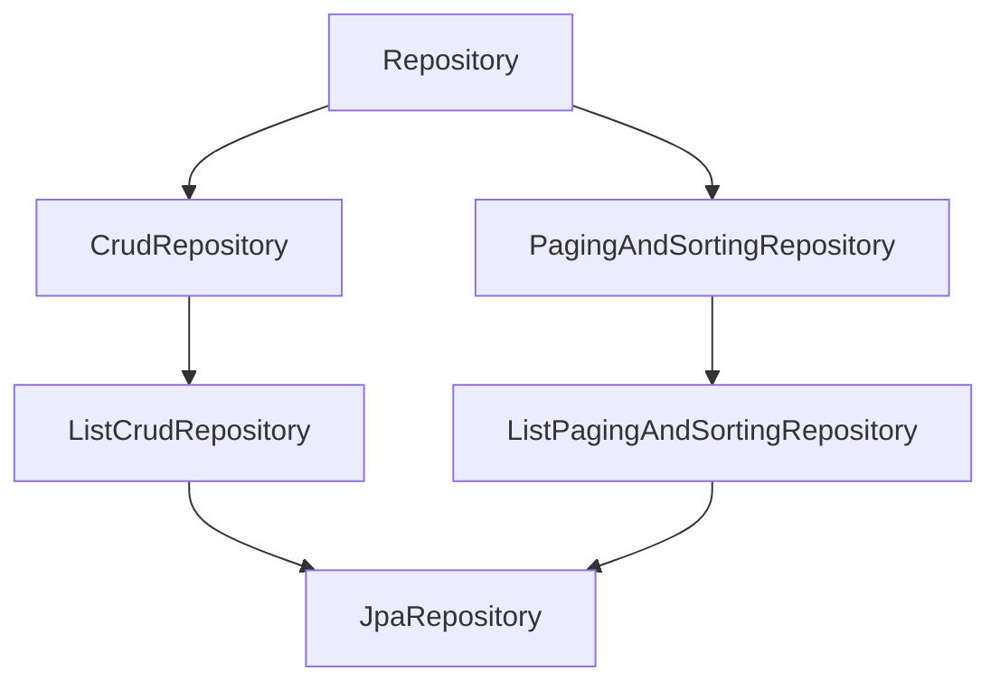

# Spring Data JPA

Spring Data JPA là lớp trừu tượng nằm trên JPA/Hibernate, cho phép bạn truy cập database chỉ bằng cách **khai báo một interface** — Spring tự sinh phần cài đặt lúc chạy. Bài này đi qua hệ thống Repository, cách đặt tên method để Spring tự sinh query, `@Query` với JPQL và native SQL, phân trang, projection, `Specification` cho truy vấn động và auditing. Đây là phần bạn sẽ dùng hằng ngày trong gần như mọi dự án Spring Boot có database quan hệ.

---

:::note[Ghi nhớ nhanh]

- ⭐ **Chỉ cần interface kế thừa `JpaRepository`** — Spring tạo proxy cài đặt sẵn CRUD, phân trang, sắp xếp; bạn không viết class DAO.
- ⭐ **Derived query method** — tên method như `findByEmailAndStatus` được parse thành JPQL; sai tên field là ứng dụng **không khởi động được**.
- **`@Query`** cho truy vấn phức tạp: JPQL (theo tên entity) mặc định, `nativeQuery = true` khi cần SQL thuần; câu UPDATE/DELETE phải thêm `@Modifying`.
- **`Pageable` + `Page`/`Slice`** để phân trang; `Page` chạy thêm câu `count`, `Slice` thì không.
- **Projection** (interface/record) để chỉ lấy vài cột; **`Specification`** để ghép điều kiện lọc động; **auditing** tự điền `@CreatedDate`, `@LastModifiedDate`.

:::

---

## Mục lục

- [Vì sao Spring Data JPA ra đời?](#vì-sao-spring-data-jpa-ra-đời)
- [Hệ thống Repository](#hệ-thống-repository)
- [Derived query method](#derived-query-method)
- [Truy vấn với @Query](#truy-vấn-với-query)
- [Phân trang và sắp xếp](#phân-trang-và-sắp-xếp)
- [Projection](#projection)
- [Specification cho truy vấn động](#specification-cho-truy-vấn-động)
- [Auditing](#auditing)
- [Câu hỏi phỏng vấn](#câu-hỏi-phỏng-vấn)

---

## Vì sao Spring Data JPA ra đời?

**Vấn đề:** Với JPA thuần, mỗi entity bạn phải viết một lớp DAO lặp đi lặp lại cùng một khuôn: inject `EntityManager`, viết `find`, `persist`, `merge`, `remove`, rồi tự viết JPQL cho từng câu tìm kiếm.

```java
@Repository
public class UserDao {

    @PersistenceContext
    private EntityManager em;

    public User findById(Long id) {
        return em.find(User.class, id);
    }

    public List<User> findByEmail(String email) {
        return em.createQuery("select u from User u where u.email = :email", User.class)
                 .setParameter("email", email)
                 .getResultList();
    }

    public User save(User user) {
        if (user.getId() == null) {
            em.persist(user);
            return user;
        }
        return em.merge(user);
    }

    // ... delete, count, phân trang, sắp xếp: lại viết tay
}
```

Có 30 entity là có 30 lớp DAO gần giống hệt nhau — tốn công, dễ sai, khó bảo trì.

**Giải pháp:** Spring Data JPA nhìn vào interface bạn khai báo và **sinh cài đặt lúc runtime** (qua dynamic proxy). Phần CRUD chung đã có sẵn trong `SimpleJpaRepository`, phần tìm kiếm riêng được suy ra từ tên method.

```java
public interface UserRepository extends JpaRepository<User, Long> {

    List<User> findByEmail(String email);
}
```

Hết. Không có class cài đặt nào cả.

:::tip[Dùng thực tế]

- API quản lý (CRUD) cho các bảng danh mục: sản phẩm, khách hàng, đơn hàng.
- Màn hình danh sách có phân trang, sắp xếp, lọc nhiều điều kiện.
- Báo cáo nhẹ cần lấy một vài cột (projection) thay vì cả entity.
- Tự động ghi lại ai tạo/sửa bản ghi lúc nào (auditing).

:::

Dependency cần thêm:

```xml
<dependency>
    <groupId>org.springframework.boot</groupId>
    <artifactId>spring-boot-starter-data-jpa</artifactId>
</dependency>
<dependency>
    <groupId>org.postgresql</groupId>
    <artifactId>postgresql</artifactId>
    <scope>runtime</scope>
</dependency>
```

```yaml
spring:
  datasource:
    url: jdbc:postgresql://localhost:5432/shop
    username: shop
    password: ${DB_PASSWORD}
  jpa:
    hibernate:
      ddl-auto: validate   # production nên dùng validate + Flyway/Liquibase
    open-in-view: false
    show-sql: false
```

---

## Hệ thống Repository

Spring Data định nghĩa một chuỗi interface, mỗi tầng thêm một nhóm khả năng:

| Interface | Thuộc module | Cung cấp |
|-----------|--------------|----------|
| `Repository` | Spring Data Commons | Interface đánh dấu (marker), không có method nào |
| `CrudRepository` | Commons | `save`, `findById`, `findAll`, `count`, `delete`, `existsById`... (trả về `Iterable`) |
| `ListCrudRepository` | Commons (từ Spring Data 3.0) | Giống `CrudRepository` nhưng trả về `List` thay vì `Iterable` |
| `PagingAndSortingRepository` | Commons | `findAll(Sort)`, `findAll(Pageable)` |
| `ListPagingAndSortingRepository` | Commons (từ 3.0) | Bản trả về `List` |
| `JpaRepository` | Spring Data JPA | Gộp tất cả ở trên + `flush`, `saveAndFlush`, `deleteAllInBatch`, `getReferenceById`... |

:::info[Thay đổi từ Spring Data 3.0 (Boot 3)]

Từ Spring Data 3.0, `PagingAndSortingRepository` **không còn kế thừa** `CrudRepository`. Nếu bạn chỉ extends `PagingAndSortingRepository` thì sẽ không có `save`/`findById` — phải extends thêm `CrudRepository` hoặc dùng luôn `JpaRepository`.

:::



Entity mẫu dùng xuyên suốt bài:

```java
@Entity
@Table(name = "orders")
public class Order {

    @Id
    @GeneratedValue(strategy = GenerationType.IDENTITY)
    private Long id;

    private String customerEmail;

    @Enumerated(EnumType.STRING)
    private OrderStatus status;

    private BigDecimal total;

    private LocalDateTime createdAt;

    // getter, setter
}
```

Chọn interface nào?

- Phần lớn dự án dùng thẳng `JpaRepository<Order, Long>` cho tiện.
- Muốn **giới hạn** method lộ ra (ví dụ không cho xoá), extends `Repository` rồi tự khai báo đúng các method cần — Spring vẫn cài đặt nếu chữ ký khớp với method trong `CrudRepository`.

```java
// Chỉ cho đọc và lưu, không cho xoá
public interface AuditLogRepository extends Repository<AuditLog, Long> {
    AuditLog save(AuditLog log);
    Optional<AuditLog> findById(Long id);
}
```

:::tip[Ví dụ đời thường]

Repository giống **quầy giao dịch ngân hàng**. Bạn chỉ cần điền phiếu "rút 2 triệu từ tài khoản X" (gọi method), còn việc tra sổ, kiểm số dư, ghi chứng từ là của nhân viên phía sau (proxy + Hibernate). `CrudRepository` là quầy giao dịch cơ bản, `JpaRepository` là quầy VIP có thêm dịch vụ — nhưng bạn vẫn chỉ điền phiếu.

:::

:::warning[Lỗi hay gặp]

- `findById` trả về `Optional` — đừng gọi `.get()` thẳng; dùng `orElseThrow(() -> new NotFoundException(...))`.
- `getReferenceById` (trước đây là `getOne`) trả về **proxy lười**, chưa truy vấn DB. Truy cập field sau khi đóng transaction sẽ ném `LazyInitializationException`; id không tồn tại chỉ lộ ra khi truy cập field (`EntityNotFoundException`).
- `save()` với entity đã có id sẽ gọi `merge` — trả về **bản sao được quản lý**; hãy dùng giá trị trả về chứ không dùng object cũ.

:::

---

## Derived query method

Spring Data parse tên method theo cấu trúc: **tiền tố + `By` + điều kiện**.

- Tiền tố: `find...By`, `read...By`, `get...By`, `query...By`, `count...By`, `exists...By`, `delete...By`.
- Điều kiện: tên thuộc tính entity, nối bằng `And`/`Or`, kèm từ khoá so sánh.

```java
public interface OrderRepository extends JpaRepository<Order, Long> {

    List<Order> findByCustomerEmail(String email);

    List<Order> findByStatusAndTotalGreaterThan(OrderStatus status, BigDecimal min);

    List<Order> findByCreatedAtBetween(LocalDateTime from, LocalDateTime to);

    List<Order> findByCustomerEmailContainingIgnoreCase(String keyword);

    List<Order> findByStatusIn(Collection<OrderStatus> statuses);

    Optional<Order> findFirstByCustomerEmailOrderByCreatedAtDesc(String email);

    List<Order> findTop10ByStatusOrderByTotalDesc(OrderStatus status);

    long countByStatus(OrderStatus status);

    boolean existsByCustomerEmail(String email);
}
```

Một số từ khoá thường dùng:

| Từ khoá | Ví dụ | JPQL tương ứng |
|---------|-------|----------------|
| `And` / `Or` | `findByAAndB` | `where a = ?1 and b = ?2` |
| `Between` | `findByPriceBetween` | `where price between ?1 and ?2` |
| `LessThan` / `GreaterThanEqual` | `findByAgeLessThan` | `where age < ?1` |
| `Like` / `Containing` / `StartingWith` | `findByNameContaining` | `where name like %?1%` |
| `IsNull` / `IsNotNull` | `findByDeletedAtIsNull` | `where deletedAt is null` |
| `In` | `findByStatusIn` | `where status in ?1` |
| `OrderBy...Desc` | `findByStatusOrderByIdDesc` | `order by id desc` |
| `IgnoreCase` | `findByEmailIgnoreCase` | `where upper(email) = upper(?1)` |
| `First` / `Top` | `findTop5By...` | giới hạn số dòng |

Truy cập thuộc tính lồng nhau (quan hệ) bằng cách nối tên: `findByCustomerAddressCity(String city)` sẽ đi `customer.address.city`. Khi tên mơ hồ, dùng dấu gạch dưới để tách rõ: `findByCustomer_Address_City`.

:::warning[Lỗi hay gặp]

- Gõ sai tên thuộc tính (`findByEmial`) → lỗi `No property 'emial' found` ngay **lúc khởi động**. Đây là điểm tốt: sai là biết sớm.
- Tên method dài kiểu `findByStatusAndCustomerEmailAndTotalGreaterThanAndCreatedAtAfter` khó đọc — quá 2–3 điều kiện thì chuyển sang `@Query` hoặc `Specification`.
- `deleteBy...` derived sẽ **load từng entity rồi xoá từng cái** (để chạy callback). Xoá hàng loạt nên dùng `@Modifying @Query("delete ...")`.

:::

---

## Truy vấn với @Query

Khi tên method không đủ diễn đạt, viết thẳng câu truy vấn.

### JPQL

JPQL (Java Persistence Query Language) viết theo **tên entity và thuộc tính Java**, không theo tên bảng/cột.

```java
public interface OrderRepository extends JpaRepository<Order, Long> {

    @Query("""
           select o from Order o
           where o.status = :status
             and o.total >= :min
           order by o.createdAt desc
           """)
    List<Order> findBigOrders(@Param("status") OrderStatus status,
                              @Param("min") BigDecimal min);

    // JOIN FETCH để tránh N+1 khi cần dữ liệu quan hệ
    @Query("select o from Order o join fetch o.items where o.id = :id")
    Optional<Order> findWithItems(@Param("id") Long id);
}
```

Từ Spring Boot 3.2 (Spring Framework 6.1), nếu biên dịch với cờ `-parameters` (Boot đã bật sẵn khi dùng `spring-boot-starter-parent`) thì có thể bỏ `@Param` — nhưng giữ `@Param` vẫn an toàn và rõ ràng hơn.

### Native query

```java
@Query(value = """
       select * from orders
       where created_at >= now() - interval '7 days'
       """, nativeQuery = true)
List<Order> findLastWeekNative();
```

Dùng native khi cần tính năng riêng của database (window function, JSONB, full-text search) mà JPQL không hỗ trợ. Đổi lại bạn mất tính độc lập với database.

### Câu UPDATE / DELETE

```java
@Modifying(clearAutomatically = true)
@Transactional
@Query("update Order o set o.status = :status where o.createdAt < :before")
int markExpired(@Param("status") OrderStatus status,
                @Param("before") LocalDateTime before);
```

- `@Modifying` bắt buộc với câu thay đổi dữ liệu, nếu thiếu sẽ lỗi khi thực thi.
- `clearAutomatically = true` xoá persistence context sau khi chạy, tránh việc entity đang cache trong bộ nhớ vẫn mang giá trị cũ.

:::warning[Lỗi hay gặp]

- **N+1 query**: lấy 100 order rồi duyệt `order.getItems()` sinh ra 1 + 100 câu SQL. Khắc phục bằng `join fetch` hoặc `@EntityGraph(attributePaths = "items")`.
- `join fetch` kết hợp phân trang với collection: Hibernate sẽ cảnh báo và **phân trang trong bộ nhớ** — rất nguy hiểm với dữ liệu lớn.
- Ghép chuỗi vào câu query (`"... where name = '" + name + "'"`) — lỗ hổng SQL injection. Luôn dùng tham số `:name`.

:::

---

## Phân trang và sắp xếp

```java
public interface OrderRepository extends JpaRepository<Order, Long> {

    Page<Order> findByStatus(OrderStatus status, Pageable pageable);

    Slice<Order> findByCustomerEmail(String email, Pageable pageable);
}
```

```java
@Service
@RequiredArgsConstructor
public class OrderQueryService {

    private final OrderRepository orderRepository;

    public Page<Order> listPaid(int page, int size) {
        Pageable pageable = PageRequest.of(page, size,
                Sort.by(Sort.Direction.DESC, "createdAt").and(Sort.by("id")));
        return orderRepository.findByStatus(OrderStatus.PAID, pageable);
    }
}
```

Trong controller, Spring MVC tự chuyển query string `?page=0&size=20&sort=createdAt,desc` thành `Pageable`:

```java
@GetMapping("/orders")
public Page<OrderDto> list(@PageableDefault(size = 20, sort = "createdAt",
                                            direction = Sort.Direction.DESC) Pageable pageable) {
    return orderRepository.findAll(pageable).map(OrderDto::from);
}
```

| Kiểu trả về | Chạy câu count? | Biết tổng số trang? | Dùng khi |
|-------------|-----------------|---------------------|----------|
| `Page` | Có | Có | Bảng có thanh phân trang "Trang 1/25" |
| `Slice` | Không | Chỉ biết còn trang sau hay không | Cuộn vô hạn (infinite scroll) |
| `List` + `Pageable` | Không | Không | Chỉ cần lấy N dòng |

:::warning[Lỗi hay gặp]

- Trang bắt đầu từ **0**, không phải 1.
- Không giới hạn `size` → client gửi `size=1000000` làm sập server. Đặt `spring.data.web.pageable.max-page-size` (mặc định 2000).
- Serialize trực tiếp `PageImpl` ra JSON: từ Spring Data 3.3 sẽ có cảnh báo vì cấu trúc JSON không ổn định. Nên bật `@EnableSpringDataWebSupport(pageSerializationMode = VIA_DTO)` hoặc tự map sang DTO phân trang của bạn.
- Sắp xếp theo field do client gửi lên mà không kiểm tra: field không tồn tại sẽ gây lỗi 500.

:::

---

## Projection

Không phải lúc nào cũng cần cả entity. Projection giúp chỉ SELECT các cột cần thiết.

**Interface-based projection** (closed projection — chỉ getter trùng tên thuộc tính):

```java
public interface OrderSummary {
    Long getId();
    BigDecimal getTotal();
    OrderStatus getStatus();
}

public interface OrderRepository extends JpaRepository<Order, Long> {
    List<OrderSummary> findByCustomerEmail(String email);
}
```

**Class/record-based projection (DTO)**:

```java
public record OrderRow(Long id, BigDecimal total) {}

public interface OrderRepository extends JpaRepository<Order, Long> {

    List<OrderRow> findByStatus(OrderStatus status);

    // Với @Query JPQL dùng constructor expression
    @Query("select new com.example.shop.order.OrderRow(o.id, o.total) from Order o where o.total > :min")
    List<OrderRow> findRowsAbove(@Param("min") BigDecimal min);
}
```

**Dynamic projection** — để caller chọn kiểu trả về:

```java
<T> List<T> findByStatus(OrderStatus status, Class<T> type);

// dùng
orderRepository.findByStatus(OrderStatus.PAID, OrderSummary.class);
```

:::tip[Ví dụ đời thường]

Projection giống **gọi món theo suất** thay vì mua cả mâm cỗ: bạn chỉ cần cơm và canh thì bảo quán chỉ mang cơm và canh, đỡ tốn bàn (bộ nhớ) và đỡ tốn công bưng (băng thông DB).

:::

:::warning[Lỗi hay gặp]

Open projection dùng `@Value("#{target.firstName + ' ' + target.lastName}")` buộc Spring **load cả entity** — mất lợi ích tối ưu SELECT. Muốn ghép giá trị thì làm trong record/DTO.

:::

---

## Specification cho truy vấn động

Màn hình lọc có 6 ô (trạng thái, email, khoảng ngày, khoảng giá...), ô nào trống thì bỏ qua. Viết derived method cho mọi tổ hợp là không thể. `Specification` dựa trên JPA Criteria API cho phép **ghép điều kiện** lúc runtime.

```java
public interface OrderRepository extends JpaRepository<Order, Long>,
                                         JpaSpecificationExecutor<Order> {
}
```

```java
public final class OrderSpecs {

    private OrderSpecs() {}

    public static Specification<Order> hasStatus(OrderStatus status) {
        return (root, query, cb) -> status == null ? null : cb.equal(root.get("status"), status);
    }

    public static Specification<Order> emailContains(String keyword) {
        return (root, query, cb) -> keyword == null || keyword.isBlank()
                ? null
                : cb.like(cb.lower(root.get("customerEmail")), "%" + keyword.toLowerCase() + "%");
    }

    public static Specification<Order> totalBetween(BigDecimal min, BigDecimal max) {
        return (root, query, cb) -> {
            if (min == null && max == null) return null;
            if (min == null) return cb.lessThanOrEqualTo(root.get("total"), max);
            if (max == null) return cb.greaterThanOrEqualTo(root.get("total"), min);
            return cb.between(root.get("total"), min, max);
        };
    }
}
```

```java
public Page<Order> search(OrderFilter f, Pageable pageable) {
    Specification<Order> spec = Specification.where(OrderSpecs.hasStatus(f.status()))
            .and(OrderSpecs.emailContains(f.email()))
            .and(OrderSpecs.totalBetween(f.minTotal(), f.maxTotal()));
    return orderRepository.findAll(spec, pageable);
}
```

Predicate trả về `null` sẽ được bỏ qua khi ghép — đó là cách "ô trống thì không lọc".

Lựa chọn thay thế: **Querydsl** (type-safe, cần sinh class Q) hoặc **Query by Example** (`Example.of(probe)`) cho lọc bằng nhau đơn giản.

:::info[Ghi chú phiên bản]

Ở Spring Data 2025.x (đi cùng Spring Boot 4), `Specification.where(...)` bị đánh dấu deprecated, thay bằng `Specification.allOf(...)` / bắt đầu bằng `Specification.unrestricted()`. Với Boot 3.x thì cách viết ở trên vẫn là chuẩn.

:::

---

## Auditing

Hầu như bảng nào cũng cần `created_at`, `updated_at`, `created_by`. Spring Data JPA tự điền giúp bạn.

```java
@Configuration
@EnableJpaAuditing(auditorAwareRef = "auditorProvider")
public class JpaAuditConfig {

    @Bean
    public AuditorAware<String> auditorProvider() {
        return () -> Optional.ofNullable(SecurityContextHolder.getContext().getAuthentication())
                .filter(Authentication::isAuthenticated)
                .map(Authentication::getName);
    }
}
```

```java
@MappedSuperclass
@EntityListeners(AuditingEntityListener.class)
public abstract class Auditable {

    @CreatedDate
    @Column(updatable = false)
    private Instant createdAt;

    @LastModifiedDate
    private Instant updatedAt;

    @CreatedBy
    @Column(updatable = false)
    private String createdBy;

    @LastModifiedBy
    private String updatedBy;
}

@Entity
public class Product extends Auditable {
    @Id @GeneratedValue
    private Long id;
    private String name;
}
```

:::warning[Lỗi hay gặp]

- Quên `@EnableJpaAuditing` hoặc quên `@EntityListeners(AuditingEntityListener.class)` → các field luôn `null`.
- Câu `@Modifying @Query("update ...")` **đi thẳng xuống DB**, không qua entity listener, nên `updatedAt` không được cập nhật. Phải tự set trong câu query.
- Đặt `@EnableJpaAuditing` lên class `@SpringBootApplication` sẽ làm các test slice như `@WebMvcTest` lỗi (vì không có JPA). Nên tách ra một class `@Configuration` riêng.

:::

---

## Câu hỏi phỏng vấn

Những câu thường gặp về chủ đề này. Tự trả lời trước, rồi bấm **Xem đáp án** để đối chiếu.

**1. Spring Data JPA tạo cài đặt cho interface repository bằng cách nào?**

<details className="qa">
<summary>Xem đáp án</summary>

Khi khởi động, Spring Data quét các interface kế thừa `Repository` và tạo **JDK dynamic proxy** cho mỗi interface. Lời gọi method CRUD chung được chuyển cho `SimpleJpaRepository` (dùng `EntityManager` bên dưới). Method tìm kiếm riêng được phân tích: nếu có `@Query` thì dùng câu đó, nếu không thì parse tên method thành JPQL (`PartTree`). Việc phân tích diễn ra **lúc khởi động**, nên tên method sai sẽ làm ứng dụng fail ngay.

</details>

**2. Khác nhau giữa `CrudRepository`, `ListCrudRepository`, `PagingAndSortingRepository` và `JpaRepository`?**

<details className="qa">
<summary>Xem đáp án</summary>

- `CrudRepository`: CRUD cơ bản, trả về `Iterable`.
- `ListCrudRepository` (Spring Data 3): như trên nhưng trả về `List`.
- `PagingAndSortingRepository`: thêm `findAll(Sort)` và `findAll(Pageable)`; từ Spring Data 3 không còn kế thừa `CrudRepository`.
- `JpaRepository`: dành riêng cho JPA, gộp tất cả và thêm `flush`, `saveAndFlush`, `deleteAllInBatch`, `getReferenceById`.

Thực tế dùng `JpaRepository` cho tiện; dùng `Repository` khi muốn giới hạn method được phép gọi.

</details>

**3. Khi nào dùng derived query, khi nào dùng `@Query`, khi nào dùng `Specification`?**

<details className="qa">
<summary>Xem đáp án</summary>

- **Derived query**: điều kiện cố định, đơn giản (1–3 điều kiện), tên method vẫn đọc được.
- **`@Query`**: điều kiện cố định nhưng phức tạp (join fetch, group by, subquery) hoặc cần native SQL.
- **`Specification`** (hoặc Querydsl): điều kiện **động** — người dùng chọn lọc theo tiêu chí nào thì mới thêm tiêu chí đó.

</details>

**4. `Page` và `Slice` khác nhau thế nào? Khi nào chọn `Slice`?**

<details className="qa">
<summary>Xem đáp án</summary>

`Page` chạy thêm một câu `select count(...)` để biết tổng số phần tử và tổng số trang. `Slice` chỉ lấy `size + 1` dòng để biết còn trang sau hay không, không đếm tổng. Chọn `Slice` cho infinite scroll hoặc bảng rất lớn mà câu count tốn kém.

</details>

**5. Vì sao câu UPDATE trong `@Query` cần `@Modifying`, và rủi ro gì với persistence context?**

<details className="qa">
<summary>Xem đáp án</summary>

Mặc định `@Query` được thực thi như câu SELECT (`getResultList`). `@Modifying` báo Spring dùng `executeUpdate()`. Câu bulk update đi thẳng xuống DB, **bỏ qua persistence context**: entity đã load trước đó trong cùng transaction vẫn giữ giá trị cũ. Dùng `clearAutomatically = true` (và `flushAutomatically = true` nếu có thay đổi chưa flush) để tránh đọc dữ liệu cũ. Ngoài ra bulk update không kích hoạt entity listener, version (optimistic lock) và auditing.

</details>

**6. Projection giúp tối ưu gì? Interface projection khác DTO projection ra sao?**

<details className="qa">
<summary>Xem đáp án</summary>

Projection chỉ SELECT các cột cần thiết, giảm dữ liệu truyền và không tạo entity được quản lý (không dirty checking). Interface projection: Spring tạo proxy implement interface, tiện và hỗ trợ lồng nhau. DTO/record projection: object thuần, dễ test, dùng constructor expression trong JPQL. Tránh open projection (`@Value` với SpEL) vì nó load cả entity.

</details>

**7. Auditing trong Spring Data JPA hoạt động thế nào?**

<details className="qa">
<summary>Xem đáp án</summary>

Bật `@EnableJpaAuditing`, gắn `@EntityListeners(AuditingEntityListener.class)` lên entity (thường qua lớp cha `@MappedSuperclass`). Listener bắt sự kiện `@PrePersist`/`@PreUpdate` để điền `@CreatedDate`, `@LastModifiedDate`. Với `@CreatedBy`/`@LastModifiedBy` cần một bean `AuditorAware` trả về người dùng hiện tại (thường lấy từ `SecurityContextHolder`).

</details>
