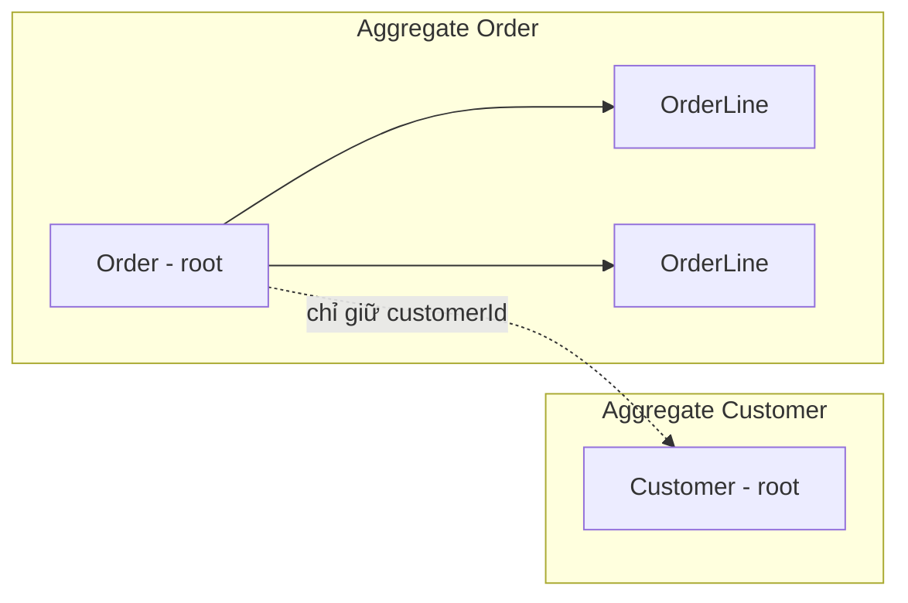

# Spring Data JDBC

Spring Data JDBC là "người anh em đơn giản" của Spring Data JPA: vẫn có repository interface, vẫn có derived query, nhưng **không có Hibernate, không lazy loading, không persistence context**. Bài này giải thích triết lý aggregate root mà Spring Data JDBC dựa vào, cách dùng `JdbcClient`/`JdbcTemplate` khi cần SQL thuần, và khi nào nên chọn JDBC thay vì JPA. Hiểu rõ khác biệt này giúp bạn tránh những "phép màu" khó đoán của ORM khi dự án không cần đến chúng.

---

:::note[Ghi nhớ nhanh]

- ⭐ **Không lazy loading, không persistence context, không dirty checking** — gọi `save()` là chạy SQL ngay, load entity là load cả aggregate.
- ⭐ **Aggregate root** — mỗi repository quản lý một aggregate; entity con thuộc aggregate được lưu/xoá cùng gốc, tham chiếu sang aggregate khác chỉ bằng **id** (`AggregateReference`).
- **`JdbcClient`** (Spring Framework 6.1, Boot 3.2) là API fluent mới cho SQL thuần, gọn hơn `JdbcTemplate`/`NamedParameterJdbcTemplate`.
- **Không tự sinh schema** — bạn tự viết DDL (schema.sql, Flyway, Liquibase).
- **Chọn JDBC** khi muốn SQL rõ ràng, mô hình DDD, ít magic; **chọn JPA** khi domain phức tạp nhiều quan hệ, cần cache cấp 1, lazy loading.

:::

---

## Mục lục

- [Vì sao Spring Data JDBC ra đời?](#vì-sao-spring-data-jdbc-ra-đời)
- [Khác biệt cốt lõi so với JPA](#khác-biệt-cốt-lõi-so-với-jpa)
- [Aggregate root](#aggregate-root)
- [Repository và query method](#repository-và-query-method)
- [JdbcClient và JdbcTemplate](#jdbcclient-và-jdbctemplate)
- [Khi nào chọn JDBC, khi nào chọn JPA](#khi-nào-chọn-jdbc-khi-nào-chọn-jpa)

---

## Vì sao Spring Data JDBC ra đời?

**Vấn đề:** JPA/Hibernate rất mạnh nhưng nhiều "phép màu" ngầm. Đoạn code dưới đây **không gọi `save()`** nhưng vẫn UPDATE database:

```java
@Transactional
public void rename(Long id, String name) {
    Customer c = customerRepository.findById(id).orElseThrow();
    c.setName(name);
    // Không gọi save, nhưng khi commit Hibernate vẫn so sánh (dirty checking) và chạy UPDATE
}

public void printOrders(Long id) {
    Customer c = customerRepository.findById(id).orElseThrow();
    c.getOrders().size(); // LazyInitializationException nếu ngoài transaction
}
```

Người mới thường gặp: N+1 query không biết từ đâu ra, `LazyInitializationException`, entity bị cập nhật ngoài ý muốn, cascade xoá nhầm. Nhiều team chỉ cần "map bảng sang object rồi chạy SQL" mà phải gánh cả cỗ máy ORM.

**Giải pháp:** Spring Data JDBC (ra đời 2018) giữ lại phần tiện lợi của Spring Data (repository, derived query, auditing) nhưng bỏ hết trạng thái ngầm:

```java
public void rename(Long id, String name) {
    Customer c = customerRepository.findById(id).orElseThrow();
    Customer renamed = c.withName(name);      // object có thể bất biến (immutable)
    customerRepository.save(renamed);         // chỉ khi gọi save mới có SQL
}
```

Đọc code là biết khi nào SQL chạy.

:::tip[Dùng thực tế]

- Microservice nhỏ, domain gọn, muốn kiểm soát SQL chặt chẽ.
- Dự án áp dụng Domain-Driven Design (DDD) với aggregate rõ ràng.
- Đội ngũ quen SQL, muốn entity là `record` bất biến.
- Truy vấn báo cáo, batch, bulk insert dùng `JdbcClient` song song với JPA.

:::

Dependency:

```xml
<dependency>
    <groupId>org.springframework.boot</groupId>
    <artifactId>spring-boot-starter-data-jdbc</artifactId>
</dependency>
```

Chỉ cần SQL thuần (không repository) thì `spring-boot-starter-jdbc` là đủ — có sẵn `JdbcTemplate`, `JdbcClient`, HikariCP.

---

## Khác biệt cốt lõi so với JPA

| Khía cạnh | Spring Data JPA | Spring Data JDBC |
|-----------|-----------------|------------------|
| Nền tảng | JPA + Hibernate | JDBC thuần |
| Persistence context (cache cấp 1) | Có | Không |
| Dirty checking (tự UPDATE khi đổi field) | Có | Không — phải gọi `save()` |
| Lazy loading | Có | Không — load cả aggregate một lần |
| Quan hệ | `@OneToMany`, `@ManyToOne`, `@ManyToMany` hai chiều tuỳ ý | Chỉ trong aggregate; giữa aggregate dùng id |
| Sinh schema | `ddl-auto` | Không — tự viết DDL |
| Entity bất biến (`record`) | Khó (cần constructor rỗng, proxy) | Hỗ trợ tốt |
| Cập nhật collection con | Tính toán diff | Xoá hết con rồi chèn lại |
| Độ dễ đoán | Thấp hơn | Cao |

:::tip[Ví dụ đời thường]

JPA giống **thuê quản gia**: bạn đổi cái ghế sang phòng khác, quản gia tự ghi sổ và tự báo cho chủ nhà (dirty checking); đồ trong kho chỉ được mang ra khi bạn hỏi tới (lazy loading). Tiện, nhưng đôi khi quản gia làm những việc bạn không biết.

Spring Data JDBC giống **tự đi chợ**: muốn gì thì tự xách về, muốn cất gì thì tự cất (`save()`). Mệt hơn chút nhưng không có bất ngờ.

:::

---

## Aggregate root

**Aggregate** (khái niệm từ DDD) là một cụm object luôn được đọc/ghi cùng nhau và có chung ranh giới nhất quán. **Aggregate root** là object gốc — bên ngoài chỉ được đi qua gốc để thao tác với các object bên trong.

Ví dụ: `Order` (gốc) chứa nhiều `OrderLine`. Không ai lưu `OrderLine` riêng lẻ; muốn thêm dòng thì sửa `Order` rồi lưu `Order`. Còn `Customer` là một aggregate khác — `Order` chỉ giữ **id** của customer.

```java
@Table("orders")
public record Order(
        @Id Long id,
        AggregateReference<Customer, Long> customerId,   // tham chiếu aggregate khác bằng id
        String status,
        @MappedCollection(idColumn = "order_id", keyColumn = "line_no")
        List<OrderLine> lines,
        @Version Integer version
) {
    public Order addLine(OrderLine line) {
        List<OrderLine> newLines = new ArrayList<>(lines);
        newLines.add(line);
        return new Order(id, customerId, status, List.copyOf(newLines), version);
    }
}

@Table("order_line")
public record OrderLine(String productCode, int quantity, BigDecimal price) {}
```

```sql
CREATE TABLE orders (
    id          BIGSERIAL PRIMARY KEY,
    customer_id BIGINT NOT NULL,
    status      VARCHAR(20) NOT NULL,
    version     INT
);

CREATE TABLE order_line (
    order_id     BIGINT NOT NULL REFERENCES orders(id),
    line_no      INT    NOT NULL,
    product_code VARCHAR(50),
    quantity     INT,
    price        NUMERIC(12, 2),
    PRIMARY KEY (order_id, line_no)
);
```

Quy tắc lưu:

- `save(order)` với id `null` → INSERT `orders` rồi INSERT từng `order_line`.
- `save(order)` với id có sẵn → UPDATE `orders`, **DELETE toàn bộ** `order_line` của đơn đó rồi INSERT lại.
- `deleteById` → xoá các dòng con rồi xoá gốc.



:::warning[Lỗi hay gặp]

- Thiết kế aggregate quá to (Customer chứa mọi Order chứa mọi OrderLine) → mỗi lần lưu customer là xoá/chèn lại hàng nghìn dòng. Aggregate phải **nhỏ**.
- Cố mô hình hoá `@ManyToOne` như JPA — Spring Data JDBC không hỗ trợ; dùng `AggregateReference` hoặc chỉ một field `Long customerId`.
- Quên `@Version` khi nhiều người cùng sửa → mất cập nhật. Có `@Version` thì cập nhật xung đột sẽ ném `OptimisticLockingFailureException`.
- Entity có id do ứng dụng tự gán (UUID) mà không có `@Version` → Spring Data JDBC tưởng là bản ghi cũ và chạy UPDATE thay vì INSERT. Dùng `@Version`, implement `Persistable`, hoặc gọi `JdbcAggregateTemplate.insert`.

:::

---

## Repository và query method

```java
public interface OrderRepository extends ListCrudRepository<Order, Long>,
                                         ListPagingAndSortingRepository<Order, Long> {

    List<Order> findByStatus(String status);

    @Query("select * from orders where customer_id = :customerId order by id desc")
    List<Order> findByCustomer(@Param("customerId") Long customerId);

    @Modifying
    @Query("update orders set status = :status where id = :id")
    boolean updateStatus(@Param("id") Long id, @Param("status") String status);
}
```

Điểm khác JPA:

- `@Query` trong Spring Data JDBC viết **SQL thuần** (theo tên bảng/cột), không phải JPQL.
- Derived query hỗ trợ được các điều kiện trên thuộc tính đơn giản của gốc; truy vấn phức tạp nên viết `@Query`.
- Auditing vẫn có: `@EnableJdbcAuditing` cùng các annotation `@CreatedDate`, `@LastModifiedDate`.
- Callback vòng đời qua bean `BeforeConvertCallback`, `BeforeSaveCallback`... thay vì `@PrePersist`.

Cấu hình tên bảng/cột: mặc định `CamelCase` → `snake_case` (`productCode` → `product_code`). Khác thì dùng `@Table("...")`, `@Column("...")`.

---

## JdbcClient và JdbcTemplate

Không phải truy vấn nào cũng cần repository. Báo cáo, thống kê, bulk insert thì SQL thuần là gọn nhất.

### JdbcTemplate (cách truyền thống)

```java
@Repository
@RequiredArgsConstructor
public class ReportDao {

    private final NamedParameterJdbcTemplate jdbc;

    public List<RevenueRow> revenueByDay(LocalDate from, LocalDate to) {
        String sql = """
                select date(created_at) as day, sum(total) as revenue
                from orders
                where created_at between :from and :to
                group by date(created_at)
                order by day
                """;
        MapSqlParameterSource params = new MapSqlParameterSource()
                .addValue("from", from)
                .addValue("to", to);
        return jdbc.query(sql, params, (rs, i) ->
                new RevenueRow(rs.getDate("day").toLocalDate(), rs.getBigDecimal("revenue")));
    }
}
```

### JdbcClient (Spring Framework 6.1 / Boot 3.2+)

`JdbcClient` gói `JdbcTemplate` và `NamedParameterJdbcTemplate` trong một API fluent; Boot tự cấu hình bean khi có DataSource.

```java
@Repository
@RequiredArgsConstructor
public class ProductDao {

    private final JdbcClient jdbcClient;

    public Optional<Product> findById(long id) {
        return jdbcClient.sql("select id, name, price from product where id = :id")
                .param("id", id)
                .query(Product.class)        // tự map cột sang record/bean theo tên
                .optional();
    }

    public List<Product> findCheaperThan(BigDecimal max) {
        return jdbcClient.sql("select id, name, price from product where price < ?")
                .param(max)
                .query(Product.class)
                .list();
    }

    public int create(Product p) {
        return jdbcClient.sql("insert into product(name, price) values (:name, :price)")
                .param("name", p.name())
                .param("price", p.price())
                .update();
    }

    public long count() {
        return jdbcClient.sql("select count(*) from product")
                .query(Long.class)
                .single();
    }
}
```

| | `JdbcTemplate` | `NamedParameterJdbcTemplate` | `JdbcClient` |
|---|---|---|---|
| Tham số | `?` theo vị trí | `:ten` | Cả hai |
| Phong cách | Nhiều overload | Nhiều overload | Fluent, dễ đọc |
| Map kết quả | `RowMapper` | `RowMapper` | `RowMapper` hoặc tự map theo class |
| Batch update | `batchUpdate` | `batchUpdate` | Chưa có API batch riêng — dùng `JdbcTemplate` |

:::warning[Lỗi hay gặp]

- Ghép chuỗi SQL với input người dùng → SQL injection. Luôn dùng `param(...)`.
- `.single()` ném lỗi khi không có dòng nào hoặc nhiều hơn một dòng; dùng `.optional()` khi có thể không tồn tại.
- Gọi `JdbcClient` nhiều câu mà quên `@Transactional` → mỗi câu là một transaction riêng, lỗi giữa chừng không rollback được các câu trước.

:::

---

## Khi nào chọn JDBC, khi nào chọn JPA

| Tình huống | Gợi ý |
|------------|-------|
| CRUD nhiều bảng, quan hệ phức tạp, đội đã quen Hibernate | Spring Data JPA |
| Domain theo DDD, aggregate nhỏ, muốn entity bất biến | Spring Data JDBC |
| Báo cáo, thống kê, truy vấn tối ưu tay | `JdbcClient` (có thể dùng song song với JPA) |
| Bulk insert/update hàng chục nghìn dòng | `JdbcTemplate.batchUpdate` |
| Cần lazy loading, cache cấp 2, kế thừa entity | Spring Data JPA |
| Muốn biết chính xác SQL nào chạy, khi nào chạy | Spring Data JDBC hoặc `JdbcClient` |
| Truy vấn type-safe sinh từ schema | Cân nhắc jOOQ (có starter `spring-boot-starter-jooq`) |

Không có lựa chọn "luôn đúng". Rất nhiều dự án dùng **JPA cho phần ghi (command)** và **`JdbcClient` cho phần đọc báo cáo (query)**.

:::tip[Ví dụ đời thường]

Chọn JPA hay JDBC giống chọn **xe số tự động hay xe số sàn**. Xe tự động (JPA) đi phố nhàn, nhưng khi leo dốc hay chở nặng thì bạn không kiểm soát được hộp số làm gì. Xe số sàn (JDBC) phải tự sang số, đổi lại biết rõ xe đang ở số mấy.

:::
