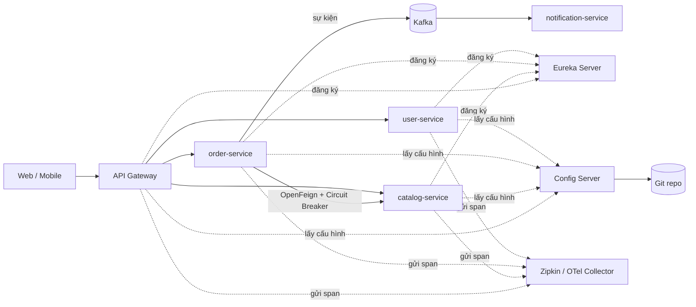

# Tổng quan Microservices & Spring Cloud

Microservices là cách chia một ứng dụng lớn thành nhiều dịch vụ nhỏ, mỗi dịch vụ tự triển khai và tự sở hữu dữ liệu. Đổi lại sự linh hoạt đó, bạn phải giải quyết hàng loạt bài toán của **hệ phân tán**: tìm nhau ở đâu, cấu hình tập trung, gọi nhau khi mạng chập chờn, lần vết một request đi qua 5 dịch vụ. Bài này so sánh monolith với microservices, liệt kê các vấn đề phân tán và giới thiệu bản đồ các dự án **Spring Cloud** giải quyết từng vấn đề — làm nền cho các bài tiếp theo trong nhóm.

---

:::note[Ghi nhớ nhanh]

- ⭐ **Đừng bắt đầu bằng microservices** — monolith được module hoá tốt là điểm khởi đầu hợp lý; tách khi có lý do rõ ràng (team lớn, scale khác nhau, deploy độc lập).
- ⭐ **Mỗi vấn đề phân tán có một dự án Spring Cloud** — Discovery (Eureka), Gateway, Config, OpenFeign, Circuit Breaker (Resilience4j), tracing (Micrometer Tracing).
- **Spring Cloud phát hành theo release train** (2022.0, 2023.0, 2024.0, 2025.0...) — mỗi train chỉ tương thích một dải phiên bản Spring Boot; quản lý bằng BOM `spring-cloud-dependencies`.
- **Bộ Netflix cũ đã bỏ** — Hystrix, Ribbon, Zuul được thay bằng Resilience4j, Spring Cloud LoadBalancer, Spring Cloud Gateway; Sleuth thay bằng Micrometer Tracing.
- **Trên Kubernetes**, nhiều chức năng (discovery, config, load balancing) đã có sẵn ở nền tảng — không cần dựng lại bằng Spring Cloud.

:::

---

## Mục lục

- [Vì sao microservices ra đời?](#vì-sao-microservices-ra-đời)
- [Monolith và Microservices](#monolith-và-microservices)
- [Các vấn đề của hệ phân tán](#các-vấn-đề-của-hệ-phân-tán)
- [Bản đồ các dự án Spring Cloud](#bản-đồ-các-dự-án-spring-cloud)
- [Release train và tương thích Spring Boot](#release-train-và-tương-thích-spring-boot)
- [Kiến trúc mẫu](#kiến-trúc-mẫu)

---

## Vì sao microservices ra đời?

**Vấn đề:** Một ứng dụng thương mại điện tử viết dạng monolith (một khối) lâu năm:

```
shop-app.jar  (1 codebase, 1 database, 40 dev cùng sửa)
├── user/
├── catalog/
├── order/
├── payment/
├── shipping/
└── notification/
```

- Sửa một dòng ở `notification` cũng phải build, test, deploy lại cả hệ thống.
- Mùa sale chỉ `catalog` và `order` quá tải, nhưng phải nhân bản cả khối (kể cả phần ít dùng).
- 40 người sửa chung một repo → xung đột merge, phát hành chậm, một lỗi `OutOfMemoryError` ở báo cáo làm sập luôn thanh toán.

**Giải pháp:** Tách thành các dịch vụ độc lập, giao tiếp qua mạng (HTTP/REST, gRPC, message broker):

```
user-service      → user_db
catalog-service   → catalog_db  (scale 10 instance mùa sale)
order-service     → order_db
payment-service   → payment_db
notification-svc  → (đọc sự kiện từ Kafka)
```

Mỗi team sở hữu một dịch vụ, deploy riêng, chọn công nghệ riêng khi cần.

:::tip[Dùng thực tế]

- Hệ thống lớn có nhiều team (từ vài chục kỹ sư trở lên) cần phát hành độc lập.
- Các phần có tải rất khác nhau: tìm kiếm sản phẩm chịu tải gấp 50 lần phần quản trị.
- Cô lập lỗi: dịch vụ gợi ý sản phẩm chết không được kéo theo thanh toán.
- Tích hợp dần hệ thống cũ (strangler pattern): bóc từng chức năng ra khỏi monolith.

:::

---

## Monolith và Microservices

| Tiêu chí | Monolith | Microservices |
|----------|----------|---------------|
| Triển khai | Một artifact | Nhiều artifact độc lập |
| Gọi giữa module | Gọi method trong bộ nhớ (nhanh, tin cậy) | Gọi qua mạng (chậm hơn, có thể lỗi) |
| Transaction | ACID trong một DB | Phân tán — dùng Saga, eventual consistency |
| Scale | Nhân bản cả khối | Scale riêng từng dịch vụ |
| Debug | Một stack trace | Phải có tracing, log tập trung |
| Vận hành | Đơn giản | Cần CI/CD, container, monitoring tốt |
| Tổ chức team | Phù hợp team nhỏ | Phù hợp nhiều team độc lập |
| Chi phí khởi đầu | Thấp | Cao |

Có một phương án ở giữa: **modular monolith** — vẫn deploy một khối nhưng chia module với ranh giới rõ ràng (Spring Modulith hỗ trợ kiểm tra ranh giới này). Khi cần tách, module đã sẵn sàng thành dịch vụ.

:::tip[Ví dụ đời thường]

Monolith giống **quán cơm gia đình**: một bếp, một người chủ lo hết, nhỏ thì cực kỳ hiệu quả. Microservices giống **khu food court**: mỗi quầy (phở, cơm tấm, trà sữa) tự nấu, tự thu tiền, đông khách quầy nào thì thêm người quầy đó. Nhưng food court cần thêm ban quản lý, bảng chỉ dẫn, hệ thống thanh toán chung — đó chính là phần Spring Cloud lo.

:::

:::warning[Lỗi hay gặp]

- **Distributed monolith** — tách thành 10 dịch vụ nhưng dùng chung một database, hoặc phải deploy cùng lúc mới chạy. Bạn nhận đủ cái khó của phân tán mà không có lợi ích nào.
- Chia dịch vụ quá nhỏ (nano-service): một request người dùng phải đi qua 8 dịch vụ, độ trễ cộng dồn, lỗi nhân lên.
- Chia theo tầng kỹ thuật (service "database", service "validation") thay vì theo **nghiệp vụ** (bounded context).

:::

---

## Các vấn đề của hệ phân tán

Khi chuyển từ gọi method sang gọi mạng, hàng loạt câu hỏi xuất hiện:

| Vấn đề | Câu hỏi | Giải pháp tiêu biểu |
|--------|---------|---------------------|
| Service discovery | `order-service` đang chạy ở IP nào, mấy instance? | Eureka, Consul, Kubernetes Service |
| Load balancing | Gọi instance nào trong 5 instance? | Spring Cloud LoadBalancer |
| API Gateway | Client mobile gọi 1 địa chỉ hay 10 địa chỉ? Xác thực ở đâu? | Spring Cloud Gateway |
| Cấu hình tập trung | Đổi URL database cho 30 dịch vụ thế nào? | Spring Cloud Config, Kubernetes ConfigMap |
| Gọi dịch vụ khác | Viết HTTP client lặp đi lặp lại | OpenFeign, HTTP Interface |
| Lỗi lan truyền | Một dịch vụ chậm kéo sập cả chuỗi | Circuit breaker, retry, timeout (Resilience4j) |
| Quan sát | Request chậm ở dịch vụ nào? | Distributed tracing (Micrometer Tracing + Zipkin/OTel) |
| Nhất quán dữ liệu | Đặt hàng thành công nhưng trừ kho thất bại? | Saga, outbox pattern, event-driven |
| Giao tiếp bất đồng bộ | Gửi email không cần chờ | Kafka, RabbitMQ (Spring Cloud Stream) |

Peter Deutsch tổng kết những giả định sai lầm khi lập trình phân tán (**fallacies of distributed computing**), trong đó nổi bật: "mạng luôn tin cậy", "độ trễ bằng 0", "băng thông vô hạn", "topology không đổi". Mọi công cụ trong Spring Cloud đều nhằm chống lại các giả định này.

---

## Bản đồ các dự án Spring Cloud

Spring Cloud không phải một thư viện mà là **tập hợp nhiều dự án**, mỗi dự án giải một bài toán:

| Dự án | Chức năng | Bài trong nhóm |
|-------|-----------|----------------|
| Spring Cloud Netflix Eureka | Service registry và discovery | Bài 2 |
| Spring Cloud LoadBalancer | Load balancing phía client | Bài 2 |
| Spring Cloud Gateway | API Gateway (bản WebFlux và bản Server MVC) | Bài 3 |
| Spring Cloud Config | Config server dựa trên Git/Vault/JDBC | Bài 4 |
| Spring Cloud OpenFeign | HTTP client khai báo bằng interface | Bài 5 |
| Spring Cloud Circuit Breaker | Lớp trừu tượng circuit breaker (Resilience4j, Spring Retry) | Bài 6 |
| Micrometer Tracing | Distributed tracing (thay Spring Cloud Sleuth) | Bài 7 |
| Spring Cloud Stream | Lập trình hướng sự kiện với Kafka/RabbitMQ | — |
| Spring Cloud Kubernetes | Dùng ConfigMap, Secret, Service của Kubernetes | — |
| Spring Cloud Consul / Zookeeper | Discovery và config dùng Consul/Zookeeper | — |
| Spring Cloud Contract | Consumer-driven contract testing | — |

Những dự án đã ngừng phát triển (chỉ nhắc khi đọc code cũ):

| Đã ngừng | Thay bằng |
|----------|-----------|
| Netflix Hystrix | Resilience4j qua Spring Cloud Circuit Breaker |
| Netflix Ribbon | Spring Cloud LoadBalancer |
| Netflix Zuul 1 | Spring Cloud Gateway |
| Spring Cloud Sleuth | Micrometer Tracing (từ Spring Boot 3) |

Lưu ý Eureka (cũng từ Netflix) **vẫn được duy trì** trong Spring Cloud Netflix.

---

## Release train và tương thích Spring Boot

Vì có nhiều dự án con với phiên bản riêng, Spring Cloud gom chúng thành một **release train** — một bộ phiên bản đã được kiểm tra chạy cùng nhau. Từ 2020, train đặt tên theo năm (calendar versioning).

| Release train | Tên mã | Spring Boot tương thích |
|---------------|--------|-------------------------|
| 2022.0.x | Kilburn | 3.0.x |
| 2023.0.x | Leyton | 3.2.x, 3.3.x |
| 2024.0.x | Moorgate | 3.4.x |
| 2025.0.x | Northfields | 3.5.x |
| 2025.1.x | Oakwood | 4.0.x |

Bảng chính xác luôn được cập nhật tại [trang Spring Cloud](https://spring.io/projects/spring-cloud) — hãy kiểm tra ở đó trước khi nâng cấp.

Khai báo BOM trong `pom.xml` để không phải ghi phiên bản từng dependency:

```xml
<properties>
    <java.version>17</java.version>
    <spring-cloud.version>2025.0.0</spring-cloud.version>
</properties>

<dependencyManagement>
    <dependencies>
        <dependency>
            <groupId>org.springframework.cloud</groupId>
            <artifactId>spring-cloud-dependencies</artifactId>
            <version>${spring-cloud.version}</version>
            <type>pom</type>
            <scope>import</scope>
        </dependency>
    </dependencies>
</dependencyManagement>

<dependencies>
    <dependency>
        <groupId>org.springframework.cloud</groupId>
        <artifactId>spring-cloud-starter-netflix-eureka-client</artifactId>
        <!-- không ghi version: BOM quản lý -->
    </dependency>
</dependencies>
```

:::warning[Lỗi hay gặp]

- Nâng Spring Boot lên phiên bản mới mà giữ release train cũ → ứng dụng fail khi khởi động với thông báo kiểu "Spring Boot [x] is not compatible with this Spring Cloud release train". Luôn nâng **cả hai** theo bảng tương thích.
- Ghi tay `version` cho từng starter Spring Cloud → lệch phiên bản giữa các module, lỗi `NoSuchMethodError` khó hiểu.
- Chép tutorial cũ dùng `@EnableHystrix`, `@EnableZuulProxy`, `@RibbonClient` — các annotation này không còn trong release train hiện tại.

:::

:::tip[Ví dụ đời thường]

Release train giống **combo linh kiện máy tính đã test tương thích** mà cửa hàng bán sẵn: mainboard, RAM, CPU chắc chắn chạy cùng nhau. Bạn tự mua lẻ từng món (ghi version riêng) thì có thể RAM không nhận, mainboard không lên hình.

:::

---

## Kiến trúc mẫu

Một hệ thống microservices điển hình dùng Spring Cloud:



Luồng một request "đặt hàng":

1. Client gọi `POST /api/orders` tới **Gateway**; Gateway xác thực JWT và chuyển tới `order-service` (tìm địa chỉ qua **Eureka**).
2. `order-service` gọi `catalog-service` qua **OpenFeign** để kiểm tra tồn kho; lời gọi được bọc bởi **circuit breaker**.
3. Đặt hàng xong, `order-service` phát sự kiện `OrderCreated` lên Kafka; `notification-service` gửi email.
4. Mọi bước mang cùng một **traceId** để tra trên Zipkin.
5. Cấu hình (timeout, URL DB) của mọi dịch vụ lấy từ **Config Server**.
