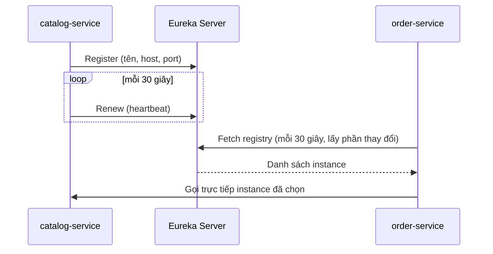

# Service Discovery với Eureka

Trong microservices, các dịch vụ liên tục được thêm, bớt, khởi động lại với địa chỉ IP thay đổi — không thể ghi cứng `http://10.0.1.15:8081` vào cấu hình. **Service discovery** (khám phá dịch vụ) giải quyết việc "ai đang chạy ở đâu". Bài này hướng dẫn dựng Eureka Server, đăng ký client, cơ chế heartbeat, cân bằng tải phía client với Spring Cloud LoadBalancer, và so sánh với service discovery có sẵn của Kubernetes.

---

:::note[Ghi nhớ nhanh]

- ⭐ **Eureka = danh bạ dịch vụ** — mỗi instance tự đăng ký khi khởi động, gửi heartbeat mỗi 30 giây; client tải danh bạ về cache và tự chọn instance để gọi.
- ⭐ **Gọi bằng tên dịch vụ** — `http://order-service/...` kết hợp `@LoadBalanced` (hoặc `lb://` ở Gateway); Spring Cloud LoadBalancer chọn instance (mặc định round-robin).
- **Eureka ưu tiên sẵn sàng (AP)** — khi mất kết nối hàng loạt, chế độ self-preservation giữ lại các bản ghi thay vì xoá, chấp nhận danh bạ có thể cũ.
- **Thông tin lan truyền có độ trễ** — instance mới có thể mất đến khoảng 30–90 giây mới được các client nhìn thấy; instance chết cũng vậy → cần retry và circuit breaker.
- **Trên Kubernetes** thường không cần Eureka — dùng Kubernetes Service (DNS + kube-proxy).

:::

---

## Mục lục

- [Vì sao cần service discovery?](#vì-sao-cần-service-discovery)
- [Dựng Eureka Server](#dựng-eureka-server)
- [Đăng ký Eureka Client](#đăng-ký-eureka-client)
- [Heartbeat, lease và self-preservation](#heartbeat-lease-và-self-preservation)
- [Spring Cloud LoadBalancer](#spring-cloud-loadbalancer)
- [So với Kubernetes service discovery](#so-với-kubernetes-service-discovery)
- [Câu hỏi phỏng vấn](#câu-hỏi-phỏng-vấn)

---

## Vì sao cần service discovery?

**Vấn đề:** `order-service` cần gọi `catalog-service`. Cách ngây thơ:

```yaml
catalog:
  url: http://10.0.1.15:8081
```

```java
restTemplate.getForObject("http://10.0.1.15:8081/api/products/{id}", ProductDto.class, id);
```

- `catalog-service` scale lên 3 instance → chỉ gọi được 1 cái.
- Instance khởi động lại trên máy khác với IP mới → `order-service` gọi vào địa chỉ chết.
- Mỗi lần đổi hạ tầng phải sửa cấu hình và deploy lại mọi dịch vụ gọi tới.

**Giải pháp:** Một **service registry** (sổ đăng ký) trung tâm. Mỗi instance tự đăng ký "tôi là `catalog-service`, ở `10.0.1.15:8081`". Bên gọi chỉ cần biết **tên**:

```java
restClient.get().uri("http://catalog-service/api/products/{id}", id)
        .retrieve().body(ProductDto.class);
```

Thư viện phía client tra registry, nhận danh sách instance đang sống và chọn một.

:::tip[Dùng thực tế]

- Hệ thống chạy trên VM/bare-metal hoặc Docker Compose, không có Kubernetes.
- Auto-scaling theo tải: instance mới tự xuất hiện trong danh bạ, không sửa cấu hình.
- Blue-green/rolling deploy: instance cũ huỷ đăng ký, instance mới đăng ký.
- Gateway định tuyến động tới dịch vụ theo tên (`lb://order-service`).

:::

:::tip[Ví dụ đời thường]

Eureka giống **tổng đài 1080** ngày xưa. Cửa hàng mở mới thì gọi lên tổng đài đăng ký số; định kỳ báo "vẫn còn hoạt động". Bạn muốn gọi "tiệm sửa xe gần nhất" thì hỏi tổng đài, tổng đài đọc cho vài số, bạn tự chọn một số để gọi. Bạn còn **ghi lại sổ tay** (cache) để lần sau khỏi hỏi — nhưng sổ tay có thể đã cũ.

:::

---

## Dựng Eureka Server

Eureka Server là một ứng dụng Spring Boot riêng.

```xml
<dependency>
    <groupId>org.springframework.cloud</groupId>
    <artifactId>spring-cloud-starter-netflix-eureka-server</artifactId>
</dependency>
```

```java
@SpringBootApplication
@EnableEurekaServer
public class DiscoveryServerApplication {
    public static void main(String[] args) {
        SpringApplication.run(DiscoveryServerApplication.class, args);
    }
}
```

```yaml
server:
  port: 8761

spring:
  application:
    name: discovery-server

eureka:
  instance:
    hostname: localhost
  client:
    register-with-eureka: false   # server đơn lẻ không tự đăng ký chính nó
    fetch-registry: false
```

Mở `http://localhost:8761` sẽ thấy dashboard liệt kê các dịch vụ đã đăng ký.

**Chạy nhiều Eureka Server (high availability)**: các server đăng ký lẫn nhau (peer) và sao chép registry cho nhau.

```yaml
# eureka-1
eureka:
  client:
    service-url:
      defaultZone: http://eureka-2:8762/eureka/
---
# eureka-2
eureka:
  client:
    service-url:
      defaultZone: http://eureka-1:8761/eureka/
```

:::warning[Lỗi hay gặp]

- Chạy một Eureka Server duy nhất ở production → điểm lỗi đơn (dù client có cache nên không chết ngay, instance mới sẽ không được phát hiện).
- Quên `register-with-eureka: false` ở server đơn → log liên tục báo lỗi không kết nối được peer.
- Để dashboard Eureka mở công khai ra Internet — lộ toàn bộ topology hệ thống. Đặt sau mạng nội bộ hoặc bật Spring Security (nhớ tắt CSRF cho đường `/eureka/**` để client đăng ký được).

:::

---

## Đăng ký Eureka Client

Ở mỗi dịch vụ nghiệp vụ:

```xml
<dependency>
    <groupId>org.springframework.cloud</groupId>
    <artifactId>spring-cloud-starter-netflix-eureka-client</artifactId>
</dependency>
```

Không cần annotation (`@EnableDiscoveryClient` là tuỳ chọn từ lâu) — có starter trên classpath là tự đăng ký.

```yaml
spring:
  application:
    name: catalog-service        # tên dùng để gọi — bắt buộc đặt

server:
  port: 0                        # cổng ngẫu nhiên, chạy nhiều instance trên một máy

eureka:
  client:
    service-url:
      defaultZone: http://localhost:8761/eureka/
  instance:
    prefer-ip-address: true
    instance-id: ${spring.application.name}:${random.uuid}
```

Đọc danh bạ bằng code (hiếm khi cần, thường để debug):

```java
@RestController
@RequiredArgsConstructor
public class DebugController {

    private final DiscoveryClient discoveryClient;

    @GetMapping("/debug/instances/{name}")
    public List<String> instances(@PathVariable String name) {
        return discoveryClient.getInstances(name).stream()
                .map(i -> i.getHost() + ":" + i.getPort())
                .toList();
    }
}
```



Lưu ý: Eureka **không đứng giữa** luồng gọi — `order-service` gọi thẳng tới `catalog-service`. Eureka chỉ là danh bạ.

---

## Heartbeat, lease và self-preservation

Các tham số mặc định quan trọng:

| Thuộc tính | Mặc định | Ý nghĩa |
|------------|----------|---------|
| `eureka.instance.lease-renewal-interval-in-seconds` | 30 | Chu kỳ client gửi heartbeat |
| `eureka.instance.lease-expiration-duration-in-seconds` | 90 | Quá thời gian này không có heartbeat thì server coi là chết |
| `eureka.client.registry-fetch-interval-seconds` | 30 | Chu kỳ client tải lại danh bạ |
| `eureka.server.eviction-interval-timer-in-ms` | 60000 | Chu kỳ server dọn instance hết hạn |
| `eureka.server.enable-self-preservation` | true | Bật chế độ tự bảo vệ |

Hệ quả: một instance chết đột ngột có thể vẫn nằm trong danh bạ của client **vài chục giây đến vài phút**. Khi tắt êm (graceful shutdown), client gửi lệnh huỷ đăng ký nên được gỡ nhanh hơn.

**Self-preservation** (tự bảo vệ): nếu trong một khoảng thời gian, số heartbeat nhận được thấp hơn ngưỡng kỳ vọng (mặc định 85%), Eureka cho rằng **mạng có vấn đề** chứ không phải các instance chết hàng loạt, nên ngừng xoá bản ghi. Dashboard sẽ hiện cảnh báo đỏ "EMERGENCY! EUREKA MAY BE INCORRECTLY CLAIMING INSTANCES ARE UP...".

Đây là lựa chọn thiết kế **AP** trong định lý CAP: thà trả danh bạ có thể cũ còn hơn xoá nhầm các instance còn sống.

:::warning[Lỗi hay gặp]

- Môi trường dev chỉ có 1–2 instance, tắt bật liên tục → self-preservation kích hoạt, instance chết vẫn hiện "UP". Có thể tắt ở dev bằng `eureka.server.enable-self-preservation: false`, **không** tắt ở production.
- Giảm heartbeat xuống 1 giây để "phát hiện nhanh" → tải lên server tăng mạnh. Thay vào đó hãy dùng retry + circuit breaker ở phía client để chịu được danh bạ cũ.
- Container khai báo hostname nội bộ không phân giải được từ dịch vụ khác → đăng ký thành công nhưng gọi không tới. Dùng `prefer-ip-address: true` hoặc cấu hình `eureka.instance.hostname` đúng.

:::

---

## Spring Cloud LoadBalancer

Sau khi có danh sách instance, cần chọn **một** instance cho mỗi lời gọi. Spring Cloud LoadBalancer (thay Netflix Ribbon) làm việc này ở **phía client**. Starter Eureka client đã kéo theo nó.

**Với RestClient** (Spring Framework 6.1+):

```java
@Configuration
public class HttpClientConfig {

    @Bean
    @LoadBalanced
    public RestClient.Builder loadBalancedRestClientBuilder() {
        return RestClient.builder();
    }
}

@Service
public class CatalogClient {

    private final RestClient restClient;

    public CatalogClient(RestClient.Builder builder) {
        this.restClient = builder.baseUrl("http://catalog-service").build();
    }

    public ProductDto getProduct(long id) {
        return restClient.get().uri("/api/products/{id}", id)
                .retrieve()
                .body(ProductDto.class);
    }
}
```

**Với WebClient** (reactive) và **RestTemplate** cũng tương tự: khai báo bean `WebClient.Builder` hoặc `RestTemplate` có `@LoadBalanced`. OpenFeign tự tích hợp LoadBalancer, không cần cấu hình thêm.

Thuật toán:

- Mặc định: `RoundRobinLoadBalancer` — lần lượt từng instance.
- Có sẵn: `RandomLoadBalancer`.
- Tuỳ biến thêm: ưu tiên cùng zone, sticky session, health-check, weighted (theo trọng số).

```java
public class RandomLbConfig {

    @Bean
    ReactorLoadBalancer<ServiceInstance> randomLoadBalancer(Environment env,
            LoadBalancerClientFactory factory) {
        String name = env.getProperty(LoadBalancerClientFactory.PROPERTY_NAME);
        return new RandomLoadBalancer(
                factory.getLazyProvider(name, ServiceInstanceListSupplier.class), name);
    }
}

@Configuration
@LoadBalancerClient(name = "catalog-service", configuration = RandomLbConfig.class)
public class LbClientsConfig {
}
```

Lưu ý `RandomLbConfig` **không** đặt `@Configuration` và không nằm trong package được component-scan, nếu không nó sẽ áp dụng cho mọi client.

:::warning[Lỗi hay gặp]

- Quên `@LoadBalanced` → lỗi `UnknownHostException: catalog-service` vì client cố phân giải DNS tên dịch vụ.
- Dùng cùng một bean `RestClient.Builder` có `@LoadBalanced` để gọi API bên ngoài (`https://api.github.com`) → LoadBalancer cố tìm dịch vụ tên `api.github.com` trong Eureka. Tạo builder riêng không `@LoadBalanced` cho lời gọi ra ngoài.

:::

---

## So với Kubernetes service discovery

Kubernetes có sẵn cơ chế discovery ở tầng nền tảng:

- Mỗi **Service** có tên DNS ổn định (`catalog-service.shop.svc.cluster.local`).
- kube-proxy/iptables (hoặc eBPF) phân phối kết nối tới các Pod sẵn sàng.
- **Readiness probe** quyết định Pod nào nhận traffic — phản ứng nhanh hơn heartbeat 30 giây.

| Tiêu chí | Eureka | Kubernetes Service |
|----------|--------|--------------------|
| Nơi đăng ký | Ứng dụng tự đăng ký (cần thư viện) | Nền tảng tự quản lý theo label |
| Ngôn ngữ | Chủ yếu Java/Spring | Mọi ngôn ngữ |
| Cân bằng tải | Phía client (LoadBalancer) | Phía hạ tầng (kube-proxy) hoặc service mesh |
| Kiểm tra sức khoẻ | Heartbeat | Readiness/liveness probe |
| Hạ tầng thêm | Phải chạy Eureka Server | Không |
| Phù hợp | VM, Docker Compose, hệ thống hỗn hợp | Cluster Kubernetes |

Trên Kubernetes, chỉ cần gọi `http://catalog-service:8080` (không cần `@LoadBalanced`). Nếu vẫn muốn dùng abstraction `DiscoveryClient` của Spring, có thể dùng Spring Cloud Kubernetes.

:::tip[Ví dụ đời thường]

Eureka giống việc mỗi hộ **tự lên phường đăng ký tạm trú**. Kubernetes giống **chung cư có ban quản lý**: ban quản lý tự biết căn nào có người ở, khách đến chỉ cần nói số căn hộ là bảo vệ dẫn lên.

:::

---

## Câu hỏi phỏng vấn

Những câu thường gặp về chủ đề này. Tự trả lời trước, rồi bấm **Xem đáp án** để đối chiếu.

**1. Service discovery giải quyết vấn đề gì? Client-side và server-side discovery khác nhau thế nào?**

<details className="qa">
<summary>Xem đáp án</summary>

Nó cho phép các dịch vụ tìm nhau bằng tên thay vì địa chỉ cứng, trong khi instance liên tục thay đổi. **Client-side discovery** (Eureka + LoadBalancer): client tự tra registry và chọn instance. **Server-side discovery** (Kubernetes Service, AWS ALB): client gọi một địa chỉ cố định, hạ tầng chọn instance giúp. Client-side linh hoạt hơn nhưng cần thư viện ở mọi client.

</details>

**2. Mô tả vòng đời đăng ký của một Eureka client.**

<details className="qa">
<summary>Xem đáp án</summary>

Khi khởi động, client gửi yêu cầu **register** kèm tên dịch vụ, host, port, metadata. Sau đó cứ 30 giây gửi **renew** (heartbeat). Đồng thời mỗi 30 giây tải phần thay đổi của registry về cache cục bộ. Khi tắt êm, client gửi **cancel** để huỷ đăng ký. Nếu chết đột ngột, server chờ hết lease (mặc định 90 giây) rồi mới gỡ trong lần dọn tiếp theo.

</details>

**3. Self-preservation mode của Eureka là gì? Vì sao không nên tắt ở production?**

<details className="qa">
<summary>Xem đáp án</summary>

Khi tỉ lệ heartbeat nhận được giảm dưới ngưỡng (mặc định 85% kỳ vọng), Eureka giả định đó là sự cố mạng và ngừng xoá instance. Điều này tránh tình huống phân mảnh mạng khiến server xoá sạch danh bạ trong khi các instance vẫn chạy tốt. Tắt nó ở production có nguy cơ mất toàn bộ danh bạ khi mạng chập chờn. Đây là lựa chọn ưu tiên Availability trong CAP.

</details>

**4. `@LoadBalanced` làm gì?**

<details className="qa">
<summary>Xem đáp án</summary>

Nó đánh dấu bean `RestTemplate`, `RestClient.Builder` hoặc `WebClient.Builder` để Spring Cloud gắn interceptor/filter của LoadBalancer. Khi gặp URL dạng `http://ten-dich-vu/...`, interceptor lấy danh sách instance của `ten-dich-vu` từ discovery, chọn một instance theo thuật toán (mặc định round-robin) và thay host/port thật vào URL.

</details>

**5. Vì sao instance đã chết vẫn có thể nhận request? Xử lý thế nào?**

<details className="qa">
<summary>Xem đáp án</summary>

Vì thông tin lan truyền có độ trễ: server chờ hết lease mới xoá, client chỉ tải lại danh bạ định kỳ, cộng thêm cache của LoadBalancer. Cách xử lý: graceful shutdown để huỷ đăng ký chủ động; ở phía gọi dùng retry sang instance khác, timeout ngắn và circuit breaker; có thể bật health-check based instance supplier của LoadBalancer.

</details>

**6. Khi deploy lên Kubernetes có nên dùng Eureka không?**

<details className="qa">
<summary>Xem đáp án</summary>

Thường không nên. Kubernetes đã cung cấp DNS cho Service, cân bằng tải, readiness probe — đầy đủ và độc lập ngôn ngữ. Thêm Eureka tạo hai nguồn sự thật về trạng thái instance và thêm hạ tầng phải vận hành. Eureka phù hợp khi chạy trên VM, Docker Compose hoặc hệ thống trải trên nhiều môi trường không có orchestrator chung.

</details>
