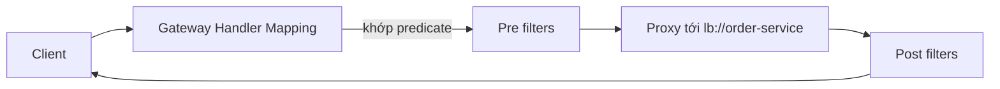

# Spring Cloud Gateway

API Gateway là **cửa ngõ duy nhất** đứng trước toàn bộ microservices: client chỉ biết một địa chỉ, còn Gateway lo định tuyến tới đúng dịch vụ, xác thực, giới hạn tần suất, ghi log. Spring Cloud Gateway là giải pháp gateway chính thức của hệ sinh thái Spring, thay thế Netflix Zuul. Bài này giải thích ba khái niệm route, predicate, filter; cách cấu hình rate limit và xác thực tập trung; và sự khác nhau giữa bản WebFlux (reactive) với bản Server MVC (servlet).

---

:::note[Ghi nhớ nhanh]

- ⭐ **Route = predicate + filter + URI đích** — predicate quyết định request nào khớp route, filter sửa request/response trước và sau khi chuyển tiếp.
- ⭐ **`lb://ten-dich-vu`** — URI dạng này dùng service discovery + LoadBalancer để chọn instance.
- **Hai bản**: WebFlux (reactive, Netty — bản gốc, nhiều tính năng nhất) và Server MVC (servlet, Tomcat — từ release train 2023.0, hợp với đội quen code blocking).
- **Rate limit** có sẵn filter `RequestRateLimiter` dùng Redis (token bucket); **xác thực** đặt tập trung ở Gateway (OAuth2 Resource Server kiểm JWT) nhưng dịch vụ phía sau vẫn nên kiểm quyền.
- **Không nhét logic nghiệp vụ vào Gateway** — Gateway chỉ làm việc chung (cross-cutting).

:::

---

## Mục lục

- [Vì sao cần API Gateway?](#vì-sao-cần-api-gateway)
- [Cài đặt và route đầu tiên](#cài-đặt-và-route-đầu-tiên)
- [Predicate](#predicate)
- [Filter](#filter)
- [Rate limit](#rate-limit)
- [Xác thực tập trung](#xác-thực-tập-trung)
- [Bản WebFlux và bản Server MVC](#bản-webflux-và-bản-server-mvc)
- [Câu hỏi phỏng vấn](#câu-hỏi-phỏng-vấn)

---

## Vì sao cần API Gateway?

**Vấn đề:** Không có gateway, ứng dụng mobile phải biết địa chỉ của từng dịch vụ:

```
https://user.shop.vn/api/users/me
https://order.shop.vn/api/orders
https://catalog.shop.vn/api/products
https://payment.shop.vn/api/payments
```

- Mỗi dịch vụ phải tự xác thực JWT, tự cấu hình CORS, tự giới hạn tần suất — lặp lại và dễ thiếu sót.
- Tách/gộp dịch vụ là phải phát hành lại app mobile.
- Lộ cấu trúc nội bộ ra ngoài, tăng bề mặt tấn công.

**Giải pháp:** Đặt một Gateway phía trước:

```
https://api.shop.vn/users/**     → user-service
https://api.shop.vn/orders/**    → order-service
https://api.shop.vn/products/**  → catalog-service
```

Gateway xác thực một lần, gắn header, giới hạn tần suất, rồi chuyển tiếp vào mạng nội bộ.

:::tip[Dùng thực tế]

- Một domain duy nhất cho web/mobile, ẩn các dịch vụ nội bộ.
- Kiểm JWT tập trung, chuyển thông tin người dùng xuống dịch vụ qua header.
- Chống spam/brute-force bằng rate limit theo IP hoặc theo user.
- Canary release: chuyển 10% traffic sang phiên bản mới bằng predicate `Weight`.

:::

:::tip[Ví dụ đời thường]

Gateway giống **quầy lễ tân bệnh viện**. Bệnh nhân không tự đi tìm phòng khám; lễ tân kiểm tra thẻ bảo hiểm (xác thực), phát số thứ tự (rate limit), rồi chỉ sang đúng khoa (route). Bác sĩ trong khoa không phải kiểm thẻ lại từ đầu, nhưng vẫn xem hồ sơ trước khi kê đơn (dịch vụ vẫn kiểm quyền).

:::

---

## Cài đặt và route đầu tiên

Bản WebFlux (phổ biến nhất):

```xml
<dependency>
    <groupId>org.springframework.cloud</groupId>
    <artifactId>spring-cloud-starter-gateway</artifactId>
</dependency>
<dependency>
    <groupId>org.springframework.cloud</groupId>
    <artifactId>spring-cloud-starter-netflix-eureka-client</artifactId>
</dependency>
```

:::info[Đổi tên ở release train 2025.0]

Từ Spring Cloud 2025.0 (Gateway 4.3), artifact được đổi tên rõ ràng hơn: `spring-cloud-starter-gateway-server-webflux` và `spring-cloud-starter-gateway-server-webmvc`; tiền tố thuộc tính cũng chuyển thành `spring.cloud.gateway.server.webflux.*`. Tên cũ vẫn chạy nhưng bị đánh dấu deprecated. Ví dụ bên dưới dùng tên quen thuộc của train 2024.0.

:::

Cấu hình route bằng YAML:

```yaml
server:
  port: 8080

spring:
  application:
    name: api-gateway
  cloud:
    gateway:
      routes:
        - id: order-service
          uri: lb://order-service
          predicates:
            - Path=/api/orders/**
          filters:
            - StripPrefix=1          # /api/orders/1 → /orders/1

        - id: catalog-service
          uri: lb://catalog-service
          predicates:
            - Path=/api/products/**
            - Method=GET
          filters:
            - StripPrefix=1
            - AddResponseHeader=Cache-Control, max-age=60
```

Hoặc bằng Java DSL:

```java
@Configuration
public class RouteConfig {

    @Bean
    public RouteLocator routes(RouteLocatorBuilder builder) {
        return builder.routes()
                .route("order-service", r -> r.path("/api/orders/**")
                        .filters(f -> f.stripPrefix(1)
                                       .addRequestHeader("X-Gateway", "shop"))
                        .uri("lb://order-service"))
                .route("legacy", r -> r.path("/old/**")
                        .uri("http://legacy.internal:9000"))
                .build();
    }
}
```



---

## Predicate

Predicate (điều kiện) quyết định request có khớp route không. Các predicate có sẵn thường dùng:

| Predicate | Ví dụ | Ý nghĩa |
|-----------|-------|---------|
| `Path` | `Path=/api/orders/**` | Khớp đường dẫn |
| `Method` | `Method=GET,POST` | Khớp HTTP method |
| `Host` | `Host=**.shop.vn` | Khớp header Host |
| `Header` | `Header=X-Version, v2` | Header có giá trị khớp regex |
| `Query` | `Query=debug` | Có tham số query |
| `Cookie` | `Cookie=beta, true` | Cookie khớp |
| `After` / `Before` / `Between` | `After=2026-11-11T00:00:00+07:00[Asia/Ho_Chi_Minh]` | Theo thời gian |
| `RemoteAddr` | `RemoteAddr=10.0.0.0/8` | Theo dải IP |
| `Weight` | `Weight=order-group, 90` | Chia tỉ lệ traffic |

Canary 90/10:

```yaml
spring:
  cloud:
    gateway:
      routes:
        - id: order-v1
          uri: lb://order-service-v1
          predicates:
            - Path=/api/orders/**
            - Weight=order-group, 90
        - id: order-v2
          uri: lb://order-service-v2
          predicates:
            - Path=/api/orders/**
            - Weight=order-group, 10
```

:::warning[Lỗi hay gặp]

- Hai route cùng khớp một request → route đứng trước (hoặc có `order` nhỏ hơn) thắng. Route `Path=/api/**` đặt trên cùng sẽ "nuốt" mọi route cụ thể bên dưới.
- Quên `StripPrefix` → dịch vụ nhận `/api/orders/1` trong khi controller map `/orders/1`, trả 404.

:::

---

## Filter

Filter thay đổi request trước khi chuyển tiếp (pre) và response trước khi trả về (post). Có hai loại:

- **GatewayFilter**: gắn cho từng route.
- **GlobalFilter**: áp dụng cho mọi route.

Một số filter có sẵn:

| Filter | Tác dụng |
|--------|----------|
| `StripPrefix=1` | Bỏ N đoạn đầu của path |
| `RewritePath=/api/(?<seg>.*), /$\{seg}` | Viết lại path bằng regex |
| `AddRequestHeader` / `RemoveRequestHeader` | Thêm/xoá header request |
| `SetStatus`, `RedirectTo` | Đổi status, chuyển hướng |
| `Retry` | Thử lại khi lỗi |
| `CircuitBreaker` | Bọc route bằng circuit breaker, có `fallbackUri` |
| `RequestRateLimiter` | Giới hạn tần suất |
| `TokenRelay` | Chuyển access token OAuth2 xuống dịch vụ |
| `RequestSize` | Giới hạn kích thước body |

Áp filter mặc định cho mọi route:

```yaml
spring:
  cloud:
    gateway:
      default-filters:
        - DedupeResponseHeader=Access-Control-Allow-Origin
        - AddResponseHeader=X-Content-Type-Options, nosniff
```

Viết GlobalFilter tự tạo — gắn mã request và ghi log thời gian xử lý:

```java
@Component
@Slf4j
public class RequestTimingFilter implements GlobalFilter, Ordered {

    @Override
    public Mono<Void> filter(ServerWebExchange exchange, GatewayFilterChain chain) {
        long start = System.currentTimeMillis();
        String path = exchange.getRequest().getURI().getPath();
        return chain.filter(exchange).doFinally(signal -> {
            long took = System.currentTimeMillis() - start;
            log.info("{} {} -> {} ({} ms)", exchange.getRequest().getMethod(), path,
                    exchange.getResponse().getStatusCode(), took);
        });
    }

    @Override
    public int getOrder() {
        return Ordered.HIGHEST_PRECEDENCE;
    }
}
```

Circuit breaker kèm fallback (cần thêm `spring-cloud-starter-circuitbreaker-reactor-resilience4j`):

```yaml
filters:
  - name: CircuitBreaker
    args:
      name: catalogCB
      fallbackUri: forward:/fallback/catalog
```

```java
@RestController
public class FallbackController {

    @GetMapping("/fallback/catalog")
    public ResponseEntity<Map<String, String>> catalogFallback() {
        return ResponseEntity.status(HttpStatus.SERVICE_UNAVAILABLE)
                .body(Map.of("message", "Danh mục sản phẩm tạm thời không khả dụng"));
    }
}
```

:::warning[Lỗi hay gặp]

Trong bản WebFlux, **không gọi code blocking** (JDBC, `RestTemplate`, `Thread.sleep`) bên trong filter — nó chặn event loop của Netty và làm cả Gateway đứng hình. Nếu bắt buộc phải blocking, dùng bản Server MVC.

:::

---

## Rate limit

`RequestRateLimiter` dùng thuật toán **token bucket** với Redis làm nơi đếm chung giữa các instance Gateway.

```xml
<dependency>
    <groupId>org.springframework.boot</groupId>
    <artifactId>spring-boot-starter-data-redis-reactive</artifactId>
</dependency>
```

```yaml
spring:
  data:
    redis:
      host: localhost
      port: 6379
  cloud:
    gateway:
      routes:
        - id: login
          uri: lb://user-service
          predicates:
            - Path=/api/auth/login
          filters:
            - StripPrefix=1
            - name: RequestRateLimiter
              args:
                redis-rate-limiter.replenishRate: 5     # 5 token được nạp mỗi giây
                redis-rate-limiter.burstCapacity: 10    # tối đa 10 token trong xô
                redis-rate-limiter.requestedTokens: 1   # mỗi request tốn 1 token
                key-resolver: "#{@ipKeyResolver}"
```

```java
@Configuration
public class RateLimitConfig {

    @Bean
    public KeyResolver ipKeyResolver() {
        return exchange -> Mono.justOrEmpty(exchange.getRequest().getRemoteAddress())
                .map(addr -> addr.getAddress().getHostAddress())
                .defaultIfEmpty("unknown");
    }

    @Bean
    public KeyResolver userKeyResolver() {
        return exchange -> exchange.getPrincipal()
                .map(Principal::getName)
                .defaultIfEmpty("anonymous");
    }
}
```

Vượt giới hạn, Gateway trả `429 Too Many Requests` kèm các header `X-RateLimit-Remaining`, `X-RateLimit-Replenish-Rate`.

:::tip[Ví dụ đời thường]

Token bucket giống **cây nước nóng lạnh có bình chứa**: bình đầy 10 cốc (burst), mỗi giây vòi nạp thêm 5 cốc (replenish). Lúc đông người có thể rót liền 10 cốc, sau đó chỉ rót được theo tốc độ nạp.

:::

:::warning[Lỗi hay gặp]

- Gateway đứng sau load balancer/proxy → `getRemoteAddress()` là IP của proxy, mọi người dùng chung một xô. Cần dùng `XForwardedRemoteAddressResolver` và chỉ tin header `X-Forwarded-For` từ proxy đáng tin.
- Redis chết → mặc định filter cho qua (fail-open). Hãy cân nhắc và giám sát Redis.

:::

---

## Xác thực tập trung

Mô hình phổ biến: Gateway là **OAuth2 Resource Server**, kiểm tra JWT do Authorization Server (Keycloak, Auth0...) phát hành.

```xml
<dependency>
    <groupId>org.springframework.boot</groupId>
    <artifactId>spring-boot-starter-oauth2-resource-server</artifactId>
</dependency>
```

```yaml
spring:
  security:
    oauth2:
      resourceserver:
        jwt:
          issuer-uri: https://auth.shop.vn/realms/shop
```

Gateway WebFlux dùng `SecurityWebFilterChain` (không phải `SecurityFilterChain` của servlet):

```java
@Configuration
@EnableWebFluxSecurity
public class GatewaySecurityConfig {

    @Bean
    public SecurityWebFilterChain securityWebFilterChain(ServerHttpSecurity http) {
        return http
                .csrf(ServerHttpSecurity.CsrfSpec::disable)
                .authorizeExchange(ex -> ex
                        .pathMatchers("/api/auth/**", "/api/products/**").permitAll()
                        .pathMatchers("/api/admin/**").hasRole("ADMIN")
                        .anyExchange().authenticated())
                .oauth2ResourceServer(oauth -> oauth.jwt(Customizer.withDefaults()))
                .build();
    }
}
```

Hai cách truyền danh tính xuống dịch vụ:

1. **Chuyển tiếp nguyên JWT** (header `Authorization` mặc định được giữ) — dịch vụ phía sau cũng là resource server và tự kiểm chữ ký. An toàn nhất (zero trust).
2. **Gắn header** như `X-User-Id` sau khi Gateway đã xác thực — đơn giản nhưng dịch vụ phải **chỉ nhận traffic từ Gateway**, nếu không ai cũng giả mạo được header.

Nếu Gateway đóng vai OAuth2 Client (đăng nhập theo luồng Authorization Code cho web), filter `TokenRelay` sẽ lấy access token trong phiên và gắn vào request xuống dịch vụ.

:::warning[Lỗi hay gặp]

- Chỉ kiểm quyền ở Gateway, dịch vụ phía sau tin tưởng hoàn toàn → kẻ tấn công lọt vào mạng nội bộ gọi thẳng dịch vụ là qua mặt được. Dịch vụ vẫn cần kiểm tra quyền trên dữ liệu (user A không được xem đơn của user B).
- Cấu hình CORS ở cả Gateway lẫn dịch vụ → header `Access-Control-Allow-Origin` bị lặp, trình duyệt từ chối. Cấu hình CORS tại một chỗ (Gateway) hoặc dùng `DedupeResponseHeader`.

:::

---

## Bản WebFlux và bản Server MVC

Từ release train 2023.0, Spring Cloud Gateway có thêm bản chạy trên Spring MVC (servlet).

| Tiêu chí | Gateway WebFlux | Gateway Server MVC |
|----------|-----------------|--------------------|
| Nền tảng | Spring WebFlux, Reactor, Netty | Spring MVC, Servlet, Tomcat |
| Mô hình | Non-blocking, reactive | Blocking (có thể dùng virtual threads của Java 21) |
| Độ chín | Bản gốc, nhiều filter nhất | Mới hơn, đang bổ sung dần |
| Viết filter tuỳ biến | `GlobalFilter` trả về `Mono` | `HandlerFilterFunction` / `Function` trên `ServerRequest` |
| Bảo mật | `SecurityWebFilterChain` | `SecurityFilterChain` |
| Phù hợp | Tải rất cao, nhiều kết nối dài (WebSocket, SSE) | Đội quen code blocking, cần gọi thư viện blocking trong filter |

Cấu hình route bản Server MVC (train 2024.0):

```xml
<dependency>
    <groupId>org.springframework.cloud</groupId>
    <artifactId>spring-cloud-starter-gateway-mvc</artifactId>
</dependency>
```

```yaml
spring:
  cloud:
    gateway:
      mvc:
        routes:
          - id: order-service
            uri: lb://order-service
            predicates:
              - Path=/api/orders/**
            filters:
              - StripPrefix=1
```

Chọn bản nào: nếu không có lý do đặc biệt và đội đã quen Spring MVC, bản Server MVC kết hợp virtual threads là lựa chọn dễ bảo trì. Cần hiệu năng tối đa với hàng chục nghìn kết nối đồng thời hoặc cần đầy đủ filter, chọn bản WebFlux.

---

## Câu hỏi phỏng vấn

Những câu thường gặp về chủ đề này. Tự trả lời trước, rồi bấm **Xem đáp án** để đối chiếu.

**1. API Gateway giải quyết những vấn đề gì? Có nhược điểm gì?**

<details className="qa">
<summary>Xem đáp án</summary>

Gateway cung cấp một điểm vào duy nhất, ẩn cấu trúc nội bộ, xử lý tập trung các việc chung: định tuyến, xác thực, rate limit, CORS, log, circuit breaker. Nhược điểm: thêm một bước mạng (độ trễ), có thể trở thành điểm lỗi đơn và nút cổ chai nếu không chạy nhiều instance, và dễ bị nhồi logic nghiệp vụ nếu không có kỷ luật.

</details>

**2. Giải thích route, predicate và filter trong Spring Cloud Gateway.**

<details className="qa">
<summary>Xem đáp án</summary>

**Route** là một quy tắc định tuyến gồm id, URI đích, danh sách predicate và filter. **Predicate** là điều kiện trên request (path, method, header, thời gian, trọng số...) — tất cả predicate phải đúng thì route mới khớp. **Filter** chỉnh sửa request trước khi chuyển tiếp và response trước khi trả về (thêm header, viết lại path, retry, rate limit, circuit breaker).

</details>

**3. `lb://` trong URI có nghĩa gì?**

<details className="qa">
<summary>Xem đáp án</summary>

Đó là scheme báo Gateway dùng Spring Cloud LoadBalancer: phần sau `lb://` là tên dịch vụ, LoadBalancer tra danh sách instance từ discovery (Eureka, Consul, Kubernetes) và chọn một instance để chuyển tiếp request.

</details>

**4. `RequestRateLimiter` hoạt động thế nào? Vì sao cần Redis?**

<details className="qa">
<summary>Xem đáp án</summary>

Nó dùng thuật toán token bucket: mỗi khoá (IP, user) có một xô token được nạp với tốc độ `replenishRate`, tối đa `burstCapacity`; mỗi request tiêu `requestedTokens`. Hết token thì trả 429. Redis được dùng để lưu trạng thái xô dùng chung giữa nhiều instance Gateway (thao tác bằng Lua script nguyên tử); nếu lưu trong bộ nhớ từng instance thì giới hạn sẽ bị nhân lên theo số instance.

</details>

**5. Có nên chỉ xác thực ở Gateway rồi tin tưởng hoàn toàn các dịch vụ phía sau?**

<details className="qa">
<summary>Xem đáp án</summary>

Không nên. Gateway nên lo xác thực thô (token hợp lệ, chưa hết hạn), nhưng dịch vụ vẫn cần kiểm quyền trên dữ liệu cụ thể. Tốt nhất chuyển tiếp nguyên JWT để dịch vụ tự kiểm chữ ký (zero trust). Nếu truyền danh tính qua header tự đặt, phải đảm bảo mạng chỉ cho phép Gateway gọi vào dịch vụ và Gateway xoá header đó từ request gốc của client.

</details>

**6. Khác nhau giữa Gateway WebFlux và Gateway Server MVC? Chọn bản nào?**

<details className="qa">
<summary>Xem đáp án</summary>

WebFlux chạy trên Netty, non-blocking, là bản gốc với bộ filter đầy đủ nhất, phù hợp tải cao và kết nối dài; nhưng filter phải viết reactive và không được blocking. Server MVC chạy trên servlet/Tomcat, viết theo kiểu blocking quen thuộc, có thể kết hợp virtual threads; phù hợp đội quen Spring MVC hoặc cần gọi thư viện blocking. Chọn theo năng lực đội và yêu cầu tải.

</details>

**7. Vì sao không nên đặt logic nghiệp vụ vào Gateway?**

<details className="qa">
<summary>Xem đáp án</summary>

Gateway là thành phần dùng chung mọi dịch vụ; nhét logic nghiệp vụ vào sẽ biến nó thành một monolith mới, buộc mọi team phải phối hợp khi thay đổi, khó test và tăng rủi ro sập toàn hệ thống. Gateway chỉ nên làm việc cross-cutting. Nếu cần gộp dữ liệu cho từng loại client, dùng pattern **Backend for Frontend (BFF)** như một dịch vụ riêng.

</details>
