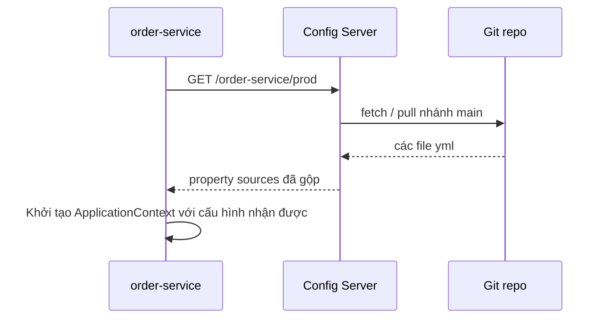

# Spring Cloud Config

Khi có hàng chục dịch vụ, mỗi dịch vụ lại chạy trên nhiều môi trường (dev, staging, prod), việc quản lý file `application.yml` rải rác trở thành ác mộng. **Spring Cloud Config** cung cấp một **config server** trung tâm đọc cấu hình từ Git (hoặc Vault, JDBC...) và phục vụ qua HTTP cho các dịch vụ. Bài này hướng dẫn dựng config server với Git backend, kết nối client bằng `spring.config.import`, làm mới cấu hình không cần khởi động lại với `@RefreshScope`, và các cách bảo vệ secret.

---

:::note[Ghi nhớ nhanh]

- ⭐ **Config server đọc từ Git** — cấu hình được version hoá, review qua pull request, rollback bằng git revert.
- ⭐ **Client dùng `spring.config.import=configserver:...`** (từ Boot 2.4) — cách cũ `bootstrap.yml` cần thêm starter `spring-cloud-starter-bootstrap`, không còn khuyến khích.
- **Quy tắc tên file**: `{application}-{profile}.yml` trong repo; `application.yml` là cấu hình chung cho mọi dịch vụ.
- **Làm mới nóng**: bean có `@RefreshScope` hoặc `@ConfigurationProperties` được nạp lại khi gọi `POST /actuator/refresh`; Spring Cloud Bus giúp phát lệnh refresh tới mọi instance.
- **Không commit secret dạng rõ** — dùng mã hoá `{cipher}`, Vault backend, hoặc secret của nền tảng (Kubernetes Secret, AWS Secrets Manager).

:::

---

## Mục lục

- [Vì sao Spring Cloud Config ra đời?](#vì-sao-spring-cloud-config-ra-đời)
- [Dựng Config Server với Git backend](#dựng-config-server-với-git-backend)
- [Cấu hình client](#cấu-hình-client)
- [Làm mới cấu hình với @RefreshScope](#làm-mới-cấu-hình-với-refreshscope)
- [Bảo mật secret](#bảo-mật-secret)
- [Câu hỏi phỏng vấn](#câu-hỏi-phỏng-vấn)

---

## Vì sao Spring Cloud Config ra đời?

**Vấn đề:** Cấu hình nằm trong từng jar:

```
order-service/src/main/resources/application-prod.yml
catalog-service/src/main/resources/application-prod.yml
user-service/src/main/resources/application-prod.yml
... (30 dịch vụ)
```

- Đổi địa chỉ Kafka cho môi trường prod → sửa 30 repo, build lại 30 image, deploy lại 30 dịch vụ.
- Bật một feature flag khẩn cấp cũng phải chờ pipeline build.
- Mật khẩu database nằm trong mã nguồn, ai đọc được repo là có mật khẩu.
- Không biết ai đã đổi timeout lúc nào khi sự cố xảy ra.

**Giải pháp:** Gom cấu hình vào **một repo Git riêng**, phục vụ qua Config Server:

```
config-repo/
├── application.yml              # chung cho mọi dịch vụ
├── application-prod.yml         # chung cho mọi dịch vụ ở prod
├── order-service.yml            # riêng order-service
├── order-service-prod.yml       # riêng order-service ở prod
└── catalog-service.yml
```

Dịch vụ khởi động sẽ hỏi Config Server "tôi là `order-service`, profile `prod`" và nhận về cấu hình đã gộp.

:::tip[Dùng thực tế]

- Đổi chung một tham số (URL broker, mức log) cho nhiều dịch vụ trong một commit.
- Bật/tắt feature flag và làm mới nóng không cần deploy.
- Audit thay đổi cấu hình qua lịch sử Git và pull request.
- Tách quyền: dev xem được cấu hình dev, chỉ ops sửa được cấu hình prod.

:::

:::tip[Ví dụ đời thường]

Config Server giống **bảng thông báo chung của khu phố** thay vì phát giấy cho từng nhà. Tổ trưởng (Git) sửa bảng một lần, mọi nhà nhìn vào là biết lịch cắt điện mới. Có thay đổi gấp thì loa phường (Spring Cloud Bus) phát để mọi nhà xem lại bảng.

:::

---

## Dựng Config Server với Git backend

```xml
<dependency>
    <groupId>org.springframework.cloud</groupId>
    <artifactId>spring-cloud-config-server</artifactId>
</dependency>
```

```java
@SpringBootApplication
@EnableConfigServer
public class ConfigServerApplication {
    public static void main(String[] args) {
        SpringApplication.run(ConfigServerApplication.class, args);
    }
}
```

```yaml
server:
  port: 8888

spring:
  application:
    name: config-server
  cloud:
    config:
      server:
        git:
          uri: https://github.com/my-org/config-repo
          default-label: main          # nhánh mặc định
          search-paths: '{application}' # mỗi dịch vụ một thư mục (tuỳ chọn)
          clone-on-start: true          # clone khi khởi động để phát hiện lỗi sớm
          username: ${GIT_USERNAME}
          password: ${GIT_TOKEN}
```

Config Server cung cấp các endpoint HTTP:

| Endpoint | Ví dụ |
|----------|-------|
| `/{application}/{profile}` | `/order-service/prod` |
| `/{application}/{profile}/{label}` | `/order-service/prod/release-2026.10` |
| `/{application}-{profile}.yml` | `/order-service-prod.yml` (dạng file đã gộp) |

`label` thường là tên nhánh hoặc tag Git — cho phép ghim cấu hình theo phiên bản phát hành.

Thứ tự ưu tiên khi gộp (cao xuống thấp):

1. `order-service-prod.yml`
2. `order-service.yml`
3. `application-prod.yml`
4. `application.yml`

Các backend khác: `native` (thư mục trên đĩa — tiện cho dev), `vault` (HashiCorp Vault), `jdbc`, `redis`, AWS S3, AWS Parameter Store/Secrets Manager. Có thể kết hợp nhiều backend (composite).

:::warning[Lỗi hay gặp]

- Config Server không có `clone-on-start` → lỗi xác thực Git chỉ lộ ra khi dịch vụ đầu tiên hỏi cấu hình.
- Chạy một instance Config Server duy nhất → dịch vụ mới không khởi động được khi server chết. Chạy ít nhất 2 instance sau load balancer; dịch vụ đang chạy không bị ảnh hưởng vì cấu hình đã nạp.
- Để Config Server mở công khai không xác thực → ai cũng đọc được toàn bộ cấu hình. Bật Spring Security (Basic auth hoặc mTLS) và chỉ cho mạng nội bộ truy cập.

:::

---

## Cấu hình client

```xml
<dependency>
    <groupId>org.springframework.cloud</groupId>
    <artifactId>spring-cloud-starter-config</artifactId>
</dependency>
```

Cách hiện đại (Spring Boot 2.4+), khai báo ngay trong `application.yml`:

```yaml
spring:
  application:
    name: order-service
  profiles:
    active: prod
  config:
    import: "configserver:http://config-server:8888"
  cloud:
    config:
      username: config-user
      password: ${CONFIG_SERVER_PASSWORD}
      fail-fast: true            # không lấy được config thì dừng khởi động
      retry:
        max-attempts: 6
        initial-interval: 1000
```

- `configserver:` bắt buộc — nếu không lấy được cấu hình thì ứng dụng không khởi động (khi bật `fail-fast`).
- `optional:configserver:` — không lấy được thì bỏ qua, dùng cấu hình cục bộ (tiện cho chạy local).
- Retry cần thêm `spring-retry` và `spring-boot-starter-aop` trên classpath.



Có thể kết hợp với Eureka để tìm Config Server theo tên (`spring.cloud.config.discovery.enabled=true`), nhưng cách đó buộc dịch vụ phải kết nối Eureka trước khi có cấu hình — đa số đội chọn trỏ thẳng URL cố định cho đơn giản.

:::info[Cách cũ: bootstrap.yml]

Trước Boot 2.4, cấu hình client đặt trong `bootstrap.yml` (được nạp trước `application.yml`). Từ Spring Cloud 2020.0, bootstrap bị tắt mặc định; muốn dùng lại phải thêm `spring-cloud-starter-bootstrap`. Code mới nên dùng `spring.config.import`.

:::

---

## Làm mới cấu hình với @RefreshScope

Đổi cấu hình trong Git không tự động áp dụng cho dịch vụ đang chạy. Cần kích hoạt **refresh**.

```yaml
# order-service.yml trong config-repo
order:
  max-items: 20
  promo-enabled: false
```

```java
@RestController
@RefreshScope
public class PromoController {

    @Value("${order.promo-enabled}")
    private boolean promoEnabled;

    @GetMapping("/promo")
    public Map<String, Boolean> promo() {
        return Map.of("enabled", promoEnabled);
    }
}
```

Bean `@ConfigurationProperties` cũng được nạp lại khi refresh mà **không cần** `@RefreshScope`:

```java
@Component
@ConfigurationProperties(prefix = "order")
@Getter
@Setter
public class OrderProperties {
    private int maxItems;
    private boolean promoEnabled;
}
```

Lưu ý: bean `@ConfigurationProperties` dạng record (bind bằng constructor) là bất biến nên không được nạp lại tại chỗ; muốn đọc giá trị mới thì dùng class có setter, hoặc đặt thêm `@RefreshScope` để bean được tạo lại.

Mở endpoint refresh của Actuator:

```yaml
management:
  endpoints:
    web:
      exposure:
        include: health, info, refresh
```

```bash
# sau khi commit thay đổi vào Git
curl -X POST http://order-service:8080/actuator/refresh
# => ["order.promo-enabled"]
```

Cơ chế: `@RefreshScope` tạo **proxy lười** cho bean. Khi refresh, Spring huỷ instance cũ; lần gọi tiếp theo proxy tạo instance mới với giá trị mới.

**Refresh nhiều instance cùng lúc** — Spring Cloud Bus (qua Kafka/RabbitMQ):

```xml
<dependency>
    <groupId>org.springframework.cloud</groupId>
    <artifactId>spring-cloud-starter-bus-kafka</artifactId>
</dependency>
```

Gọi `POST /actuator/busrefresh` trên một instance bất kỳ → sự kiện lan tới mọi dịch vụ. Kết hợp `spring-cloud-config-monitor` và webhook Git để tự refresh mỗi khi push.

:::warning[Lỗi hay gặp]

- Thay đổi những thuộc tính ảnh hưởng hạ tầng (URL DataSource, port server, pool size) rồi refresh → bean đó không được tạo lại an toàn hoặc không đổi gì. Những thay đổi này cần **khởi động lại**.
- Đặt `@RefreshScope` lên bean có state (cache trong bộ nhớ, kết nối) → refresh làm mất state.
- Gọi `/actuator/refresh` trên một instance rồi tưởng mọi instance đã cập nhật — các instance khác vẫn dùng giá trị cũ.

:::

---

## Bảo mật secret

**1. Mã hoá giá trị trong repo** — Config Server hỗ trợ mã hoá đối xứng hoặc bất đối xứng:

```yaml
# config-server: khoá đặt qua biến môi trường ENCRYPT_KEY, không ghi vào file
encrypt:
  key: ${ENCRYPT_KEY}
```

```bash
curl -X POST http://config-server:8888/encrypt -d 'mat-khau-that'
# => 6f1c2a...e9
```

```yaml
# order-service-prod.yml trong config-repo
spring:
  datasource:
    password: '{cipher}6f1c2a...e9'
```

Config Server giải mã trước khi trả cho client (mặc định). Nhớ đặt giá trị trong nháy đơn khi dùng YAML.

**2. Vault backend** — secret nằm trong HashiCorp Vault, có phân quyền, audit, xoay vòng tự động. Config Server dùng profile `vault`, hoặc dịch vụ đọc trực tiếp qua Spring Cloud Vault.

**3. Secret của nền tảng** — Kubernetes Secret, AWS Secrets Manager, Azure Key Vault; ứng dụng đọc qua biến môi trường hoặc `spring.config.import` tương ứng.

| Cách | Ưu điểm | Nhược điểm |
|------|---------|-----------|
| `{cipher}` trong Git | Đơn giản, đi cùng config | Lộ khoá là lộ hết; xoay khoá vất vả |
| Vault | Phân quyền, audit, secret động | Thêm hạ tầng phải vận hành |
| Secret của cloud/K8s | Tích hợp sẵn nền tảng | Phụ thuộc nền tảng |

:::warning[Lỗi hay gặp]

- Commit mật khẩu dạng rõ vào config-repo rồi xoá ở commit sau — vẫn còn trong lịch sử Git. Phải **đổi mật khẩu** ngay.
- Endpoint `/encrypt` và `/decrypt` của Config Server mở không xác thực → ai cũng giải mã được. Bảo vệ bằng Spring Security.
- Mở `/actuator/env` công khai ở dịch vụ → có thể lộ giá trị cấu hình. Chỉ expose các endpoint cần thiết.

:::

---

## Câu hỏi phỏng vấn

Những câu thường gặp về chủ đề này. Tự trả lời trước, rồi bấm **Xem đáp án** để đối chiếu.

**1. Spring Cloud Config giải quyết vấn đề gì?**

<details className="qa">
<summary>Xem đáp án</summary>

Nó tập trung cấu hình của nhiều dịch vụ, nhiều môi trường vào một nơi (thường là Git), có version, audit, rollback; cho phép đổi cấu hình không cần build lại ứng dụng và làm mới nóng một số thuộc tính. Đồng thời tách cấu hình (và secret) ra khỏi mã nguồn theo nguyên tắc 12-factor app.

</details>

**2. Config Server gộp các file cấu hình theo thứ tự ưu tiên nào?**

<details className="qa">
<summary>Xem đáp án</summary>

Với `order-service` profile `prod`: `order-service-prod.yml` cao nhất, rồi `order-service.yml`, rồi `application-prod.yml`, thấp nhất `application.yml`. Ngoài ra cấu hình từ Config Server mặc định ưu tiên cao hơn file cục bộ trong jar, nhưng thấp hơn biến môi trường và tham số dòng lệnh nếu cấu hình cho phép ghi đè (`spring.cloud.config.override-system-properties`).

</details>

**3. `spring.config.import` khác `bootstrap.yml` thế nào?**

<details className="qa">
<summary>Xem đáp án</summary>

`bootstrap.yml` là cơ chế cũ: Spring Cloud tạo một bootstrap context riêng nạp trước để lấy cấu hình từ xa. Từ Boot 2.4, Spring Boot có cơ chế import cấu hình chuẩn — `spring.config.import=configserver:...` khai báo ngay trong `application.yml`, không cần context phụ. Bootstrap bị tắt mặc định từ Spring Cloud 2020.0 và chỉ bật lại bằng `spring-cloud-starter-bootstrap`.

</details>

**4. `@RefreshScope` hoạt động thế nào? Có giới hạn gì?**

<details className="qa">
<summary>Xem đáp án</summary>

Bean có `@RefreshScope` được bọc bởi proxy; khi có sự kiện refresh (`/actuator/refresh` hoặc Bus), Spring huỷ instance đang cache, lần gọi tiếp theo tạo instance mới với cấu hình mới. Giới hạn: chỉ tác động lên bean trong scope này (và `@ConfigurationProperties` có setter); không phù hợp cho thay đổi hạ tầng như DataSource, port; bean có state sẽ mất state; và refresh chỉ áp dụng cho instance nhận lệnh nếu không dùng Bus.

</details>

**5. Làm sao làm mới cấu hình cho 20 instance cùng lúc?**

<details className="qa">
<summary>Xem đáp án</summary>

Dùng Spring Cloud Bus với Kafka hoặc RabbitMQ: gọi `POST /actuator/busrefresh` trên một instance, sự kiện được phát tới mọi instance đăng ký bus. Có thể tự động hoá bằng webhook Git gọi `/monitor` của Config Server (`spring-cloud-config-monitor`). Trên Kubernetes, có thể dùng Spring Cloud Kubernetes theo dõi ConfigMap, hoặc đơn giản là rolling restart.

</details>

**6. Bạn bảo vệ secret trong hệ thống dùng Spring Cloud Config thế nào?**

<details className="qa">
<summary>Xem đáp án</summary>

Không commit secret dạng rõ. Lựa chọn: mã hoá giá trị bằng `{cipher}` với khoá cấp qua biến môi trường; dùng Vault backend để có phân quyền, audit và secret động; hoặc dùng secret manager của nền tảng. Bảo vệ Config Server bằng xác thực và mạng nội bộ, khoá các endpoint `/encrypt`, `/decrypt`, và không expose `/actuator/env` ra ngoài.

</details>
