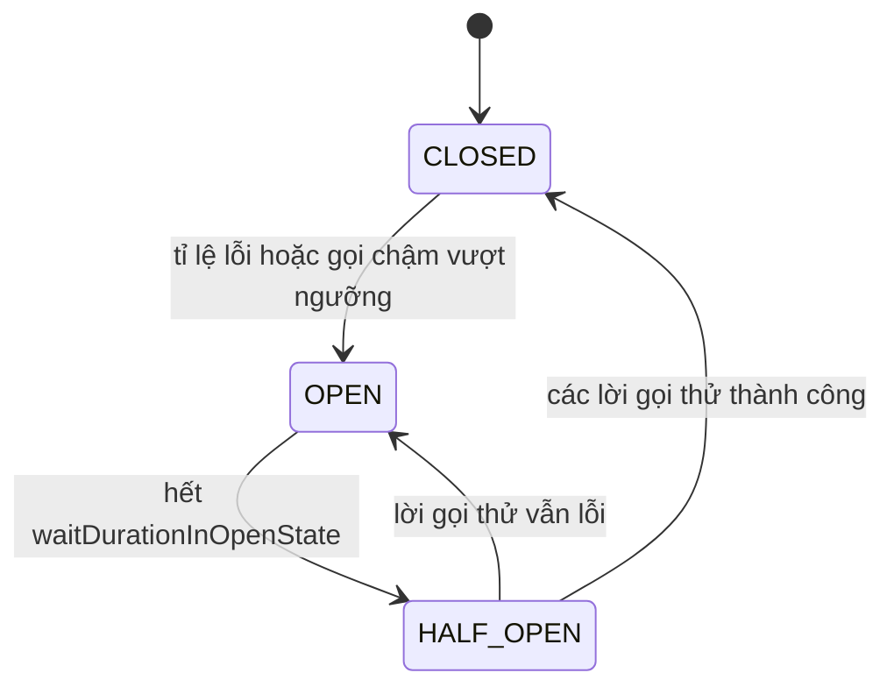

# Circuit Breaker với Resilience4j

Trong hệ phân tán, lỗi là chuyện **chắc chắn xảy ra**: dịch vụ chậm, mạng chập chờn, database quá tải. Nếu không có cơ chế phòng vệ, một dịch vụ lỗi sẽ kéo sập cả chuỗi gọi nó. Bài này giải thích pattern **circuit breaker** (cầu dao) với ba trạng thái closed/open/half-open, cùng các cơ chế bổ trợ: fallback, retry, timeout, bulkhead — triển khai bằng **Resilience4j**, thư viện thay thế Netflix Hystrix đã ngừng phát triển, và lớp trừu tượng **Spring Cloud Circuit Breaker**.

---

:::note[Ghi nhớ nhanh]

- ⭐ **Ba trạng thái**: CLOSED (cho qua, đếm lỗi) → vượt ngưỡng thì OPEN (chặn ngay, trả fallback) → hết thời gian chờ thì HALF_OPEN (thử vài request) → thành công thì về CLOSED, thất bại thì lại OPEN.
- ⭐ **Thứ tự mặc định của annotation Resilience4j**: Retry bọc ngoài CircuitBreaker, rồi RateLimiter, TimeLimiter, Bulkhead — retry quá nhiều có thể làm mở cầu dao nhanh hơn.
- **Retry chỉ cho lỗi tạm thời và thao tác idempotent** — retry một lệnh trừ tiền không idempotent có thể trừ hai lần.
- **Timeout** (`TimeLimiter`) và **bulkhead** giới hạn tài nguyên mà một phụ thuộc chậm có thể chiếm.
- **Hystrix đã ngừng** (chế độ bảo trì từ 2018, bị bỏ khỏi Spring Cloud 2020.0) — dùng Resilience4j.

:::

---

## Mục lục

- [Vì sao circuit breaker ra đời?](#vì-sao-circuit-breaker-ra-đời)
- [Ba trạng thái của circuit breaker](#ba-trạng-thái-của-circuit-breaker)
- [Cài đặt Resilience4j với Spring Boot](#cài-đặt-resilience4j-với-spring-boot)
- [Fallback](#fallback)
- [Retry](#retry)
- [Timeout với TimeLimiter](#timeout-với-timelimiter)
- [Bulkhead](#bulkhead)
- [Spring Cloud Circuit Breaker](#spring-cloud-circuit-breaker)
- [Câu hỏi phỏng vấn](#câu-hỏi-phỏng-vấn)

---

## Vì sao circuit breaker ra đời?

**Vấn đề:** `order-service` gọi `catalog-service`. Một ngày database của catalog bị khoá, mỗi request treo 30 giây:

```java
public Order place(PlaceOrderCommand cmd) {
    ProductDto p = catalogClient.getProduct(cmd.productId()); // treo 30 giây
    // ...
}
```

- Tomcat có 200 thread. Sau vài giây, cả 200 thread đều đang chờ catalog.
- `order-service` không còn thread phục vụ bất kỳ request nào, kể cả những API **không liên quan** catalog.
- Gateway và các dịch vụ gọi `order-service` cũng bắt đầu treo → **lỗi dây chuyền** (cascading failure).
- Trong khi đó, hàng nghìn request vẫn tiếp tục dội vào catalog đang ốm, khiến nó không thể hồi phục.

**Giải pháp:** Đặt một "cầu dao" quanh lời gọi. Khi tỉ lệ lỗi vượt ngưỡng, cầu dao **ngắt** — các lời gọi sau thất bại **ngay lập tức** (hoặc trả fallback) mà không chạm tới catalog. Sau một khoảng thời gian, cầu dao cho thử vài request để kiểm tra catalog đã khoẻ chưa.

```java
@CircuitBreaker(name = "catalog", fallbackMethod = "productUnavailable")
public ProductDto getProduct(long id) {
    return catalogClient.getProduct(id);
}
```

Michael Nygard giới thiệu pattern này trong sách *Release It!* (2007); Netflix phổ biến nó qua Hystrix.

:::tip[Dùng thực tế]

- Gọi dịch vụ nội bộ hoặc API bên thứ ba (cổng thanh toán, SMS, bản đồ).
- Tính năng phụ (gợi ý sản phẩm, đánh giá) lỗi thì ẩn đi, không làm hỏng trang chính.
- Bảo vệ database/cache: Redis chết thì đọc thẳng DB với giới hạn.
- Gateway bọc route bằng circuit breaker kèm `fallbackUri`.

:::

:::tip[Ví dụ đời thường]

Đúng như **cầu dao (CB) điện trong nhà**: khi có chập điện, cầu dao nhảy để bảo vệ cả căn nhà khỏi cháy, thay vì để dòng điện tiếp tục chạy vào chỗ hỏng. Sau khi sửa, bạn bật lại thử — nếu vẫn chập thì cầu dao lại nhảy.

:::

---

## Ba trạng thái của circuit breaker



| Trạng thái | Hành vi |
|------------|---------|
| **CLOSED** (đóng mạch) | Cho mọi lời gọi đi qua, ghi nhận kết quả vào cửa sổ trượt (sliding window) |
| **OPEN** (ngắt mạch) | Từ chối ngay mọi lời gọi với `CallNotPermittedException`, không gọi xuống dịch vụ đích |
| **HALF_OPEN** (nửa mở) | Cho một số lượng nhỏ lời gọi thử đi qua để đánh giá |

Ngoài ra Resilience4j có các trạng thái đặc biệt `DISABLED`, `FORCED_OPEN`, `METRICS_ONLY` để điều khiển thủ công.

Cách tính tỉ lệ lỗi — **sliding window**:

- `COUNT_BASED`: xét N lời gọi gần nhất (ví dụ 20).
- `TIME_BASED`: xét các lời gọi trong N giây gần nhất.

Tỉ lệ chỉ được tính khi đủ `minimumNumberOfCalls` — tránh việc 1 lỗi trên 1 lời gọi (100%) đã ngắt mạch.

Lời gọi **chậm** cũng được tính: lời gọi vượt `slowCallDurationThreshold` là "chậm"; tỉ lệ chậm vượt `slowCallRateThreshold` cũng làm mở cầu dao — bảo vệ trước dịch vụ không lỗi nhưng ì ạch.

---

## Cài đặt Resilience4j với Spring Boot

```xml
<dependency>
    <groupId>io.github.resilience4j</groupId>
    <artifactId>resilience4j-spring-boot3</artifactId>
    <version>2.2.0</version>
</dependency>
<dependency>
    <groupId>org.springframework.boot</groupId>
    <artifactId>spring-boot-starter-aop</artifactId>
</dependency>
<dependency>
    <groupId>org.springframework.boot</groupId>
    <artifactId>spring-boot-starter-actuator</artifactId>
</dependency>
```

Hoặc dùng starter của Spring Cloud `spring-cloud-starter-circuitbreaker-resilience4j` (đã kéo theo Resilience4j, phiên bản do BOM quản lý).

Cấu hình:

```yaml
resilience4j:
  circuitbreaker:
    configs:
      default:
        sliding-window-type: COUNT_BASED
        sliding-window-size: 20
        minimum-number-of-calls: 10
        failure-rate-threshold: 50              # >= 50% lỗi thì mở
        slow-call-duration-threshold: 2s
        slow-call-rate-threshold: 80
        wait-duration-in-open-state: 30s
        permitted-number-of-calls-in-half-open-state: 3
        automatic-transition-from-open-to-half-open-enabled: true
        register-health-indicator: true
        record-exceptions:
          - java.io.IOException
          - java.util.concurrent.TimeoutException
          - org.springframework.web.client.HttpServerErrorException
        ignore-exceptions:
          - com.example.order.ProductNotFoundException   # lỗi nghiệp vụ không tính
    instances:
      catalog:
        base-config: default
      payment:
        base-config: default
        failure-rate-threshold: 30
        wait-duration-in-open-state: 60s

management:
  endpoints:
    web:
      exposure:
        include: health, circuitbreakers, circuitbreakerevents
  health:
    circuitbreakers:
      enabled: true
```

Dùng annotation:

```java
@Service
@RequiredArgsConstructor
@Slf4j
public class CatalogFacade {

    private final CatalogClient catalogClient;

    @CircuitBreaker(name = "catalog", fallbackMethod = "productFallback")
    public ProductDto getProduct(long id) {
        return catalogClient.getProduct(id);
    }

    private ProductDto productFallback(long id, Throwable ex) {
        log.warn("Fallback sản phẩm {}: {}", id, ex.toString());
        return ProductDto.unavailable(id);
    }
}
```

:::warning[Lỗi hay gặp]

- Gắn annotation lên method `private` hoặc gọi method từ **chính class đó** (`this.getProduct()`) → Spring AOP proxy không chặn được, circuit breaker không chạy.
- Tính cả lỗi 4xx (dữ liệu sai, không tìm thấy) vào tỉ lệ lỗi → người dùng nhập sai nhiều cũng làm ngắt mạch. Dùng `ignore-exceptions` cho lỗi nghiệp vụ.
- Mỗi dịch vụ đích phải có **instance riêng** (`catalog`, `payment`) — dùng chung một tên làm lỗi của dịch vụ này ngắt luôn dịch vụ kia.

:::

---

## Fallback

Fallback là phương án dự phòng khi lời gọi thất bại hoặc cầu dao đang mở.

Quy tắc chữ ký: **cùng kiểu trả về**, **cùng tham số** với method gốc, thêm một tham số cuối kiểu exception. Có thể khai báo nhiều fallback theo loại exception — Resilience4j chọn cái khớp cụ thể nhất:

```java
private ProductDto productFallback(long id, CallNotPermittedException ex) {
    // cầu dao đang mở
    return cache.getOrDefault(id, ProductDto.unavailable(id));
}

private ProductDto productFallback(long id, Exception ex) {
    // mọi lỗi khác
    return ProductDto.unavailable(id);
}
```

Chiến lược fallback hợp lý:

| Chiến lược | Ví dụ |
|------------|-------|
| Trả dữ liệu cache gần nhất | Giá sản phẩm lần đọc trước |
| Giá trị mặc định an toàn | Danh sách gợi ý rỗng |
| Giảm chức năng | Ẩn mục đánh giá, hiện "tạm thời không khả dụng" |
| Xếp hàng xử lý sau | Lưu yêu cầu gửi email vào bảng outbox |
| Báo lỗi rõ ràng | Thanh toán: trả 503 kèm thông báo thử lại, **không** giả vờ thành công |

:::tip[Ví dụ đời thường]

Quán phở hết bánh phở thì đề xuất **chuyển sang bún** (fallback hợp lý), chứ không bưng ra bát nước dùng không và nói là phở (fallback sai).

:::

---

## Retry

Retry thử lại lời gọi khi gặp lỗi tạm thời (mạng chập chờn, 503).

```yaml
resilience4j:
  retry:
    instances:
      catalog:
        max-attempts: 3                   # tính cả lần gọi đầu
        wait-duration: 200ms
        enable-exponential-backoff: true
        exponential-backoff-multiplier: 2   # 200ms, 400ms...
        retry-exceptions:
          - java.io.IOException
          - org.springframework.web.client.HttpServerErrorException$ServiceUnavailable
        ignore-exceptions:
          - com.example.order.ProductNotFoundException
```

```java
@Retry(name = "catalog")
@CircuitBreaker(name = "catalog", fallbackMethod = "productFallback")
public ProductDto getProduct(long id) {
    return catalogClient.getProduct(id);
}
```

Thứ tự aspect mặc định của Resilience4j (ngoài vào trong):

```
Retry ( CircuitBreaker ( RateLimiter ( TimeLimiter ( Bulkhead ( method ) ) ) ) )
```

Nghĩa là mỗi lần retry đều đi qua circuit breaker và được tính vào thống kê. Có thể đổi thứ tự bằng các thuộc tính `resilience4j.retry.retry-aspect-order`, `resilience4j.circuitbreaker.circuit-breaker-aspect-order` (số lớn hơn có độ ưu tiên cao hơn, chạy bọc ngoài).

:::warning[Lỗi hay gặp]

- **Retry thao tác không idempotent** (tạo đơn, trừ tiền) khi lỗi timeout: có thể request đầu đã thành công, retry tạo bản ghi thứ hai. Chỉ retry thao tác idempotent hoặc dùng idempotency key.
- **Retry storm**: 3 tầng dịch vụ mỗi tầng retry 3 lần → dịch vụ cuối nhận 27 lần tải. Chỉ retry ở một tầng, dùng backoff có jitter (`enable-randomized-wait`).
- Retry cả lỗi 400/404 — lỗi đó không bao giờ tự hết.

:::

---

## Timeout với TimeLimiter

`TimeLimiter` giới hạn thời gian chờ một tác vụ bất đồng bộ. Với annotation, method phải trả về `CompletableFuture` (hoặc kiểu reactive `Mono`/`Flux`):

```yaml
resilience4j:
  timelimiter:
    instances:
      catalog:
        timeout-duration: 2s
        cancel-running-future: true
```

```java
@TimeLimiter(name = "catalog", fallbackMethod = "productAsyncFallback")
@CircuitBreaker(name = "catalog")
public CompletableFuture<ProductDto> getProductAsync(long id) {
    return CompletableFuture.supplyAsync(() -> catalogClient.getProduct(id), executor);
}

private CompletableFuture<ProductDto> productAsyncFallback(long id, Throwable ex) {
    return CompletableFuture.completedFuture(ProductDto.unavailable(id));
}
```

Với lời gọi đồng bộ (blocking), cách đơn giản và đáng tin hơn là đặt **timeout ở HTTP client** (connect/read timeout của Feign, `RestClient`). Timeout là tuyến phòng thủ đầu tiên — không có timeout thì circuit breaker cũng phải chờ rất lâu mới ghi nhận được lỗi.

---

## Bulkhead

Bulkhead (vách ngăn) giới hạn số lời gọi **đồng thời** tới một phụ thuộc, để một phụ thuộc chậm không chiếm hết tài nguyên.

```yaml
resilience4j:
  bulkhead:
    instances:
      recommendation:
        max-concurrent-calls: 10
        max-wait-duration: 0          # hết chỗ thì từ chối ngay
  thread-pool-bulkhead:
    instances:
      report:
        core-thread-pool-size: 4
        max-thread-pool-size: 8
        queue-capacity: 20
```

```java
@Bulkhead(name = "recommendation", fallbackMethod = "noRecommendation")
public List<ProductDto> recommend(long userId) {
    return recommendationClient.forUser(userId);
}

private List<ProductDto> noRecommendation(long userId, Throwable ex) {
    return List.of();
}
```

| Loại | Cơ chế | Khi dùng |
|------|--------|----------|
| `SEMAPHORE` (mặc định) | Đếm số lời gọi đồng thời trên chính thread gọi | Lời gọi đồng bộ thông thường |
| `THREADPOOL` | Chạy trong thread pool riêng, method trả `CompletableFuture` | Cách ly hoàn toàn, chấp nhận chi phí đổi luồng |

:::tip[Ví dụ đời thường]

Thân tàu thuỷ chia thành nhiều **khoang kín** (bulkhead): một khoang thủng chỉ ngập khoang đó, tàu không chìm. Tương tự, dịch vụ gợi ý chậm chỉ chiếm tối đa 10 "chỗ", phần còn lại của ứng dụng vẫn chạy.

:::

---

## Spring Cloud Circuit Breaker

Spring Cloud Circuit Breaker là **lớp trừu tượng** để code không phụ thuộc trực tiếp vào thư viện cụ thể (Resilience4j, Spring Retry).

```xml
<dependency>
    <groupId>org.springframework.cloud</groupId>
    <artifactId>spring-cloud-starter-circuitbreaker-resilience4j</artifactId>
</dependency>
```

```java
@Service
public class CatalogFacade {

    private final CatalogClient catalogClient;
    private final CircuitBreaker circuitBreaker;

    public CatalogFacade(CatalogClient catalogClient, CircuitBreakerFactory<?, ?> factory) {
        this.catalogClient = catalogClient;
        this.circuitBreaker = factory.create("catalog");
    }

    public ProductDto getProduct(long id) {
        return circuitBreaker.run(
                () -> catalogClient.getProduct(id),
                throwable -> ProductDto.unavailable(id));
    }
}
```

Cấu hình mặc định bằng `Customizer`:

```java
@Bean
public Customizer<Resilience4JCircuitBreakerFactory> defaultCustomizer() {
    return factory -> factory.configureDefault(id -> new Resilience4JConfigBuilder(id)
            .circuitBreakerConfig(CircuitBreakerConfig.custom()
                    .failureRateThreshold(50)
                    .waitDurationInOpenState(Duration.ofSeconds(30))
                    .slidingWindowSize(20)
                    .build())
            .timeLimiterConfig(TimeLimiterConfig.custom()
                    .timeoutDuration(Duration.ofSeconds(2))
                    .build())
            .build());
}
```

Các thuộc tính `resilience4j.circuitbreaker.instances.*` trong YAML vẫn được áp dụng cho instance cùng tên. Spring Cloud OpenFeign (`spring.cloud.openfeign.circuitbreaker.enabled=true`) và Spring Cloud Gateway (filter `CircuitBreaker`) đều dùng lớp trừu tượng này.

| | Annotation Resilience4j | Spring Cloud Circuit Breaker |
|---|---|---|
| Phong cách | Khai báo bằng annotation (AOP) | Gọi API `run(supplier, fallback)` |
| Đầy đủ tính năng | Có đủ Retry, Bulkhead, RateLimiter... | Tập trung vào circuit breaker + time limiter |
| Phụ thuộc thư viện | Gắn với Resilience4j | Đổi implementation được |

:::info[Vì sao Hystrix bị bỏ]

Netflix Hystrix chuyển sang chế độ bảo trì cuối 2018 và bị loại khỏi Spring Cloud từ release train 2020.0. Hystrix dựa nhiều vào thread pool cho mỗi phụ thuộc và cấu hình qua Archaius. Resilience4j nhẹ hơn, thiết kế theo kiểu hàm (decorator), chia thành các module độc lập (CircuitBreaker, Retry, Bulkhead, RateLimiter, TimeLimiter) và tích hợp Micrometer.

:::

---

## Câu hỏi phỏng vấn

Những câu thường gặp về chủ đề này. Tự trả lời trước, rồi bấm **Xem đáp án** để đối chiếu.

**1. Giải thích ba trạng thái của circuit breaker.**

<details className="qa">
<summary>Xem đáp án</summary>

**CLOSED**: cho lời gọi qua và ghi nhận kết quả vào sliding window. Khi đủ số lời gọi tối thiểu và tỉ lệ lỗi (hoặc gọi chậm) vượt ngưỡng → chuyển **OPEN**: mọi lời gọi bị từ chối ngay (`CallNotPermittedException`), trả fallback. Sau `waitDurationInOpenState` → **HALF_OPEN**: cho một số lời gọi thử; nếu tỉ lệ lỗi dưới ngưỡng thì về CLOSED, ngược lại quay lại OPEN.

</details>

**2. Circuit breaker giúp gì cho hệ thống? Khác retry ở điểm nào?**

<details className="qa">
<summary>Xem đáp án</summary>

Circuit breaker ngăn lỗi dây chuyền: thất bại nhanh thay vì chờ, giải phóng thread và cho dịch vụ đích thời gian hồi phục. Retry thì ngược lại — cố gắng gọi lại để vượt qua lỗi tạm thời. Retry phù hợp lỗi thoáng qua; circuit breaker phù hợp khi lỗi kéo dài. Hai cơ chế dùng kết hợp, với retry giới hạn và có backoff.

</details>

**3. Thứ tự mặc định khi kết hợp nhiều annotation Resilience4j là gì? Ảnh hưởng thế nào?**

<details className="qa">
<summary>Xem đáp án</summary>

Ngoài vào trong: Retry → CircuitBreaker → RateLimiter → TimeLimiter → Bulkhead → method. Vì Retry bọc ngoài, mỗi lần thử lại đều đi qua circuit breaker và được tính vào thống kê lỗi; khi cầu dao mở, retry nhận `CallNotPermittedException` (nên cấu hình không retry exception này). Có thể đổi thứ tự bằng thuộc tính `*-aspect-order`.

</details>

**4. Khi nào không nên retry?**

<details className="qa">
<summary>Xem đáp án</summary>

Không retry lỗi vĩnh viễn (400, 401, 404, lỗi validate). Không retry thao tác không idempotent (tạo đơn, chuyển tiền) trừ khi có idempotency key. Tránh retry ở nhiều tầng cùng lúc gây retry storm. Luôn dùng số lần giới hạn, exponential backoff và jitter.

</details>

**5. Bulkhead là gì? Semaphore bulkhead khác thread pool bulkhead thế nào?**

<details className="qa">
<summary>Xem đáp án</summary>

Bulkhead giới hạn số lời gọi đồng thời tới một phụ thuộc để nó không chiếm hết tài nguyên chung. Semaphore bulkhead đếm số lời gọi đang chạy trên chính thread gọi, nhẹ, phù hợp code đồng bộ. Thread pool bulkhead chạy lời gọi trong pool riêng, cách ly hoàn toàn, method phải trả `CompletableFuture`, tốn chi phí đổi luồng và cần chú ý truyền context (security, tracing).

</details>

**6. Viết fallback thế nào cho đúng?**

<details className="qa">
<summary>Xem đáp án</summary>

Về kỹ thuật: cùng kiểu trả về, cùng tham số với method gốc, thêm tham số exception cuối; nằm cùng class. Về nghiệp vụ: fallback phải an toàn — trả cache, giá trị rỗng, giảm chức năng, hoặc báo lỗi rõ ràng; không được giả lập kết quả thành công cho thao tác quan trọng như thanh toán. Ghi log/metrics trong fallback để biết hệ thống đang chạy chế độ suy giảm.

</details>

**7. Vì sao Hystrix bị thay bằng Resilience4j?**

<details className="qa">
<summary>Xem đáp án</summary>

Netflix ngừng phát triển Hystrix (chế độ bảo trì từ 2018), Spring Cloud loại bỏ nó từ 2020.0. Resilience4j nhẹ, chỉ phụ thuộc Vavr (bản 1.x) hoặc không phụ thuộc thêm (bản 2.x), thiết kế theo decorator hàm, chia module độc lập, hỗ trợ Java 17+, reactive, và tích hợp tốt với Micrometer/Actuator.

</details>
