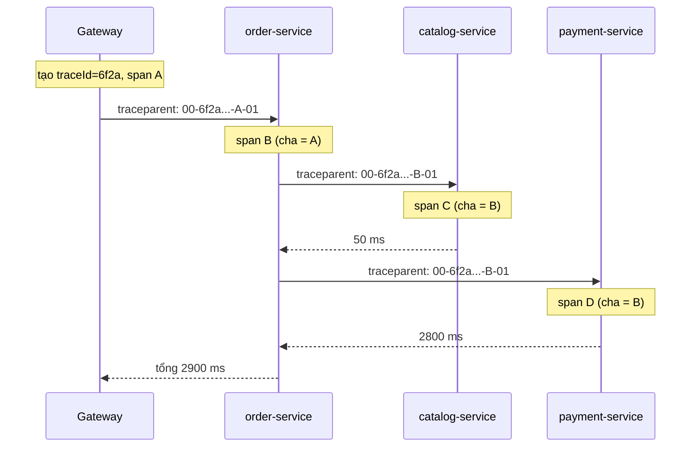

# Distributed Tracing (Micrometer Tracing)

Một request "đặt hàng" có thể đi qua Gateway, `order-service`, `catalog-service`, `payment-service` và Kafka. Khi người dùng kêu "chậm quá", làm sao biết chậm ở đâu? **Distributed tracing** (truy vết phân tán) gắn cho mỗi request một mã định danh xuyên suốt và đo thời gian từng bước. Bài này giải thích trace, span, cách truyền ngữ cảnh (propagation) giữa dịch vụ, việc Spring Cloud Sleuth bị thay bằng **Micrometer Tracing** từ Spring Boot 3, cách gửi dữ liệu tới Zipkin hoặc OpenTelemetry, và in `traceId` vào log.

---

:::note[Ghi nhớ nhanh]

- ⭐ **Trace = toàn bộ hành trình một request; span = một bước trong hành trình** — mọi span của một request chung một `traceId`, mỗi span có `spanId` và trỏ tới span cha.
- ⭐ **Sleuth đã ngừng ở Spring Boot 2.x** — Boot 3 dùng **Micrometer Tracing** (bridge Brave hoặc OpenTelemetry) qua Actuator, cấu hình bằng `management.tracing.*`.
- **Propagation** truyền `traceId` qua header HTTP/message; mặc định chuẩn **W3C `traceparent`**, có thể đổi sang B3.
- **Sampling mặc định 10%** (`management.tracing.sampling.probability=0.1`) — dev nên đặt 1.0 để thấy mọi trace.
- **Client HTTP phải tạo từ builder do Spring Boot cấu hình** (`RestClient.Builder`, `RestTemplateBuilder`, `WebClient.Builder`) thì mới được gắn tracing tự động; Boot 3.2+ tự in `traceId`/`spanId` vào log.

:::

---

## Mục lục

- [Vì sao cần distributed tracing?](#vì-sao-cần-distributed-tracing)
- [Trace, span và propagation](#trace-span-và-propagation)
- [Từ Sleuth sang Micrometer Tracing](#từ-sleuth-sang-micrometer-tracing)
- [Cài đặt với Zipkin](#cài-đặt-với-zipkin)
- [Cài đặt với OpenTelemetry](#cài-đặt-với-opentelemetry)
- [traceId trong log](#traceid-trong-log)
- [Tạo span thủ công và baggage](#tạo-span-thủ-công-và-baggage)
- [Câu hỏi phỏng vấn](#câu-hỏi-phỏng-vấn)

---

## Vì sao cần distributed tracing?

**Vấn đề:** Log của từng dịch vụ nằm riêng lẻ:

```
[order-service]   10:00:01.120 INFO  Nhận yêu cầu đặt hàng user=42
[catalog-service] 10:00:01.135 INFO  Lấy sản phẩm id=7
[catalog-service] 10:00:01.140 INFO  Lấy sản phẩm id=7
[payment-service] 10:00:03.900 WARN  Gọi cổng thanh toán chậm
[order-service]   10:00:04.010 INFO  Đặt hàng xong
```

Hệ thống có 500 request mỗi giây. Hai dòng "Lấy sản phẩm id=7" thuộc request nào? Dòng WARN của payment liên quan tới đơn nào? Không có cách nào nối các dòng log này lại với nhau một cách chắc chắn.

**Giải pháp:** Gắn cho mỗi request một `traceId` khi vào hệ thống và **truyền theo** qua mọi lời gọi:

```
[order-service,   6f2a9c1e...,a1b2] Nhận yêu cầu đặt hàng user=42
[catalog-service, 6f2a9c1e...,c3d4] Lấy sản phẩm id=7
[payment-service, 6f2a9c1e...,e5f6] Gọi cổng thanh toán chậm
```

Lọc log theo `6f2a9c1e...` là thấy đủ hành trình. Gửi các span tới Zipkin/Jaeger/Tempo là thấy luôn biểu đồ thời gian.

:::tip[Dùng thực tế]

- Tìm dịch vụ gây chậm trong chuỗi gọi (catalog 50ms, payment 2.8 giây).
- Lọc toàn bộ log của một request lỗi khi khách hàng báo mã lỗi.
- Vẽ bản đồ phụ thuộc giữa các dịch vụ từ dữ liệu thực tế.
- Phát hiện N+1 lời gọi HTTP (một request sinh ra 50 span gọi cùng dịch vụ).

:::

:::tip[Ví dụ đời thường]

Tracing giống **mã vận đơn** khi gửi hàng. Kiện hàng đi qua bưu cục quận, kho trung chuyển, xe liên tỉnh, bưu cục nhận — mỗi nơi quét mã và ghi giờ. Tra mã vận đơn (traceId) là biết hàng đang kẹt ở đâu và mỗi chặng (span) mất bao lâu.

:::

---

## Trace, span và propagation



| Khái niệm | Ý nghĩa |
|-----------|---------|
| **Trace** | Toàn bộ hành trình một request, xác định bởi `traceId` |
| **Span** | Một đơn vị công việc (một lời gọi HTTP, một câu SQL, một method), có `spanId`, thời gian bắt đầu/kết thúc, tag, sự kiện |
| **Parent span** | Span gọi tới span hiện tại — tạo thành cây |
| **Tag / attribute** | Thông tin kèm span: `http.method`, `http.status_code`, `db.statement` |
| **Propagation** | Cách truyền ngữ cảnh trace qua ranh giới tiến trình (header HTTP, header message Kafka) |
| **Sampling** | Quyết định trace nào được ghi lại và gửi đi |

Hai chuẩn header propagation phổ biến:

- **W3C Trace Context** (mặc định trong Boot 3): header `traceparent: 00-{traceId}-{spanId}-{flags}`.
- **B3** (của Zipkin): các header `X-B3-TraceId`, `X-B3-SpanId`... hoặc header gộp `b3`.

Hệ thống có dịch vụ cũ chỉ hiểu B3 thì cấu hình:

```yaml
management:
  tracing:
    propagation:
      type: b3, w3c      # gửi và nhận cả hai
```

---

## Từ Sleuth sang Micrometer Tracing

| | Spring Cloud Sleuth | Micrometer Tracing |
|---|---|---|
| Thời kỳ | Spring Boot 2.x | Spring Boot 3.x trở đi |
| Thuộc về | Spring Cloud | Micrometer (cùng họ với Micrometer Metrics), tích hợp qua Actuator |
| Cách đo | Instrument riêng cho từng thư viện | **Observation API** — một lần đo sinh ra cả metrics lẫn trace |
| Tracer | Brave (mặc định), OTel (thử nghiệm) | Bridge Brave hoặc bridge OpenTelemetry |
| Cấu hình | `spring.sleuth.*` | `management.tracing.*` |
| Trạng thái | Ngừng, không hỗ trợ Boot 3 | Đang phát triển |

Lý do thay đổi: Sleuth instrument từng thư viện theo cách riêng của nó, trùng lặp với việc đo metrics. Micrometer **Observation API** gom lại: các thư viện (Spring MVC, WebFlux, `RestClient`, JDBC qua datasource-micrometer, Kafka, RabbitMQ) chỉ cần tạo một `Observation`, rồi các handler sinh ra timer (metrics) và span (tracing).

:::warning[Lỗi hay gặp]

- Chép cấu hình `spring.sleuth.sampler.probability` sang Boot 3 → không có tác dụng. Thuộc tính mới là `management.tracing.sampling.probability`.
- Thêm `spring-cloud-starter-sleuth` vào dự án Boot 3 → không có phiên bản tương thích trong release train hiện tại.

:::

---

## Cài đặt với Zipkin

Chạy Zipkin bằng Docker:

```bash
docker run -d -p 9411:9411 openzipkin/zipkin
```

Dependency (phiên bản do Spring Boot quản lý):

```xml
<dependency>
    <groupId>org.springframework.boot</groupId>
    <artifactId>spring-boot-starter-actuator</artifactId>
</dependency>
<dependency>
    <groupId>io.micrometer</groupId>
    <artifactId>micrometer-tracing-bridge-brave</artifactId>
</dependency>
<dependency>
    <groupId>io.zipkin.reporter2</groupId>
    <artifactId>zipkin-reporter-brave</artifactId>
</dependency>
```

```yaml
spring:
  application:
    name: order-service        # hiện thành tên dịch vụ trên Zipkin

management:
  tracing:
    sampling:
      probability: 1.0         # dev: 100%; prod: thường 0.01 - 0.1
  zipkin:
    tracing:
      endpoint: http://localhost:9411/api/v2/spans
```

Gọi dịch vụ khác bằng builder được Spring Boot cấu hình:

```java
@Service
public class CatalogClient {

    private final RestClient restClient;

    // Inject RestClient.Builder do Boot tạo → đã gắn ObservationRegistry, tự truyền traceparent
    public CatalogClient(RestClient.Builder builder) {
        this.restClient = builder.baseUrl("http://catalog-service").build();
    }

    public ProductDto get(long id) {
        return restClient.get().uri("/api/products/{id}", id).retrieve().body(ProductDto.class);
    }
}
```

Mở `http://localhost:9411`, tìm theo tên dịch vụ hoặc traceId để xem biểu đồ.

:::warning[Lỗi hay gặp]

- Tạo client bằng `RestClient.create()` hoặc `new RestTemplate()` → **không** có tracing, trace bị đứt ở dịch vụ gọi. Luôn inject builder.
- Chạy code bất đồng bộ (`@Async`, `CompletableFuture`, thread pool tự tạo) → ngữ cảnh trace nằm trong ThreadLocal nên bị mất ở luồng mới. Dùng executor được Spring quản lý kèm `ContextPropagatingTaskDecorator` (Spring Framework 6.1+) để truyền ngữ cảnh.
- Kafka: phải bật `spring.kafka.template.observation-enabled=true` và `spring.kafka.listener.observation-enabled=true` thì trace mới đi qua message.

:::

---

## Cài đặt với OpenTelemetry

OpenTelemetry (OTel) là chuẩn mở, trung lập nhà cung cấp cho traces, metrics và logs. Dùng bridge OTel và exporter OTLP để gửi tới **OpenTelemetry Collector**, từ đó chuyển tiếp tới Jaeger, Grafana Tempo, Elastic, Datadog...

```xml
<dependency>
    <groupId>io.micrometer</groupId>
    <artifactId>micrometer-tracing-bridge-otel</artifactId>
</dependency>
<dependency>
    <groupId>io.opentelemetry</groupId>
    <artifactId>opentelemetry-exporter-otlp</artifactId>
</dependency>
```

```yaml
management:
  tracing:
    sampling:
      probability: 0.1
  otlp:
    tracing:
      endpoint: http://otel-collector:4318/v1/traces
```

Muốn gửi thẳng tới Zipkin bằng bridge OTel thì dùng `opentelemetry-exporter-zipkin` thay cho exporter OTLP.

| Lựa chọn | Khi nào |
|----------|---------|
| Brave + Zipkin | Hệ thống nhỏ, muốn đơn giản, đã quen Zipkin |
| OTel + OTLP Collector | Muốn chuẩn mở, đổi backend dễ, gom cả metrics/logs, hệ thống đa ngôn ngữ |
| OpenTelemetry Java Agent | Muốn instrument không sửa code (gắn `-javaagent`), chấp nhận cơ chế riêng không qua Micrometer |

:::info[Ghi chú phiên bản]

Spring Boot 4 bổ sung starter `spring-boot-starter-opentelemetry` để gom các dependency OTel. Với Boot 3.x, dùng bộ dependency như trên.

:::

---

## traceId trong log

Từ **Spring Boot 3.2**, khi có Micrometer Tracing, log mặc định tự thêm phần tương quan (correlation) chứa `traceId` và `spanId`:

```
2026-10-14T10:00:01.120+07:00  INFO 12345 --- [order-service] [nio-8080-exec-1] [6f2a9c1e0b7d4e21a3f4b5c6d7e8f901-a1b2c3d4e5f60718] c.e.order.OrderController : Nhận yêu cầu đặt hàng
```

Với Boot 3.0/3.1, phải tự thêm vào pattern:

```yaml
logging:
  pattern:
    level: "%5p [${spring.application.name:},%X{traceId:-},%X{spanId:-}]"
```

Hai giá trị được đặt vào **MDC** (Mapped Diagnostic Context) của SLF4J, nên các appender JSON (Logstash encoder, ECS) cũng đưa chúng thành field riêng — tìm kiếm trên Kibana/Loki theo `traceId` rất nhanh.

Trả `traceId` cho client để hỗ trợ khách hàng:

```java
@RestControllerAdvice
@RequiredArgsConstructor
public class GlobalErrorHandler {

    private final Tracer tracer;

    @ExceptionHandler(Exception.class)
    public ProblemDetail handle(Exception ex) {
        ProblemDetail pd = ProblemDetail.forStatusAndDetail(
                HttpStatus.INTERNAL_SERVER_ERROR, "Có lỗi xảy ra, vui lòng thử lại");
        Span span = tracer.currentSpan();
        if (span != null) {
            pd.setProperty("traceId", span.context().traceId());
        }
        return pd;
    }
}
```

Khách gửi mã `traceId` này cho bộ phận hỗ trợ, kỹ sư tra ngay được toàn bộ log và trace.

---

## Tạo span thủ công và baggage

Phần lớn span được tạo tự động (HTTP vào/ra, JDBC nếu có instrument, messaging). Muốn đo một đoạn nghiệp vụ, dùng **Observation API** (sinh cả metrics và span):

```java
@Service
@RequiredArgsConstructor
public class PricingService {

    private final ObservationRegistry registry;

    public BigDecimal calculate(Cart cart) {
        return Observation.createNotStarted("pricing.calculate", registry)
                .lowCardinalityKeyValue("channel", cart.channel())
                .highCardinalityKeyValue("cart.id", cart.id())
                .observe(() -> doCalculate(cart));
    }
}
```

Hoặc dùng annotation `@Observed` (cần `spring-boot-starter-aop`; từ Boot 3.2 có thể bật bằng `management.observations.annotations.enabled=true`, bản cũ hơn phải khai báo bean `ObservedAspect` thủ công):

```java
@Observed(name = "inventory.reserve", contextualName = "reserve-stock")
public void reserve(long productId, int qty) { ... }
```

- `lowCardinalityKeyValue`: giá trị ít biến thể (kênh, loại) — dùng làm tag cho cả metrics và span.
- `highCardinalityKeyValue`: giá trị nhiều biến thể (id) — chỉ gắn vào span, không vào metrics (tránh bùng nổ chuỗi thời gian).

**Baggage** — truyền thêm thông tin nghiệp vụ theo trace qua các dịch vụ:

```yaml
management:
  tracing:
    baggage:
      remote-fields: x-tenant-id
      correlation:
        fields: x-tenant-id      # đưa vào MDC để in ra log
```

:::warning[Lỗi hay gặp]

- Đặt sampling 100% ở production với lưu lượng lớn → tốn băng thông và lưu trữ. Dùng tỉ lệ thấp, hoặc tail-based sampling ở OTel Collector (giữ toàn bộ trace lỗi/chậm).
- Gắn dữ liệu nhạy cảm (số thẻ, mật khẩu, token) vào tag hoặc baggage → bị gửi sang hệ thống tracing và mọi dịch vụ phía sau.
- Đưa id người dùng vào `lowCardinalityKeyValue` → metrics sinh hàng triệu chuỗi thời gian, Prometheus quá tải.

:::

---

## Câu hỏi phỏng vấn

Những câu thường gặp về chủ đề này. Tự trả lời trước, rồi bấm **Xem đáp án** để đối chiếu.

**1. Trace và span khác nhau thế nào?**

<details className="qa">
<summary>Xem đáp án</summary>

Trace là toàn bộ hành trình của một request qua hệ thống, xác định bởi `traceId`. Span là một bước công việc trong hành trình đó (một lời gọi HTTP, một câu truy vấn), có `spanId`, thời gian bắt đầu/kết thúc, tag và tham chiếu tới span cha. Các span cùng `traceId` tạo thành một cây thể hiện quan hệ gọi và thời gian từng bước.

</details>

**2. Ngữ cảnh trace được truyền giữa các dịch vụ như thế nào?**

<details className="qa">
<summary>Xem đáp án</summary>

Qua **propagation**: bên gọi chèn ngữ cảnh (traceId, spanId hiện tại, cờ sampling) vào header của request/message — mặc định header W3C `traceparent`, hoặc các header B3. Bên nhận đọc header, tạo span con có cùng traceId và cha là span của bên gọi. Trong một tiến trình, ngữ cảnh được giữ trong ThreadLocal (và MDC cho log), nên khi đổi luồng phải truyền ngữ cảnh thủ công hoặc dùng decorator.

</details>

**3. Vì sao Spring Cloud Sleuth bị thay bằng Micrometer Tracing?**

<details className="qa">
<summary>Xem đáp án</summary>

Sleuth chỉ hỗ trợ đến Spring Boot 2.x. Ở Boot 3, Spring chuyển sang Micrometer **Observation API**: thư viện chỉ cần instrument một lần, các handler sinh cả metrics và trace. Micrometer Tracing là lớp trừu tượng trên Brave hoặc OpenTelemetry, được Actuator tự cấu hình. Điều này loại bỏ trùng lặp giữa đo metrics và tracing, đồng thời đưa tracing vào lõi thay vì phụ thuộc Spring Cloud.

</details>

**4. Sampling là gì? Nên đặt bao nhiêu?**

<details className="qa">
<summary>Xem đáp án</summary>

Sampling quyết định trace nào được ghi và gửi đi, nhằm giảm chi phí. Spring Boot mặc định 10%. Dev/test nên đặt 100% để debug. Production thường 1–10% tuỳ lưu lượng; quyết định sampling được truyền cùng ngữ cảnh để cả chuỗi dịch vụ thống nhất. Để không bỏ sót trace lỗi/chậm, dùng tail-based sampling tại OpenTelemetry Collector.

</details>

**5. Vì sao trace bị "đứt" giữa hai dịch vụ? Cách khắc phục?**

<details className="qa">
<summary>Xem đáp án</summary>

Nguyên nhân thường gặp: tạo HTTP client thủ công (`new RestTemplate()`, `RestClient.create()`) nên không có instrument; gọi trong luồng khác mà không truyền ngữ cảnh; messaging chưa bật observation; hai dịch vụ dùng chuẩn propagation khác nhau (W3C và B3); hoặc proxy/gateway trung gian xoá header. Khắc phục: inject builder do Boot cấu hình, dùng `ContextPropagatingTaskDecorator`, bật observation cho Kafka/RabbitMQ, cấu hình `management.tracing.propagation.type` thống nhất.

</details>

**6. Làm sao in traceId vào log và tận dụng nó?**

<details className="qa">
<summary>Xem đáp án</summary>

Micrometer Tracing đặt `traceId`, `spanId` vào MDC. Từ Boot 3.2, pattern log mặc định đã có phần correlation; bản cũ tự thêm `%X{traceId}` vào `logging.pattern.level`. Dùng log JSON để traceId thành field riêng, gom log tập trung (ELK, Loki) rồi tìm theo traceId. Có thể trả traceId trong response lỗi để khách hàng cung cấp khi báo lỗi, và liên kết từ log sang giao diện trace (Grafana Tempo/Zipkin).

</details>
