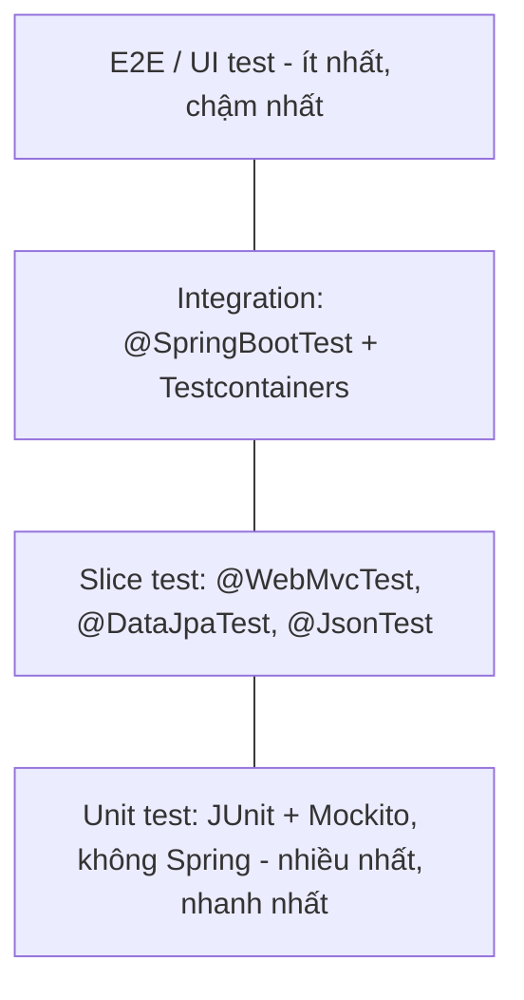

# @SpringBootTest

`@SpringBootTest` khởi động **toàn bộ ApplicationContext** của ứng dụng trong test — gần nhất với khi chạy thật. Bài này đặt nó vào bức tranh chung của test pyramid, liệt kê những gì `spring-boot-starter-test` mang theo, giải thích các chế độ `webEnvironment`, cách gọi API thật bằng `TestRestTemplate`/`WebTestClient`, cơ chế **context caching** giúp test chạy nhanh, và dùng **Testcontainers** với `@ServiceConnection` để test với database thật. Đây là nền tảng cho các bài testing tiếp theo.

---

:::note[Ghi nhớ nhanh]

- ⭐ **`@SpringBootTest` = integration test** — nạp toàn bộ bean, chậm hơn unit test nhiều; dùng cho luồng đầu-cuối, không dùng để test từng hàm nhỏ.
- ⭐ **Context caching** — Spring tái sử dụng context giữa các test class có **cùng cấu hình**; mỗi `@MockitoBean`, `@TestPropertySource`, profile khác nhau hay `@DirtiesContext` đều tạo context mới, làm bộ test chậm hẳn.
- **`webEnvironment`**: `MOCK` (mặc định, không mở cổng, dùng MockMvc), `RANDOM_PORT` (server thật, dùng `TestRestTemplate`/`WebTestClient`), `DEFINED_PORT`, `NONE`.
- **Test với `RANDOM_PORT` không rollback** — request chạy trên luồng server khác, `@Transactional` trên test không bao được; phải tự dọn dữ liệu.
- **Testcontainers + `@ServiceConnection`** (Boot 3.1+) — chạy PostgreSQL/Kafka/Redis thật trong Docker, Boot tự cấu hình kết nối.

:::

---

## Mục lục

- [Vì sao cần @SpringBootTest?](#vì-sao-cần-springboottest)
- [Test pyramid trong Spring Boot](#test-pyramid-trong-spring-boot)
- [spring-boot-starter-test gồm gì?](#spring-boot-starter-test-gồm-gì)
- [Các chế độ webEnvironment](#các-chế-độ-webenvironment)
- [Gọi API với TestRestTemplate và WebTestClient](#gọi-api-với-testresttemplate-và-webtestclient)
- [Context caching](#context-caching)
- [Testcontainers với @ServiceConnection](#testcontainers-với-serviceconnection)
- [Câu hỏi phỏng vấn](#câu-hỏi-phỏng-vấn)

---

## Vì sao cần @SpringBootTest?

**Vấn đề:** Unit test với Mockito kiểm tra từng class riêng lẻ rất tốt, nhưng **không phát hiện** được các lỗi nằm ở chỗ "ghép nối":

```java
// Unit test pass, nhưng khi chạy thật:
// - thiếu @Transactional → LazyInitializationException
// - cấu hình Jackson làm sai format ngày
// - SecurityFilterChain chặn mất endpoint
// - câu @Query viết sai cú pháp JPQL
// - property trong application.yml gõ sai tên
class OrderServiceTest {
    @Test
    void place() {
        OrderRepository repo = mock(OrderRepository.class);
        OrderService service = new OrderService(repo);
        // ...
    }
}
```

Trước Spring Boot, dựng context trong test phải tự khai báo `@ContextConfiguration` với danh sách class cấu hình, tự dựng DataSource test, tự khởi động server nhúng.

**Giải pháp:** `@SpringBootTest` tự tìm class `@SpringBootApplication`, dựng context y như khi chạy thật (auto-configuration, `application.yml`, mọi bean):

```java
@SpringBootTest
class ShopApplicationTests {

    @Test
    void contextLoads() {
        // Pass nghĩa là toàn bộ bean khởi tạo thành công
    }
}
```

:::tip[Dùng thực tế]

- Kiểm tra luồng nghiệp vụ trọn vẹn: gọi API đặt hàng → lưu DB → phát sự kiện.
- Kiểm tra cấu hình bảo mật, serialization, exception handler hoạt động cùng nhau.
- Smoke test "context khởi động được" trong pipeline CI.
- Test tích hợp với database, Kafka, Redis thật qua Testcontainers.

:::

---

## Test pyramid trong Spring Boot



| Tầng | Công cụ | Tốc độ | Kiểm tra gì |
|------|---------|--------|-------------|
| Unit | JUnit 5, Mockito, AssertJ | Mili giây | Logic nghiệp vụ một class |
| Slice | `@WebMvcTest`, `@DataJpaTest`... | Vài giây (nạp một phần context) | Một tầng: controller, repository, JSON |
| Integration | `@SpringBootTest` | Vài giây đến chục giây | Nhiều tầng ghép lại, cấu hình thật |
| E2E | Playwright, Selenium, Postman/Newman | Lâu | Hệ thống triển khai thật từ góc người dùng |

Nguyên tắc: **nhiều unit test, vừa phải slice test, ít integration test** — nhưng integration test phải bao phủ các luồng quan trọng nhất.

:::tip[Ví dụ đời thường]

Kiểm tra một chiếc xe máy: unit test là **thử từng linh kiện** (bugi, phanh) trên bàn; slice test là **thử cả cụm động cơ** trên giá; `@SpringBootTest` là **nổ máy chạy thử trong sân**; E2E là **chạy ngoài đường thật**. Không ai chạy ngoài đường để kiểm tra từng con ốc.

:::

---

## spring-boot-starter-test gồm gì?

```xml
<dependency>
    <groupId>org.springframework.boot</groupId>
    <artifactId>spring-boot-starter-test</artifactId>
    <scope>test</scope>
</dependency>
```

Một dependency mang theo:

| Thư viện | Vai trò |
|----------|---------|
| JUnit Jupiter (JUnit 5) | Framework chạy test |
| Spring Test, Spring Boot Test | `@SpringBootTest`, MockMvc, test slice, context caching |
| AssertJ | Assertion dạng fluent `assertThat(x).isEqualTo(y)` |
| Hamcrest | Matcher (dùng trong MockMvc `jsonPath`) |
| Mockito | Tạo mock/stub |
| JSONassert | So sánh JSON |
| JsonPath | Truy vấn JSON bằng biểu thức `$.items[0].name` |
| XMLUnit | So sánh XML |

Thư viện thêm khi cần: `spring-security-test` (`@WithMockUser`), `spring-boot-testcontainers` + module Testcontainers, `reactor-test`, `awaitility` (chờ điều kiện bất đồng bộ).

---

## Các chế độ webEnvironment

```java
@SpringBootTest(webEnvironment = SpringBootTest.WebEnvironment.RANDOM_PORT)
class OrderApiIT { }
```

| Giá trị | Server thật? | Dùng với | Ghi chú |
|---------|-------------|----------|---------|
| `MOCK` (mặc định) | Không — môi trường servlet giả lập | `MockMvc` (thêm `@AutoConfigureMockMvc`) | Nhanh, test chạy cùng luồng với request |
| `RANDOM_PORT` | Có, cổng ngẫu nhiên | `TestRestTemplate`, `WebTestClient` | Gần thật nhất, chạy song song nhiều bộ test không đụng cổng |
| `DEFINED_PORT` | Có, cổng trong `server.port` | Như trên | Dễ xung đột cổng, ít dùng |
| `NONE` | Không có web | Test service/batch/consumer | Context không có tầng web |

```java
@SpringBootTest
@AutoConfigureMockMvc
class OrderMockEnvTest {

    @Autowired
    private MockMvc mockMvc;

    @Test
    void listOrders() throws Exception {
        mockMvc.perform(get("/api/orders"))
               .andExpect(status().isOk());
    }
}
```

Lấy cổng thật khi cần: `@LocalServerPort int port;`.

Ghi đè cấu hình cho test:

```java
@SpringBootTest(properties = {
        "app.payment.enabled=false",
        "spring.jpa.show-sql=true"
})
@ActiveProfiles("test")
class PaymentDisabledTest { }
```

Thêm bean riêng cho test bằng `@TestConfiguration` (lớp lồng bên trong test class sẽ được nạp tự động; lớp ngoài thì dùng `@Import`).

```java
@SpringBootTest
@Import(FixedClockConfig.class)
class InvoiceDueDateTest { }

@TestConfiguration
class FixedClockConfig {
    @Bean
    Clock clock() {
        return Clock.fixed(Instant.parse("2026-01-01T00:00:00Z"), ZoneOffset.UTC);
    }
}
```

---

## Gọi API với TestRestTemplate và WebTestClient

**TestRestTemplate** — Boot tự cấu hình bean khi dùng `RANDOM_PORT`/`DEFINED_PORT`, URL tương đối tự trỏ về cổng đang chạy:

```java
@SpringBootTest(webEnvironment = SpringBootTest.WebEnvironment.RANDOM_PORT)
class OrderApiIT {

    @Autowired
    private TestRestTemplate rest;

    @Autowired
    private OrderRepository orderRepository;

    @AfterEach
    void cleanUp() {
        orderRepository.deleteAll();     // server chạy luồng khác → không rollback được, tự dọn
    }

    @Test
    void createOrder_returns201() {
        var request = new CreateOrderRequest("an@example.com", List.of(new Line("IP15", 1)));

        ResponseEntity<OrderResponse> res = rest.postForEntity("/api/orders", request, OrderResponse.class);

        assertThat(res.getStatusCode()).isEqualTo(HttpStatus.CREATED);
        assertThat(res.getBody()).isNotNull();
        assertThat(res.getBody().status()).isEqualTo("NEW");
        assertThat(orderRepository.count()).isEqualTo(1);
    }

    @Test
    void getMissingOrder_returns404() {
        ResponseEntity<String> res = rest.getForEntity("/api/orders/999", String.class);
        assertThat(res.getStatusCode()).isEqualTo(HttpStatus.NOT_FOUND);
    }
}
```

`TestRestTemplate` **không ném exception** khi gặp 4xx/5xx (khác `RestTemplate`), nên assert status trực tiếp được. Gửi kèm Basic auth: `rest.withBasicAuth("admin", "secret")`.

**WebTestClient** — API fluent, dùng được cho cả ứng dụng MVC lẫn WebFlux (với MVC cần có `spring-webflux` trên classpath ở scope test):

```java
@SpringBootTest(webEnvironment = SpringBootTest.WebEnvironment.RANDOM_PORT)
class ProductApiIT {

    @Autowired
    private WebTestClient client;

    @Test
    void listProducts() {
        client.get().uri("/api/products?size=5")
              .exchange()
              .expectStatus().isOk()
              .expectBody()
              .jsonPath("$.content.length()").isEqualTo(5)
              .jsonPath("$.content[0].name").isNotEmpty();
    }
}
```

:::info[Ghi chú phiên bản]

Spring Framework 7 / Spring Boot 4 bổ sung `RestTestClient` — client test fluent kiểu `WebTestClient` nhưng không cần WebFlux. Với Boot 3.x, dùng `TestRestTemplate` hoặc `WebTestClient`.

:::

:::warning[Lỗi hay gặp]

- Đặt `@Transactional` lên test dùng `RANDOM_PORT` rồi tưởng dữ liệu sẽ được rollback — request xử lý trên luồng Tomcat với transaction riêng, dữ liệu đã commit thật. Dùng `@AfterEach` dọn dẹp, hoặc `@Sql` chạy script xoá.
- Test phụ thuộc thứ tự chạy (test B cần dữ liệu test A tạo) → chạy lẻ thì fail. Mỗi test tự chuẩn bị dữ liệu.

:::

---

## Context caching

Dựng một ApplicationContext tốn vài giây. Spring TestContext Framework **cache context** theo "khoá cấu hình" gồm: các class cấu hình, profile đang bật, property ghi đè, danh sách bean bị mock/spy, context customizer... Hai test class có khoá giống nhau dùng chung một context.

```
OrderApiIT          → context #1 (khởi tạo 8 giây)
ProductApiIT        → dùng lại context #1 (0 giây)
PaymentDisabledTest → properties khác → context #2 (8 giây)
OrderServiceIT      → có @MockitoBean PaymentGateway → context #3 (8 giây)
```

Những thứ làm **vỡ cache**:

| Nguyên nhân | Cách giảm |
|-------------|-----------|
| Mỗi class mock một tập bean khác nhau | Gom mock vào một lớp cha test dùng chung |
| `@TestPropertySource`/`properties` khác nhau | Thống nhất profile `test` chung |
| `@ActiveProfiles` khác nhau | Hạn chế số profile test |
| `@DirtiesContext` | Chỉ dùng khi thật sự làm bẩn context (đổi singleton state) |
| `@Import` cấu hình test khác nhau | Gom vào lớp cha |

Mẫu lớp cha dùng chung:

```java
@SpringBootTest(webEnvironment = SpringBootTest.WebEnvironment.RANDOM_PORT)
@ActiveProfiles("test")
@Import(TestcontainersConfig.class)
public abstract class BaseIntegrationTest {

    @Autowired
    protected TestRestTemplate rest;
}

class OrderApiIT extends BaseIntegrationTest { /* ... */ }
class ProductApiIT extends BaseIntegrationTest { /* ... */ }
```

Cache mặc định giữ tối đa 32 context (`spring.test.context.cache.maxSize`). Bật log `logging.level.org.springframework.test.context.cache=DEBUG` để xem thống kê hit/miss.

:::tip[Ví dụ đời thường]

Context caching giống **hâm nóng nồi lẩu cho cả bàn**: mọi người ăn chung một nồi thì chỉ đun một lần. Ai đòi nồi riêng "không cay" (`properties` khác), "thêm nấm" (mock khác) thì bếp phải đun nồi mới — bàn đông mà ai cũng đòi riêng thì chờ mãi.

:::

---

## Testcontainers với @ServiceConnection

H2 in-memory tiện nhưng **không giống** PostgreSQL/MySQL thật (cú pháp, kiểu dữ liệu, hành vi khoá). Testcontainers chạy database thật trong Docker cho test.

```xml
<dependency>
    <groupId>org.springframework.boot</groupId>
    <artifactId>spring-boot-testcontainers</artifactId>
    <scope>test</scope>
</dependency>
<dependency>
    <groupId>org.testcontainers</groupId>
    <artifactId>junit-jupiter</artifactId>
    <scope>test</scope>
</dependency>
<dependency>
    <groupId>org.testcontainers</groupId>
    <artifactId>postgresql</artifactId>
    <scope>test</scope>
</dependency>
```

**Cách 1 — khai báo trong test class:**

```java
@SpringBootTest
@Testcontainers
class OrderRepositoryIT {

    @Container
    @ServiceConnection
    static PostgreSQLContainer<?> postgres = new PostgreSQLContainer<>("postgres:16-alpine");

    @Autowired
    private OrderRepository orderRepository;

    @Test
    void savesAndFinds() {
        orderRepository.save(new Order("an@example.com"));
        assertThat(orderRepository.findByCustomerEmail("an@example.com")).hasSize(1);
    }
}
```

`@ServiceConnection` (Spring Boot 3.1+) cho Boot biết container này cung cấp kết nối PostgreSQL → tự tạo `JdbcConnectionDetails` với URL, user, password của container. Không cần `spring.datasource.*`.

**Cách 2 — gom vào `@TestConfiguration` dùng chung (khuyên dùng):**

```java
@TestConfiguration(proxyBeanMethods = false)
public class TestcontainersConfig {

    @Bean
    @ServiceConnection
    PostgreSQLContainer<?> postgres() {
        return new PostgreSQLContainer<>("postgres:16-alpine");
    }

    @Bean
    @ServiceConnection
    MongoDBContainer mongo() {
        return new MongoDBContainer("mongo:7.0");
    }
}
```

Container là bean nên sống cùng context — kết hợp với context caching, nhiều test class dùng chung một container.

Cách cũ (trước 3.1) dùng `@DynamicPropertySource` — vẫn hữu ích cho dịch vụ chưa có hỗ trợ `@ServiceConnection`:

```java
@DynamicPropertySource
static void props(DynamicPropertyRegistry registry) {
    registry.add("spring.datasource.url", postgres::getJdbcUrl);
    registry.add("spring.datasource.username", postgres::getUsername);
    registry.add("spring.datasource.password", postgres::getPassword);
}
```

Bonus: dùng chính cấu hình Testcontainers để **chạy ứng dụng ở local** mà không cần cài database — tạo `TestShopApplication` trong `src/test` gọi `SpringApplication.from(ShopApplication::main).with(TestcontainersConfig.class).run(args)`.

:::warning[Lỗi hay gặp]

- Máy CI không có Docker → test Testcontainers fail. Cần runner có Docker hoặc Testcontainers Cloud.
- Dùng tag `latest` cho image → test hôm nay pass, mai fail vì image đổi. Ghim phiên bản trùng với production.
- Mỗi test class tự khai báo container static riêng → mỗi class khởi động một container mới, chậm. Gom vào cấu hình dùng chung.

:::

---

## Câu hỏi phỏng vấn

Những câu thường gặp về chủ đề này. Tự trả lời trước, rồi bấm **Xem đáp án** để đối chiếu.

**1. `@SpringBootTest` khác test slice như `@WebMvcTest` thế nào? Khi nào dùng cái nào?**

<details className="qa">
<summary>Xem đáp án</summary>

`@SpringBootTest` nạp toàn bộ context (mọi bean, mọi auto-configuration) — dùng cho integration test nhiều tầng. Test slice chỉ nạp các bean liên quan một tầng (`@WebMvcTest`: controller, advice, filter, converter; `@DataJpaTest`: JPA và repository) nên nhanh hơn và cô lập lỗi tốt hơn. Dùng slice để test kỹ từng tầng, dùng `@SpringBootTest` cho các luồng quan trọng xuyên tầng.

</details>

**2. Giải thích các giá trị của `webEnvironment`.**

<details className="qa">
<summary>Xem đáp án</summary>

`MOCK` (mặc định): tạo môi trường web giả lập, không mở cổng, test qua `MockMvc`. `RANDOM_PORT`: khởi động server nhúng thật trên cổng ngẫu nhiên, test qua `TestRestTemplate`/`WebTestClient`. `DEFINED_PORT`: như trên nhưng dùng cổng cấu hình. `NONE`: không tạo môi trường web, dùng cho test tầng service/batch.

</details>

**3. Context caching là gì? Điều gì làm nó mất tác dụng?**

<details className="qa">
<summary>Xem đáp án</summary>

Spring TestContext cache ApplicationContext theo khoá cấu hình và tái sử dụng cho các test class có cùng khoá, tránh dựng lại context tốn nhiều giây. Cache bị vỡ khi cấu hình khác nhau: tập `@MockitoBean`/`@MockBean` khác, property/profile khác, `@Import` khác, hoặc `@DirtiesContext` đánh dấu context bẩn. Cách giảm: dùng lớp cha test chung, thống nhất profile, hạn chế mock trong integration test.

</details>

**4. Vì sao `@Transactional` trên test với `RANDOM_PORT` không rollback dữ liệu?**

<details className="qa">
<summary>Xem đáp án</summary>

Rollback tự động chỉ áp dụng cho transaction gắn với luồng chạy test. Với `RANDOM_PORT`, test gửi HTTP request thật tới server; request được xử lý trên luồng của Tomcat, với transaction riêng đã commit. Transaction của test không bao được transaction đó. Với `MOCK` + MockMvc thì request chạy cùng luồng nên rollback được (trừ khi code mở transaction mới hoặc chạy async).

</details>

**5. `@ServiceConnection` giải quyết vấn đề gì?**

<details className="qa">
<summary>Xem đáp án</summary>

Trước Boot 3.1, phải dùng `@DynamicPropertySource` để chép URL, user, password của container vào `spring.datasource.*`. `@ServiceConnection` cho Boot tự sinh bean `ConnectionDetails` (ví dụ `JdbcConnectionDetails`, `KafkaConnectionDetails`) từ container, ưu tiên hơn property, giảm code lặp và hỗ trợ sẵn nhiều dịch vụ: PostgreSQL, MySQL, MongoDB, Redis, Kafka, RabbitMQ, Elasticsearch...

</details>

**6. Vì sao nên dùng Testcontainers thay vì H2 cho integration test?**

<details className="qa">
<summary>Xem đáp án</summary>

H2 chỉ giả lập một phần cú pháp và hành vi của database thật; các tính năng riêng (JSONB, window function, kiểu dữ liệu, hành vi khoá, migration Flyway viết cho PostgreSQL) có thể pass trên H2 nhưng fail trên production hoặc ngược lại. Testcontainers chạy đúng engine và phiên bản production, giúp test đáng tin hơn; đổi lại cần Docker và chậm hơn chút khi khởi động.

</details>
